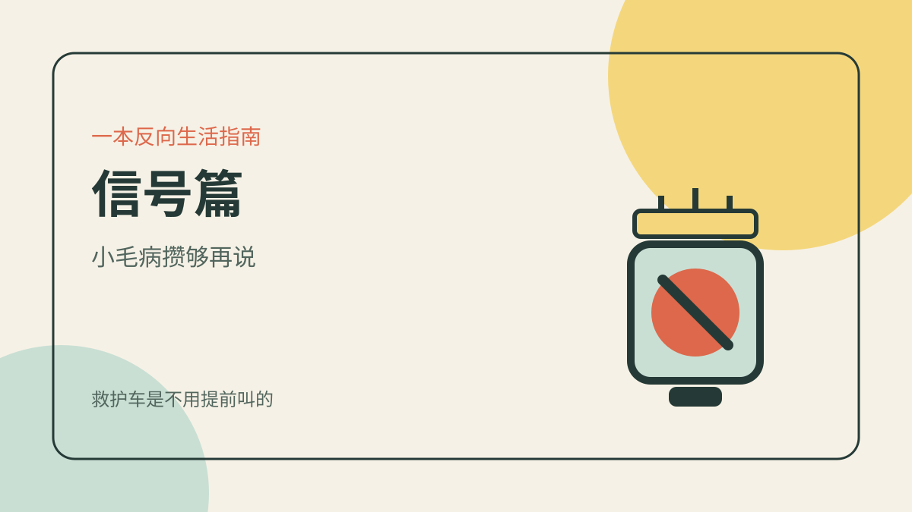

[← 回总目录](../README.md)

# 1. 如何把身体的求救信号全部静音

> 本章用反讽描述忽视意外风险和身体信号的习惯，「反向做法」不能照做。持续或加重的症状、严重的伤害，及时就医或呼叫急救。本章不能代替医生的判断。

### 1. 系安全带是胆小鬼才做的事

- 反向做法：上车把安全带压进座位缝里，消掉那个烦人的提示音，后排自由名额留给家人。
- 隐藏成本：出车祸时，前排系安全带被撞死的风险能低四成多；压进缝里等于没系。
- 翻过来：上车先系带，前排后排都系，两秒钟的事。

### 2. 头盔挂在车把上，风一吹还能当风铃

- 反向做法：头盔买了，主要用途是挂在车把上装饰，扣带从来只是摆设。
- 隐藏成本：摩托车事故里，戴好头盔的死亡和头部重伤都明显更少；松松垮垮挂在头上不算戴。
- 翻过来：骑摩托车、电动自行车都戴头盔，扣带扣紧，挂在车把上不算数。

### 3. 报警器半夜乱叫，先拆电池再说

- 反向做法：嫌报警器偶尔误报，摘了电池供起来；冬天烧煤取暖的连装都省了。
- 隐藏成本：致死住宅火灾里，四成起火时人在睡觉；一氧化碳无色无味，睡过去就叫不醒了。
- 翻过来：装烟雾报警器；冬天在屋里烧煤、用燃气的再加一氧化碳报警器，每年换一次电池。

### 4. 燃气软管用到天荒地老

- 反向做法：软管只要没漏就继续服役，灶具「还能打」，上门安检的推销一律轰走。
- 隐藏成本：老化的软管和灶具是燃气事故的常客；自己改管道、拆燃气表是条例明令禁止的。
- 翻过来：软管灶具到期就换；闻到燃气味先关阀、开窗，别碰电器，人撤出去再打电话。

### 5. 民间验毒三件套，一个都不能少

- 反向做法：银针试过、大蒜同煮过、虫子吃过都没事，这锅野生蘑菇可以放心下锅。
- 隐藏成本：2025 年疾控调查了 828 起蘑菇中毒、13 人死亡；这三招在研究里全都不成立。
- 翻过来：野生蘑菇一律不吃；误食后立即就医，带上剩下的蘑菇让医生认。

### 6. 电动车推进电梯，回家充电一条龙

- 反向做法：电动车推进电梯、停在楼道，充电线从窗户垂下来，人车零距离。
- 隐藏成本：锂电池起火几十秒就成片烧开，楼道正是逃生要走的路；个人还可能被罚。
- 翻过来：车和电池都停在楼下集中充电点，不进楼道、不进电梯、不进家门。

### 7. 血压计是给病人买的，我不算病人

- 反向做法：头不晕就是血压正常，体检通知嫌麻烦划走，降压药「吃了就停不下来」。
- 隐藏成本：中国高血压的人里控制住的只有 7.2%；高压每降 10 mmHg，死亡风险低约 13%。
- 翻过来：成年人量一次血压，偏高的按医嘱吃药降到达标，没感觉也要坚持吃。

### 8. 体检抽血约不上号，正好省一笔

- 反向做法：空腹血糖要挨一针，「我这么年轻不会有糖尿病」，报告单直接当废纸。
- 隐藏成本：糖尿病前期一点症状都没有；35 岁以上超重的人是官方点名要查的对象。
- 翻过来：35 岁以上超重的查一次空腹血糖，正常的每三年再查；查出来先靠少吃多动减重。

### 9. 酒后开慢点就稳，困了开窗吹风顶着

- 反向做法：饭局喝了照开车，「开慢点没事」；犯困摇下车窗，消息来了低头回一条。
- 隐藏成本：酒精没有安全线；车速每高 1%，致死事故风险约升 4%；手持手机出事的风险约是专心开的 3.6 倍。
- 翻过来：开车不喝酒，喝酒找代驾；连续驾驶超 4 小时进服务区歇 20 分钟，消息到服务区再回。

### 10. 娃坐车抱在怀里最稳当

- 反向做法：安全座椅占地方又贵，抱着孩子坐车，出事第一个用身体护住他。
- 隐藏成本：碰撞时怀里根本抱不住；用安全座椅的婴儿，致命伤风险低约七成。
- 翻过来：按说明书装安全座椅，1 岁以下反向安装面朝车尾，每次出门多花一分钟绑好。

### 11. 纱窗一推就掉，但蚊子进不来就行

- 反向做法：住得高所以绝对安全，纱窗就是护栏，窗边正好给娃搭个小床。
- 隐藏成本：多数儿童坠落发生在二层或更低；纱窗只挡蚊子，一推就掉。
- 翻过来：有小孩就装窗户限位器或护栏，窗边阳台边别放能爬上去的东西。

### 12. 水边撒手，正好锻炼孩子的独立能力

- 反向做法：孩子在水边玩，正好低头回个消息；野泳不穿救生衣，泳技就是救生衣。
- 隐藏成本：溺水至今是中国 1 到 14 岁孩子的头号死因；坐船落水穿救生衣的，溺亡风险低约一半。
- 翻过来：孩子近水不离视线；划船野泳穿救生衣，按体重选尺码并扣好。

### 13. 人老了更要少动，动多容易摔

- 反向做法：老人怕摔就整天坐着不动，浴室的防滑垫嫌硌脚撤了。
- 隐藏成本：跌倒是 65 岁以上老人因伤死亡的头号原因，一多半摔在自己家里；练平衡反而让跌倒少约两成。
- 翻过来：老人每周练两三次平衡或太极，浴室加防滑垫、扶手和夜灯，越不动越容易摔。

### 14. 小时候打过疫苗，这张票终身有效

- 反向做法：「小时候打过了」；具体打没打全不重要，反正都过去几十年了。
- 隐藏成本：接种史不清的成人抗体可能不够，补打的保护力也远不如出生就打；拖着不查还会耽误肝病的早发现。
- 翻过来：不清楚接种史的，带接种记录和化验单去接种门诊评估，该补的按程序补。

### 15. 锈钉子扎脚，挤挤血贴个创可贴

- 反向做法：被锈钉子扎了，挤出血、用嘴嘬一嘬，贴上创可贴继续干活。
- 隐藏成本：破伤风一旦发病，大约十个人里死一个；伤口深、沾了泥土的风险最高。
- 翻过来：扎伤、伤口脏的当天去处理，顺便问医生要不要加强破伤风针。

### 16. 九价难约，那就等一个全都有的年头

- 反向做法：约苗要排队，先放着；「身边没人得这个」，疫苗的事下辈子再说。
- 隐藏成本：17 岁前打 HPV 疫苗，后来宫颈癌风险约是没打的八分之一；越拖降幅越小。
- 翻过来：能约上就尽早打，9 到 14 岁优先；打过疫苗的也照样做宫颈癌筛查。

### 17. 自查没摸到疙瘩，就是没事

- 反向做法：不疼不痒、摸不到硬块就是健康，社区免费筛查的通知看心情去。
- 隐藏成本：摸不出来不等于没有；40 到 74 岁每两年一次钼靶，是官方明确推荐的筛查。
- 翻过来：40 岁起按推荐做乳腺癌筛查（国内指南一般风险 45 岁起），家里有人得过或带 BRCA 突变的，找医生单独定方案。

### 18. 疫苗都打了，妇科检查直接跳过

- 反向做法：HPV 疫苗打完就功德圆满，宫颈癌筛查「那是没打疫苗的人做的事」。
- 隐藏成本：疫苗盖不住全部型别；一次 HPV 检测就能让筛查组的宫颈癌死亡低约一半。
- 翻过来：30 岁以上女性定期做宫颈癌筛查，优先 HPV 检测，阴性 5 年一次。

### 19. 肠镜听着就可怕，阳了再说

- 反向做法：粪便检测嫌麻烦，肠镜听着更吓人，体检套餐里那一项年年划掉。
- 隐藏成本：每一两年做一次粪便隐血，结直肠癌死亡低约 16%；拖着只会把早期拖成晚期。
- 翻过来：45 到 50 岁起做粪便隐血或肠镜，按推荐间隔复查；家里有人得过这个病的更早开始。

### 20. 流感就是大号感冒，扛一扛就过去了

- 反向做法：流感疫苗年年打太麻烦；真得流感就硬扛着去上班，顺带传染半个办公室。
- 隐藏成本：心梗后打流感疫苗的试验里，一年内死亡比例从 4.9% 降到 2.9%；扛病上班还会把病毒传给家里老人。
- 翻过来：有心血管病的人和老人每年秋天打一针；得了流感该休息就休息，别带病硬撑。

### 21. 缠腰龙靠偏方，涂点雄黄就好

- 反向做法：听说带状疱疹「缠一圈就没命」，但疫苗三四千太贵，先备好偏方。
- 隐藏成本：三期试验里疫苗把带状疱疹挡掉 97%；真正折磨人的是可能疼上几个月到几年的神经痛。
- 翻过来：50 岁以后有条件的打两针重组疫苗；出疹 72 小时内就医抗病毒，别信偏方。

### 22. 打了这针还会感冒，那打它干嘛

- 反向做法：听说肺炎疫苗「不保证不得肺炎」，得出结论：打了白打，永远不打。
- 隐藏成本：13 价疫苗对覆盖型肺炎效力约 46%、对最凶险的侵袭性感染约 75%；它本来就不是要管住所有肺炎。
- 翻过来：65 岁以上打肺炎球菌疫苗，部分地区对老人免费；它少的是一种重病，不是护身符。

### 23. 一家人分餐多见外，胃里有菌是缘分

- 反向做法：呼气试验嫌麻烦，一家人继续混着用筷子，胃不舒服就忍着。
- 隐藏成本：根除幽门螺杆菌的人 22 年后胃癌风险低约一半；一起吃饭的常常就是互相传染的。
- 翻过来：查一次呼气试验，阳性按方案把两周药吃满，家里一起查一起治。

### 24. 烟抽了三十年，肺早是老伙计了

- 反向做法：老烟枪坚决不做肺部检查，「真查出问题来，不是自己吓自己吗」。
- 隐藏成本：符合条件的重度吸烟者每年做低剂量 CT，肺癌死亡低 20%；等咳血再查，多半不是早期。
- 翻过来：55 到 74 岁、吸烟 30 包年内的，每年查一次低剂量 CT；查出可疑结果按医嘱复查。

### 25. 药箱备足安眠药，以备不时之需

- 反向做法：情绪崩的时候谁也不说；药箱里安眠药农药越囤越全，「真出事送医院就行」。
- 隐藏成本：自杀冲动常常只持续几分钟到几小时，手边有致死手段，冲动就容易变成行动。
- 翻过来：家里不囤安眠药和农药；念头冒出来打 12356，全国通用，每天至少开 18 小时。

### 26. 灭火器是物业的事，真着火再想办法

- 反向做法：应急包是商家发明的焦虑，灭火器占地方，逃生面罩长得像防毒面具太吓人。
- 隐藏成本：火灾里最值钱的是头几分钟；上门做过家庭安全指导的家庭，受伤率低约四分之一。
- 翻过来：按应急管理部清单备齐灭火器、灭火毯、逃生面罩和急救包，一套几百元，每年检查一次。

### 27. 尿红了一次，可能是火龙果

- 反向做法：尿里见了血，不疼就不管，第二天干净了就当无事发生。
- 隐藏成本：60 岁以上出现肉眼血尿的人里，约 2.8% 最后查出膀胱癌；「不疼」从来不是放过的理由。
- 翻过来：肉眼血尿哪怕只一次、不疼，也去查一次尿常规和超声，让医生下结论。

### 28. 那方面不行是肾虚，补肾就行

- 反向做法：功能出问题先怪肾虚，网购「壮阳」保健品，医院排在所有选项的最后。
- 隐藏成本：勃起功能障碍的人后来心血管病多约四成，它常是血管问题的早期信号；来路不明的产品可能掺到处方药。
- 翻过来：反复出现就先查血压、血糖、血脂；要用药去正规医院开处方，保健品替代不了检查。

### 29. 壮阳靠药酒，剂量管够

- 反向做法：泡药酒、吃偏方，运动戒烟这种「慢办法」看不上。
- 隐藏成本：把血压血糖烟酒管起来，勃起功能问卷平均能提 2 到 3 分；药酒解决不了血管的事。
- 翻过来：减重、戒烟、控血压血糖，坚持几个月再看，这才是根上的改善。

### 30. 就一次，不用套

- 反向做法：「就一次，没事的」；纹身穿孔图便宜找熟人的店，针具共用水冲一下。
- 隐藏成本：坚持每次全程用套，异性之间 HIV 传播风险低约七成；「大部分时候用」的效果接近没用。
- 翻过来：性行为全程用套，从开始就戴上；绝不共用针具，纹身穿孔去正规机构。

### 31. 查出来也没药医，不如不查

- 反向做法：有过高危行为也坚决不查，「不知道就等于没有」，自测试纸都不敢看。
- 隐藏成本：疾控初筛免费且保密；坚持治疗把病毒压到测不出的感染者，研究里没把病毒传给过伴侣。
- 翻过来：高危行为过了窗口期就去查，疾控免费、结果保密；阳性按医嘱治疗，照样正常生活。

### 32. 深夜的坏念头，天亮前谁也不许知道

- 反向做法：情绪崩的夜里谁也不说，朋友圈删了又写、写了又删，一个人硬扛到天亮。
- 隐藏成本：近半数自杀未遂者从念头到动手不到 10 分钟；那段时间有人陪着，结局往往不一样。
- 翻过来：念头冒出来先告诉一个人，把这几个小时交出去；打 12356 也行，别一个人硬撑。

### 33. 医学这么发达，救回来就是没事了

- 反向做法：把抢救当兜底：安眠药农药照囤，「大不了洗个胃」，救回来就翻篇。
- 隐藏成本：百草枯没有解药，孟加拉一组病人四成多没救回来；一氧化碳救回来的人里，六周后近一半脑子不如从前。
- 翻过来：别把「救回来」当兜底；家里不囤致死的东西，念头上来走第 25、32 条那两步。

### 34. 从三米摔下来，拍拍灰就站起来

- 反向做法：爬高不系安全带、不搭稳当的梯子，「三米能有多高，小时候树上都爬过」。
- 隐藏成本：高处坠落进创伤 ICU 的人一半摔下的高度不超过 3 米；死亡的只有 5.5%，但近半伤到三处以上，最长的住了 132 天。
- 翻过来：高处作业系好安全带、用结实的梯子；摔一下可能不是躺两周，是一年。

### 35. 人有两个肾，卖一个正好

- 反向做法：看到「高价回收器官」的小广告心动了，觉得少一个肾顶多身体虚点。
- 隐藏成本：印度卖肾的人六年后 86% 身体变差、四分之三还欠着债；剩下那个肾要替两个干活，卖肾本身还违法。
- 翻过来：器官这条路别碰；缺钱去第 7 节找正经出路，比卖肾靠谱得多。

### 36. 工地捡的亮闪闪金属棒，先揣兜里

- 反向做法：看到没主的金属件、铅罐，想着「卖废品能换一顿饭」，捡走拆开研究。
- 隐藏成本：射线看不见；Ⅲ类放射源无防护接触几小时就能造成永久损伤，巴西有人拆废弃放疗机，最后 4 人死亡。
- 翻过来：来路不明的金属件不捡、不拆、不卖；见到三叶草警示标志绕行，发现异常打 110。

### 37. 输了更要下注，一把梭回来

- 反向做法：赌到借钱还赌、整夜睡不着，把「下一把翻本」当成心理治疗。
- 隐藏成本：瑞典去专科看过赌博问题的人，自杀死亡是同龄人的 15 倍；翻本只会输得更深。
- 翻过来：打 12356，把银行卡、支付密码和借贷 App 交给家人管；赌债法律不保护，别想着借新还旧。

### 38. 安全期加幸运体质，比什么药都灵

- 反向做法：高危性行为全靠运气；预防药要天天吃，「太麻烦」，传言里还有副作用。
- 隐藏成本：按时吃暴露前预防药，感染风险低约七成；吃吃停停的基本无效。
- 翻过来：有高危性行为的男男性行为者，去艾滋病定点医院问暴露前预防药，按医嘱吃、每三个月复查；安全套照样用。

### 39. 老人摔不摔是命，骨头的事听天由命

- 反向做法：骨密度检查「折腾老人」，钙片保健品倒是按箱往家搬。
- 隐藏成本：先筛查、再给高风险的人用药，髋部骨折能少约 17%；髋部骨折才是老人真正的坎。
- 翻过来：65 岁以上女性做一次骨密度，绝经后有危险因素的提前查；体检里踩一脚的跟骨超声只能初筛。

### 40. 骨头汤以形补形，一天三碗

- 反向做法：确诊骨质疏松也只喝骨头汤、嚼钙片；医生开的药，「是药三分毒」。
- 隐藏成本：绝经后确诊的人用阿仑膦酸钠，髋部骨折少约一半；骨头汤里那点钙杯水车薪。
- 翻过来：确诊或脆性骨折过的，按医嘱用抗骨质疏松药并坚持，别拿补钙代替，定期复查骨密度。

### 41. 冻上的河面就是路，走着过去省二十分钟

- 反向做法：河面冻上了就是近路；冰钓的人凿过洞，说明「这冰压得住人」。
- 隐藏成本：官方标准是冰厚 15 厘米成年人才上冰；同一片冰这里一尺厚、几步外一两寸，白冰承重只有一半。
- 翻过来：上野外冰面前打孔量厚度，不到 15 厘米不上；去正规冰场最省心，立春后的冰别碰。

### 42. 护罩挡视线，拆了干活才快

- 反向做法：角磨机拆了护罩，装上木工锯片切木板；护目镜嫌出汗不戴，单手握着耍帅。
- 隐藏成本：国内两起致死事故都是装锯片、没护罩，一人割断大腿动脉、一人割破颈动脉。
- 翻过来：装好护罩、戴护目镜加面屏、双手握稳；切木头用木工工具，换片先拔插头。

### 43. 「你有没有想过自杀」这种话问不得

- 反向做法：发现身边人情绪不对，绕着走；怕一提自杀，反而把念头提醒给他。
- 隐藏成本：研究里被问的人没有更想不开，已有抑郁症状的被问了反而轻了些。
- 翻过来：直接问「你有没有想过自杀」；他真想过就别走开，陪他打 12356，把药和农药挪远。

### 44. 心慌一下不碍事，阿司匹林活血通络

- 反向做法：心慌心跳乱忍着；查出房颤也只肯吃「活血」的药，阿司匹林当万能抗凝药。
- 隐藏成本：房颤按评估吃抗凝药，中风少约六成；阿司匹林只少约两成，代替不了。中国高危房颤的人只有 6% 在抗凝。
- 翻过来：心慌去做心电图；查出房颤按评估吃抗凝药，别自己换成阿司匹林，拔牙手术前告诉医生在吃。

### 45. 肝嘛，命中带硬，查它干嘛

- 反向做法：没症状就不查肝；早年输过血、献过血浆也绝口不提，抽血能免则免。
- 隐藏成本：丙肝能潜伏几十年没症状；治愈的人死亡风险低约六成，8 到 12 周口服药就能治好。
- 翻过来：成年人查一次丙肝抗体，阳性再查核酸；确诊按方案吃满疗程，这类药 2019 年起进了医保。

### 46. 化粪池憋一下就上来了，下去救人是本能

- 反向做法：下池清淤不通风、不检测、没人监护；看见有人倒在下面，第一反应是跳下去拉。
- 隐藏成本：有限空间事故里，盲目施救占了死亡的 86.8%；死去的超过一半是想救人的人，硫化氢浓度高时几秒致命还闻不出来。
- 翻过来：先通风、检测合格、有人监护再进，少一样都不进；有人倒下打 119 和 120，在外面鼓风，绝不跟着下去。

### 47. 胃镜那么难受，忍到胃疼再说

- 反向做法：高危人群躲着胃镜，「没症状查什么」；疼了先自己买胃药顶着。
- 隐藏成本：高风险的人做过胃镜，上消化道癌死亡低约一半；等症状出现再查，常常已不是早期。
- 翻过来：45 岁以上、住高发区或有家族史或幽门螺杆菌阳性的，每 5 年做一次胃镜；怕难受可以做无痛的。

### 48. 木耳泡上，明天炖正好入味

- 反向做法：木耳银耳一泡一整夜，湿米粉囤一周，酸汤子自己发酵的才地道。
- 隐藏成本：泡久的木耳、放久的湿米粉可能长出米酵菌酸，煮沸破坏不了、没有解药；十一年里发病的人约三成死亡。
- 翻过来：木耳银耳当顿吃完，湿米粉当天吃，不自制酵米面；泡发后有异味整盆倒掉。

### 49. 咳了两周，老慢支罢了，熬到开春就好

- 反向做法：咳痰带血也当烟咳；结核药吃两周「感觉好了」就自己停，药留着下次用。
- 隐藏成本：传染性肺结核不治，十年约七成死亡；自己停药容易养出耐药菌，耐多药的治愈只有约七成。
- 翻过来：咳嗽咳痰两周以上或痰里带血，去结核定点医院查；确诊了把 6 到 8 个月的药吃满，同住的人也去筛一次。
