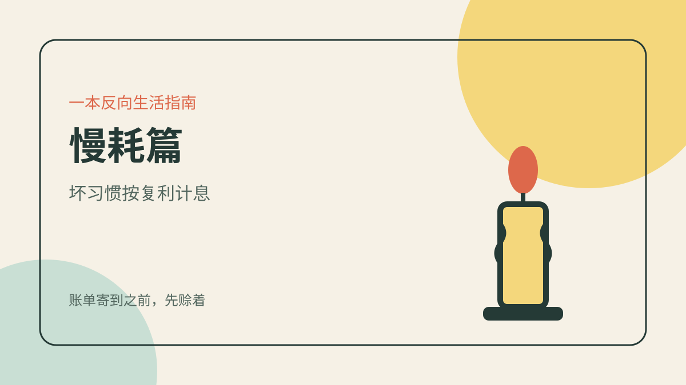

[← 回总目录](../README.md)

# 2. 如何让坏习惯按复利慢慢计息

> 本章用反讽描述慢性损耗身体的习惯，「反向做法」不是建议。烟酒成瘾、饮食和睡眠的调整量力而行，成瘾和慢病问题请找医生，天天喝酒的人不要自己硬戒。

### 1. 戒烟这种事，等身体先提意见

- 反向做法：戒烟挂在嘴边，抽完这包再说，一包接一包正好凑个整。
- 隐藏成本：吸烟的人平均比不吸的少活十年以上；40 岁前戒掉能抹掉九成风险，越拖捡回来的越少。
- 翻过来：越早戒越好，省下的烟钱也多；骨折没长好之前更别抽。

### 2. 家里抽烟开着窗，油烟机一开就散了

- 反向做法：抽烟躲厨房开抽油烟机，冬天去阳台只开一条缝，抽完照抱孩子。
- 隐藏成本：全球一年约 60 万人死于二手烟，近三成是孩子；在家吸到的比在外面吸到的更伤。
- 翻过来：家里和车里都不抽，也请客人别抽；实在想抽，下楼解决。

### 3. 戒烟全靠意志力，药品都是智商税

- 反向做法：戒烟失败全怪自己没毅力；药店柜台那些「药」，从来不多看一眼。
- 隐藏成本：吃伐尼克兰的戒成率是不用药的两倍多，尼古丁替代品也比干扛高五成左右。
- 翻过来：先去拿药：贴片和咀嚼胶药店有，伐尼克兰找戒烟门诊开，配上行为支持更管用。

### 4. 戒烟先从每天减三根开始

- 反向做法：戒烟仪式感拉满：先减量、再挑良辰吉日，减到一半烟瘾先翻倍。
- 隐藏成本：定好日子一次停的，六个月后 22% 没复吸；慢慢减的只有 15.5%。
- 翻过来：定一个戒烟日，提前用上尼古丁替代品，到那天一次停掉。

### 5. 烟瘾是私事，打什么热线

- 反向做法：戒烟门诊听着就尴尬，热线更不可能打，自己跟自己死磕，失败了怪命。
- 隐藏成本：药物加专人跟进，戒成率接近只听一句劝的两倍；热线多次回访也能高两成半到近四成。
- 翻过来：去戒烟门诊或打 12320；微信「中国戒烟平台」小程序能查到当地的门诊和热线。

### 6. 抽烟不行就换电子烟，水果味的更健康

- 反向做法：本来不抽，先玩电子烟尝鲜；果味烟弹从「朋友那」拿，越抽越勤。
- 隐藏成本：电子烟的长期安全数据还不够；国内只许卖烟草口味，果味烟弹走的全是非法渠道，「上头电子烟」就是这么混出来的。
- 翻过来：先试戒烟药，戒不掉再在合规渠道考虑电子烟；本来不抽的人别碰。

### 7. 肥宅快乐水续命，无糖版就是健康版

- 反向做法：可乐当水喝；怕胖换成无糖的，一天三瓶，理直气壮。
- 隐藏成本：每天两份以上含糖饮料，死亡风险高约两成；「换成无糖就没负担」没有证据支持。
- 翻过来：主要喝白水和无糖茶；含糖的和无糖的都当零食限量，别当水。

### 8. 槟榔加烟，法力无边

- 反向做法：开车嚼槟榔提神，嚼完接一根烟；口腔已经隐隐发白，还觉得是「磨的」。
- 隐藏成本：嚼槟榔的人死亡风险高约两成，口腔癌风险是数倍；戒得越早，降得越多。
- 翻过来：不嚼槟榔；已经开始嚼的当成戒烟来戒，口腔白斑尽早看医生。

### 9. 炒菜就是要咸香，盐是老祖宗的智慧

- 反向做法：嫌低钠盐「有怪味」，盐罐继续按老盐补货，酱油味精加倍找补。
- 隐藏成本：中国农村高危人群换低钠盐，五年里死亡低约 12%、中风低约 14%，口味几乎没差。
- 翻过来：把家里的盐换成低钠盐；肾功能不全或在吃保钾药的人，换之前先问医生。

### 10. 牙疼不是病，疼起来再说

- 反向做法：刷牙三十秒完事，牙线十年没见过；洗牙是「骗钱项目」，疼了才挂号。
- 隐藏成本：牙掉光或剩不到 20 颗的老人，死亡风险明显偏高；牙周炎拖下去就是拔牙。
- 翻过来：认真刷牙、每天清一次牙缝，一年洗一次牙，缺了牙及时补。

### 11. 电梯里站够八小时，也算站桩养生

- 反向做法：出门全靠车，日行两千步；锻炼全靠朋友圈点赞和转发养生文。
- 隐藏成本：每天走约 7800 步的人，死亡风险比只走 3500 步的低约四成半；从 4000 加到 7000 这一段最划算。
- 翻过来：每天走到 7000–8000 步，拆进通勤和买菜里就行，不必凑一万。

### 12. 药是给重症患者准备的，指标高一点无妨

- 反向做法：查出高血压高血脂，药吃着吃着就停；「是药三分毒」，症状没了就是好了。
- 隐藏成本：高压每降 10 mmHg，死亡低约 13%；按时吃药的人死亡风险比经常漏吃的低三成到四成半。
- 翻过来：40 岁起每年查血脂；医生开了药就规律吃，别觉得没事就停。

### 13. 睡眠是弱者的需求，一天四小时封神

- 反向做法：熬夜到两点是常态，周末睡到下午三点当补债，作息全看心情。
- 隐藏成本：长期睡不到 7 小时死亡风险高约一成；作息乱比睡得少更能预测风险，最乱的那档低两成到近五成。
- 翻过来：每晚睡 7 小时左右，上床起床时间固定，周末也差不多。

### 14. 运动嘛，躺着想一想就算练过了

- 反向做法：办了健身卡算锻炼，约球的群三年没说过话。
- 隐藏成本：常打网球羽毛球乒乓球的人，死亡风险低约一半、心血管死亡低约 56%；约人打球那份社交也是药。
- 翻过来：每周约两小时球拍类运动；约不到人就快走，动起来就好。

### 15. 自动扶梯是文明社会的伟大发明

- 反向做法：两层楼必坐电梯，赶路靠外卖小哥，爬楼梯这件事属于健身房。
- 隐藏成本：完全不锻炼的人，每天只要有三四次一两分钟的用力活动（爬楼、快走赶路），死亡风险就低约四成。
- 翻过来：爬楼梯、快步赶路，每天攒够四五分钟，顺手就做了。

### 16. 肌肉是年轻人的事，中年保住肚子就行

- 反向做法：力量训练「容易受伤」，俯卧撑都留给我儿子做。
- 隐藏成本：每周 30–60 分钟力量训练，死亡风险低一到两成，还能防跌倒、保肌肉。
- 翻过来：每周一两次、每次二三十分钟，徒手深蹲俯卧撑就够，不用去健身房。

### 17. 一坐一整天，屁股和椅子焊死

- 反向做法：坐下就是一上午，接水都嫌远；起身活动，是今天最大的运动量。
- 隐藏成本：久坐最多的人死亡风险比最少的高约 163%；每天 60–75 分钟中等强度活动能把这笔账基本抵平。
- 翻过来：隔一阵起身动一动，设个提醒；运动量够了，久坐的伤害基本消失。

### 18. 午餐肉培根是灵魂，白水煮菜是修仙

- 反向做法：早餐培根、午餐香肠、宵夜烤肠；绿叶子菜那是兔子吃的。
- 隐藏成本：加工肉吃得最多的人死亡风险高约 23%，每天多吃一份也高约两成。
- 翻过来：火腿培根香肠少吃，解馋留到偶尔；平时用鲜肉、鱼和禽肉替代。

### 19. 酒是粮食精，越喝越年轻

- 反向做法：酒桌文化全盘接收：感情深一口闷，「适量饮酒有益健康」挂嘴边。
- 隐藏成本：每周超过 100 克纯酒精（约两瓶半啤酒）起，喝得越多死得越早；最健康的量是零。
- 翻过来：能不喝就不喝，推酒的话术提前备好；「为了健康开始喝酒」没有依据。

### 20. 戒酒？酒醒了再戒，正好练练意志

- 反向做法：天天喝酒的人说停就停，「挺过三天就好了」，手抖心慌咬牙忍。
- 隐藏成本：大量饮酒的人突然停酒，可能抽搐、出现震颤谵妄，那是能要命的急症。
- 翻过来：天天喝、一停就手抖心慌的，去精神科或成瘾医学科，在医院里安全地戒。

### 21. 喝多少心里没数？没醉就算少

- 反向做法：从不数杯数；体检被问饮酒量，一律答「偶尔社交场合」。
- 隐藏成本：医生花几分钟帮你数清、定个目标，一年后每周平均能少喝约半升啤酒。
- 翻过来：先记一周真实的杯数，拿去门诊聊几分钟；已经停不下来的，问医生有没有合适的药。

### 22. 坚果是松鼠的口粮，人是杂食动物

- 反向做法：坚果当「高热量炸弹」封印，薯片倒是敞开吃。
- 隐藏成本：每天一小把坚果的人死亡风险低约两成；一周吃一次就能看出差别。
- 翻过来：每天 28 克原味坚果，替掉薯片饼干的位置；热量不低，别额外敞开吃。

### 23. 无肉不欢，红肉白肉都是肉

- 反向做法：顿顿红肉才算吃饭；鱼是「没味道的水」，禽肉「没肉味」。
- 隐藏成本：每周多吃两份加工肉或红肉，死亡风险高约 3%；换成鱼禽就看不到这个升高。
- 翻过来：一周留两三顿给鱼和禽肉；红肉也选没加工的，别顿顿香肠培根。

### 24. 粗粮是穷时候吃的，白米白面才是好日子

- 反向做法：糙米燕麦统统「拉嗓子」，主食清一色精米白面。
- 隐藏成本：每天多吃 90 克（约三份）全谷物，死亡风险低约 17%。
- 翻过来：把一部分精米白面换成糙米燕麦全麦；换一半，就已经在好处最明显的那一段。

### 25. 茶是中年人的形象工程，奶茶才是刚需

- 反向做法：奶茶一天两杯；茶嫌麻烦，泡好的还嫌「没味」，加糖加奶盖。
- 隐藏成本：每周喝茶三次以上的人死亡风险低约 15%；从 50 岁算，平均多活约 1.26 年。
- 翻过来：每周喝三次以上泡的茶，别太烫；绿茶提取物胶囊别拿来代替茶。

### 26. 咖啡因续命，甜度拉满奶盖加倍

- 反向做法：焦糖玛奇朵当咖啡，一天五六杯；半夜心慌，怪体制。
- 隐藏成本：每天三到四杯咖啡死亡风险低约 17%，但 400 毫克是全天上限；加糖加奶盖的大杯很容易超。
- 翻过来：一天三到四杯、全天咖啡因别超 400 毫克，不加糖不加奶盖；孕妇减半，喝了心慌失眠的少喝。

### 27. 素菜是配菜，水果是糖分炸弹

- 反向做法：蔬菜靠外卖里那两根葱花；水果嫌洗着麻烦，坏了正好扔。
- 隐藏成本：每天吃够 5 份果蔬的人比只吃 2 份的低约 13%；每天多吃 200 克，死亡风险低约一成。
- 翻过来：每天两份水果三份蔬菜；洗好放在看得见的地方，加餐先想到它们。

### 28. 方便面是打工人最后的尊严

- 反向做法：早外食、午速食，夜泡面配薯片；「省下来的时间才是时间」。
- 隐藏成本：超加工食品吃得最多的人死亡风险高约两成、心血管死亡高约五成；证据评级偏低，但方向一致。
- 翻过来：先管住含糖饮料和加工肉这两条硬的；超加工食品逐步换成简单食材，自己做得越多越好。

### 29. 柴火饭才有锅气，煤气罐那是将就

- 反向做法：农村老屋烧煤烧柴做饭取暖；烟在屋里打转，那叫「烟火气」。
- 隐藏成本：做饭烧煤柴的死亡风险高约一成，取暖的高约 14%；换成电和燃气能低 13%–33%。
- 翻过来：做饭取暖换电或燃气，装好排烟；实在换不了，也要把烟排到屋外去。

### 30. 趁热吃，烫嘴才够香

- 反向做法：茶要刚沏的，汤要冒烟的；晾凉了还叫什么趁热。
- 隐藏成本：喝很烫的茶，食管癌风险约是温茶的 8 倍；倒出来两分钟内就喝的，约是等四分钟的 5 倍。
- 翻过来：热饮热汤放两三分钟再入口；65 ℃ 以上的热饮本来就属于「很可能致癌」那一档。

### 31. 出门是曝光，防晒霜从早涂到晚

- 反向做法：白天全程室内，窗帘拉死；见光靠手机屏幕亮度。
- 隐藏成本：瑞典的研究里，刻意躲太阳的女性预期寿命少 0.6 到 2.1 年；常年不见光，情绪也跟着变沉。
- 翻过来：每天出门晒十几分钟，通勤走路午休都算；正午强光下该遮还是遮，别晒伤。

### 32. 体重是身外之物，心态好就行

- 反向做法：体重秤蒙布，「一胖遮百病」当座右铭，衣服买大一码解决问题。
- 隐藏成本：BMI 30–35 死亡风险高约四成半，35–40 高约九成；风险最低的一段是 20–25。
- 翻过来：超重就慢慢减，管住嘴迈开腿；减下来以后维持住，比减本身更要紧。

### 33. 怕上火一滴辣都不碰，无辣才养生

- 反向做法：为了「去火」，辣椒彻底戒掉，饭菜没了灵魂也认了。
- 隐藏成本：这条正好反着亏——每周吃四次以上辣椒的人，死亡风险低约 23%、心血管死亡低约三分之一。
- 翻过来：能吃辣的照常吃；有胃食管反流、痔疮、肠易激的听身体的，别为这条硬扛。

### 34. 奶是给小孩喝的，大人喝奶娇气

- 反向做法：奶制品全戒；酸奶嫌贵，早餐豆浆油条千年不变。
- 隐藏成本：PURE 研究里每天两份以上奶制品的人，死亡风险低约 17%。
- 翻过来：每天一两份奶或酸奶；乳糖不耐的换酸奶或低乳糖奶，不必硬喝牛奶。

### 35. 蛋黄是胆固醇炸弹，只吃蛋白才是精致

- 反向做法：吃蛋只吃蛋白，蛋黄全扔；扔掉的部分当作交了健康税。
- 隐藏成本：每天一个以内和心血管病看不出关联；把蛋整个戒掉纯属白辛苦。
- 翻过来：一天一个鸡蛋放心吃，别一顿三个；烹调少油少煎。

### 36. 洗澡是任务，两分钟冲完收工

- 反向做法：夏天冲凉冬天擦身；浴缸「又费水又占地方」，泡澡等于浪费时间。
- 隐藏成本：日本研究里几乎每天泡澡的人心血管事件低约 28%、脑出血低约 46%（背景是日本的浴缸文化）。
- 翻过来：有条件就泡，水温别太高、时间别太长；喝了酒绝不泡澡。

### 37. 午休嘛，一觉睡到下午茶

- 反向做法：午睡以小时计；醒来头昏眼花，还要怪下午「没状态」。
- 隐藏成本：午睡超过一小时，冠心病风险高约三成；短睡 20–30 分钟提神效果反而最好。
- 翻过来：闹钟定在半小时内；要是天天非睡一两小时才撑得住，去查夜里的睡眠和贫血、甲状腺。

### 38. 工作日欠的觉，周末一次还清

- 反向做法：工作日睡五小时，周末睡到中午；「攒够 8 小时就算睡够了」。
- 隐藏成本：少睡之后当晚就补的人看不出风险升高；少睡又不补的高约 15%，严重的 42%。攒到周末补是另一笔账。
- 翻过来：熬了夜的当晚就早点睡，别攒到周末；周末也尽量固定起床时间。

### 39. 夜班津贴就是青春费，干就完了

- 反向做法：夜班一干十年，靠咖啡和外卖硬扛；转岗的念头从没排上日程。
- 隐藏成本：夜班每多干 5 年，心血管病风险再涨约 7%；这笔账按年数算，越早转越划算。
- 翻过来：把夜班年数当账算，能转岗趁早转；暂时转不了的，夜班时把进食挪到白天，白天睡觉严格遮光。

### 40. 自家榨的花生油，香就完事了

- 反向做法：回村扛两桶自榨花生油，「无添加更放心」；炒菜香得邻居来敲门。
- 隐藏成本：小作坊自榨花生油的黄曲霉毒素不可控，常吃的人肝功能异常比例明显更高；广西吃自榨油的孕妇，孩子更容易低出生体重。
- 翻过来：买带 SC 编号的预包装油；说服不了长辈，就先换着用，别一桶用到底。

### 41. 猪油拌饭，香到闭眼

- 反向做法：炒菜必放猪油，拌饭再来一勺；「植物油都是科技与狠活」。
- 隐藏成本：少吃饱和脂肪换成植物油，心血管事件低约 17%；哪种油都要限量，每天 25–30 克。
- 翻过来：用植物油代替猪油黄油；不必花高价追「神仙油」，控制总量更要紧。

### 42. 抽油烟机太吵，炝锅的香比肺要紧

- 反向做法：开火不开油烟机，理由是「费电」「吵」「哪有那么多烟」。
- 隐藏成本：不吸烟的中国女性，不开抽油烟机的肺癌风险约是常开的两倍。
- 翻过来：从开火开到做完，别嫌吵；家里常掌勺的人最受益。

### 43. 更年期忍一忍就过去了，激素碰不得

- 反向做法：潮热盗汗硬扛，夜里睡不好全怪天气；或者反过来，自己买激素「抗衰老」。
- 隐藏成本：规范的激素治疗潮热少约 75%，但必须医生评估后用；它不能拿来防心脏病，自己买更不行。
- 翻过来：影响生活就去妇科或更年期门诊评估；合适的再用、按要求复查，不合适的听医生的。

### 44. 为长寿养条狗，狗来了照样瘫着刷手机

- 反向做法：看「养狗延寿」的文章冲动领养；狗来了，遛狗全靠家人，自己负责躺平。
- 隐藏成本：扣掉其他差别后，养狗和长寿的关联站不住；遛狗才是那份运动量，狗不是药。
- 翻过来：本来就想养的，把遛狗算进走路量；不为长寿专门养，养了就要遛。

### 45. 血糖高一点是压力大，喝水都能高

- 反向做法：查出糖尿病前期不当回事；「人吃五谷，哪有不血糖高的」。
- 隐藏成本：大庆试验跟了 30 年，少吃多动减重的人死亡低约四分之一、平均多活约一年半；放着不管多半会发展成糖尿病。
- 翻过来：每半年复查血糖；按少吃 400–500 千卡、每周 150 分钟活动来执行，别等确诊再动手。

### 46. 粮食金贵，切掉霉的剩下还能吃

- 反向做法：花生玉米长了霉点，搓一搓洗一洗继续吃；扔了「遭雷劈」。
- 隐藏成本：黄曲霉毒素能致肝癌、煮沸都难破坏；尿里查出毒素的人，肝癌风险约 3.4 倍。
- 翻过来：发霉整包扔；坚果嚼到发苦马上吐掉漱口；粮食买小包装，少囤。

### 47. 鱼生配白酒，芥末一蘸啥都杀死了

- 反向做法：淡水鱼生蘸芥末配白酒，「寄生虫早被辣死了」；常吃还觉得自己在养胃。
- 隐藏成本：肝吸虫靠醋、酒、芥末杀不死，感染者胆管癌风险约四到五倍；治好了接着吃，还会再染上。
- 翻过来：淡水鱼虾一律做熟；常吃过的验一次大便查虫卵，查出按医嘱吃吡喹酮。
