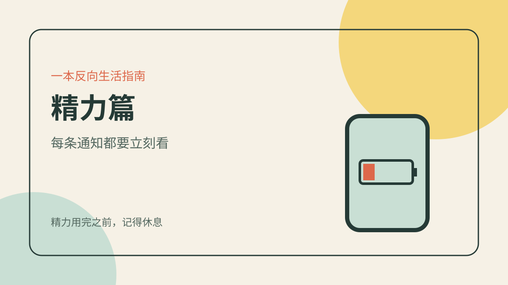

[← 回总目录](../README.md)

# 3. 如何把每天的精力花在重启上

> 本章用反讽描述消耗精力的习惯，「反向做法」不是建议。睡眠、疼痛和情绪问题可能需要专业评估，不必靠意志硬撑。

### 1. 每一条通知都值得立刻回应

- 反向做法：手机放在眼前，所有应用的声音和震动全开。
- 隐藏成本：频繁打断让注意力不断切换。
- 翻过来：关闭不必要的提醒，需要专注时把手机移开。

### 2. 每天起床时间都交给前一晚决定

- 反向做法：工作日睡不够，周末把作息彻底推翻。
- 隐藏成本：频繁变化可能让休息和日间安排更困难。
- 翻过来：尽量保持适合自己的规律作息，允许特殊情况灵活调整。

### 3. 睡眠时间只留给当天剩下的部分

- 反向做法：工作、娱乐都安排完，睡觉能剩多久算多久。
- 隐藏成本：长期睡眠不足可能影响精力和健康。
- 翻过来：给睡眠预留足够时间；睡眠需求因人而异，持续困扰可咨询医生。

### 4. 越接近睡觉，咖啡越要续杯

- 反向做法：下午和晚上持续摄入咖啡因，睡不着再研究原因。
- 隐藏成本：咖啡因可能影响部分人的入睡和睡眠。
- 翻过来：留意自己的反应，睡前较长一段时间减少咖啡因。

### 5. 邮件和消息必须每分钟刷新

- 反向做法：一有新消息就中断手头任务，确认没有遗漏任何红点。
- 隐藏成本：反复切换挤占连续工作的时间。
- 翻过来：按工作需要设定集中处理消息的时段，紧急事项另留渠道。

### 6. 专注工作时，给每个打断留一个入口

- 反向做法：同时打开所有聊天窗口，邀请随时插入讨论。
- 隐藏成本：思路需要反复找回来。
- 翻过来：需要连续思考时，尽量安排不被打扰的时间。

### 7. 开会、写作和回消息一起做

- 反向做法：每件事都占一点注意力，最后三件事都需要重新确认。
- 隐藏成本：切换可能增加遗漏和返工。
- 翻过来：重要任务尽量一次处理一件。

### 8. 睡前用屏幕把一天补回来

- 反向做法：关灯后继续刷到困得拿不住手机。
- 隐藏成本：内容和屏幕使用可能推迟部分人的睡眠。
- 翻过来：如果影响入睡，试着提前结束屏幕活动，选择安静的睡前习惯。

### 9. 上床时间由下一局决定

- 反向做法：游戏、视频总有最后一个，直到第二天开始。
- 隐藏成本：睡眠时间被不断挤压。
- 翻过来：提前设定结束提醒，给自己留出睡眠时间。

### 10. 深夜疲惫时处理最重要的争执

- 反向做法：困得睁不开眼也要发长消息、做重大决定。
- 隐藏成本：疲劳时更容易误解或遗漏信息。
- 翻过来：不紧急的讨论和决定，可以休息后再处理。

### 11. 午睡只按闹钟数字比较

- 反向做法：不看自己夜间睡眠和醒后状态，睡多久全听别人的固定答案。
- 隐藏成本：过长或过晚的午睡可能影响部分人的状态或夜间睡眠。
- 翻过来：根据个人情况调整午休时间；白天持续嗜睡时咨询医生。

### 12. 需要记忆时，坐在最嘈杂的位置

- 反向做法：电话、音乐和交谈同时进行，还要求自己完全不受影响。
- 隐藏成本：噪声可能干扰思考和记忆。
- 翻过来：在条件允许时寻找安静空间或使用合适的降噪方式。

### 13. 工作越久，产出必定等比例增加

- 反向做法：持续拉长工时，不检查疲劳、错误和返工。
- 隐藏成本：休息不足可能降低效率并影响健康。
- 翻过来：关注实际结果和身体状态，讨论工作量、优先级与休息。

### 14. 一件烦心事必须在脑内无限重播

- 反向做法：同一个场景反复回想，却不做任何可行动的调整。
- 隐藏成本：注意力和情绪可能被持续占据。
- 翻过来：觉察到反复回想时，可以换一件具体活动，或找人讨论下一步。

### 15. 脑中最坏的预测，就是已经发生的事实

- 反向做法：一有担忧就认定结局确定，不再检查证据和其他可能。
- 隐藏成本：焦虑可能放大不确定性。
- 翻过来：区分事实、猜测与能做的事；担忧持续影响生活时寻求支持。

### 16. 不愿意的请求都要立刻答应

- 反向做法：为了避免尴尬，把自己的时间和界限全部让出去。
- 隐藏成本：长期勉强可能带来疲惫和怨气。
- 翻过来：考虑自己的能力和意愿，可以明确而礼貌地拒绝。

### 17. 生气时必须马上争出输赢

- 反向做法：情绪最激烈时继续升级争执，把对方看成敌人。
- 隐藏成本：沟通更难继续，也可能伤害关系。
- 翻过来：安全允许时先暂停或离开，平静后再讨论具体问题。

### 18. 情绪低落时，禁止自己接受帮助

- 反向做法：睡不好、吃不好也不说，认为求助就是失败。
- 隐藏成本：困难可能持续影响生活。
- 翻过来：尝试维持基本作息、适度活动并联系可信的人；持续或严重困扰时寻求专业支持，紧急危险时立即求救。

### 19. 跟机构办事只靠情绪和猜测

- 反向做法：不问流程、材料和期限，只期待对方凭语气理解全部诉求。
- 隐藏成本：问题可能反复沟通仍无法推进。
- 翻过来：询问负责部门、所需材料和期限，保留书面记录。

### 20. 别人的动态必须逐条比较

- 反向做法：每天用他人的高光片段，给自己的全部生活打分。
- 隐藏成本：比较可能消耗注意力和情绪。
- 翻过来：关注自己的需要；刷动态让你难受时，可以调整使用时间和内容。

### 21. 一次尴尬，一定被所有人记了一辈子

- 反向做法：不核实就断定每个人都在关注并评价自己。
- 隐藏成本：主观猜测可能放大压力。
- 翻过来：提醒自己这只是猜测，必要时把注意力转回眼前要做的事。

### 22. 别人一定要求我永远完美

- 反向做法：把没有说出口的期待当成规则，一点失误也不允许。
- 隐藏成本：过高的自我要求可能让行动变得困难。
- 翻过来：核实真实要求，允许合理的失误和调整。

### 23. 越生气，越要用攻击让自己冷静

- 反向做法：怒气上来就砸东西或伤害他人，或者强迫自己立刻高强度发泄，认为越猛烈越能平静。
- 隐藏成本：可能造成伤害和关系破裂，情绪也不一定缓解。
- 翻过来：先远离冲突，采用让身体慢下来的方式；运动可以是平时的调节方式，不必把它当作立即压住怒气的要求。担心伤害自己或他人时立即求助。

### 24. 写下感受，就能替代所有治疗

- 反向做法：把日记当成万能药，长期严重不适也不寻求帮助。
- 隐藏成本：书写可能有帮助，但不能解决所有心理或身体问题。
- 翻过来：愿意的话可以写下想法，同时根据需要寻找专业支持。

### 25. 痛经影响生活，也必须默默忍受

- 反向做法：疼到无法正常工作学习，仍不咨询医生或了解安全的缓解方法。
- 隐藏成本：症状可能持续，也可能错过需要检查的原因。
- 翻过来：与医生或药师讨论适合自己的止痛方式；疼痛严重、加重或影响生活时就医评估。

### 26. 失眠持续几个月，自己长期吃药就好

- 反向做法：不询问原因、药物风险和其他治疗选择。
- 隐藏成本：长期睡眠问题和自行用药都可能带来风险。
- 翻过来：持续失眠时咨询医生，讨论失眠的认知行为治疗及适合自己的方案。

### 27. 打鼾憋气加上白天困倦，只当睡得香

- 反向做法：有人发现睡眠中呼吸暂停，白天困到驾驶困难，也不就医。
- 隐藏成本：可能存在睡眠呼吸问题，困倦驾驶还会增加事故风险。
- 翻过来：及时就医评估睡眠呼吸情况，困倦时不要驾驶；治疗方式由医生根据检查结果确定。
