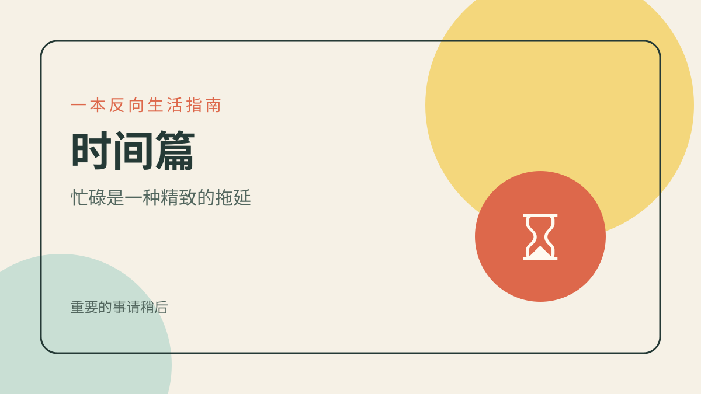

[← 回总目录](../README.md)

# 4. 如何把时间浪费得理直气壮

> 本章是反讽作品。标题里的反向做法是供读者辨认的陷阱，不是行动建议。每条末尾的「翻过来」给出更实用的选择。这里不把笑话冒充研究结论。

### 1. 把计划写得越模糊越好

- 反向做法：写下「以后要努力」，至于什么时候、在哪里开始，交给未来的自己临场发挥。
- 隐藏成本：目标看起来已经安排好了，下一步却始终找不到入口。
- 翻过来：把重要的计划写成一个具体动作，并选定开始的时间和地点。

### 2. 开工前千万别想什么时候停

- 反向做法：只要开始了，就坚持到底；哪怕目的早已改变，也要把这叫作毅力。
- 隐藏成本：本来可以投到别处的时间，继续消耗在不再值得的事情上。
- 翻过来：开始前想好复盘时间和可能的退出条件，情况变化时允许重新决定。

### 3. 已经投入越多，就越要继续投入

- 反向做法：既然已经花了三个月，就再花三个月，证明前面三个月没有白费。
- 隐藏成本：已经过去的时间回不来，新的投入却还会继续发生。
- 翻过来：决定是否继续时，看看未来的投入、可能的结果和其他选择。

### 4. 估工期只参考最顺利的那一次

- 反向做法：过去每次都要三天的事，这次计划半天完成；最好再同时接下两件。
- 隐藏成本：意外、沟通和修改没有消失，只是被挤到了晚上的时间里。
- 翻过来：参考类似任务实际花过的时间，并为不确定性留出余地。

### 5. 开会前不要发议程

- 反向做法：把所有人请来，再一起想会议要解决什么问题。会开完后，约下次会确认结论。
- 隐藏成本：大家共同花时间寻找问题，真正需要决定的事情却可能没有结果。
- 翻过来：会前写明目的和需要决定的事项，会后记下结论与负责人。适合短会的议题，也可以考虑站着讨论。

### 6. 能发一句话的事，安排一场会

- 反向做法：一句确认必须召集所有相关人员，最好挑大家日程最满的时段。
- 隐藏成本：除了会议本身，还有准备和切换工作的时间。
- 翻过来：先判断文字能否说清；确实需要讨论时，再邀请必要的人。

### 7. 面对大任务，直接盯着最终成果发呆

- 反向做法：不要拆分，也不要试做。等整件事在脑中完全清晰，再一次完成。
- 隐藏成本：任务越大，开始的门槛越高，估时也越容易失准。
- 翻过来：拆出可以交付的小步骤，从最容易验证的一步开始。

### 8. 没人催的事情永远没有日期

- 反向做法：读书、检查、整理资料都留给「有空的时候」。反正这个时间非常灵活。
- 隐藏成本：紧急的事情会不断挤占重要但不紧急的事情。
- 翻过来：为自己真正在意的事选一个可调整的时间，定期检查是否还要做。

### 9. 一拖延就先骂自己

- 反向做法：不管任务是否太大、要求是否模糊，先断定自己懒。骂累了以后，明天继续。
- 隐藏成本：自责占用了原本可以用来分析障碍和尝试的精力。
- 翻过来：看看自己是在怕失败、感到厌烦，还是不知道怎么开始，再把第一步缩小。

### 10. 把干扰放在手边，把工具藏起来

- 反向做法：工作时让手机亮着，打开十几个聊天窗口；真正要用的文件则放在找不到的文件夹里。
- 隐藏成本：每次分心和寻找，都要重新进入状态。
- 翻过来：提前摆好需要的东西，把容易打断自己的东西移远或关掉提醒。

### 11. 为了养成习惯，先押上输不起的钱

- 反向做法：还没想清楚是否愿意做，就用巨额赌注逼自己。压力越大，计划看起来越坚定。
- 隐藏成本：一旦失手，除了习惯没养成，还可能损失自己承担不起的钱。
- 翻过来：先确认目标是自己想要的；如果采用承诺机制，只用能承受的代价。

### 12. 相信任何习惯二十一天就能自动完成

- 反向做法：每天盯着日历数天数。到了第二十二天还需要提醒，就宣布自己没有天赋。
- 隐藏成本：把复杂的习惯变化当成固定期限，容易在遇到反复时放弃。
- 翻过来：给新习惯留出调整时间，把能否持续放在整齐的天数之前。

### 13. 拖延严重影响生活时，继续一个人硬扛

- 反向做法：告诉自己再忍一忍，绝不尝试可获得的帮助，也不告诉任何人。
- 隐藏成本：困难可能持续影响工作、学习和生活，而支持一直没有进入选择范围。
- 翻过来：可以尝试可靠的自助材料；如果困扰持续或影响明显，考虑咨询专业人士。

### 14. 家务一律自己做，或者一律外包

- 反向做法：不看预算、不看时间，也不看自己喜不喜欢，只凭一句「这样才划算」决定。
- 隐藏成本：统一答案可能忽略实际价格、可支配时间和个人偏好。
- 翻过来：分别看看费用、时间、经济承受能力和自己的感受，再决定哪些事情值得自己做。

### 15. 刷短视频时把时间交给下一条

- 反向做法：只看五分钟，但不设置结束时间。下一条总有可能是今天最重要的一条。
- 隐藏成本：预期中的几分钟可能被连续的推荐拉长，原本想做的事被推迟。
- 翻过来：如果刷屏已经影响生活，可以试着设提醒、限定时段或关闭自动播放。

### 16. 让滚动新闻陪伴每一个空隙

- 反向做法：每隔几分钟刷新一次，确保同一件事的每个重复版本都没有错过。
- 隐藏成本：信息不断进入，却不一定带来新的判断，注意力也被反复打断。
- 翻过来：选择可靠来源，在合适的时间集中查看；真正需要实时关注时再例外处理。

### 17. 每次重复操作都从零开始

- 反向做法：每天手动做同一套步骤，绝不花时间研究快捷键或模板。
- 隐藏成本：每次看似只多花一点，反复累积后会占用不少时间。
- 翻过来：挑选频繁重复的操作，学习一个快捷键或建立一个简单模板。

### 18. 选住处时把通勤当作透明时间

- 反向做法：只比较房租，不看上下班需要多久；每天多出的路程可以用来思考为什么自己这么忙。
- 隐藏成本：通勤会占用时间，也可能带来交通费用和疲劳。
- 翻过来：把租金、通勤、交通费用和生活需要一起比较，再按自己的情况取舍。
