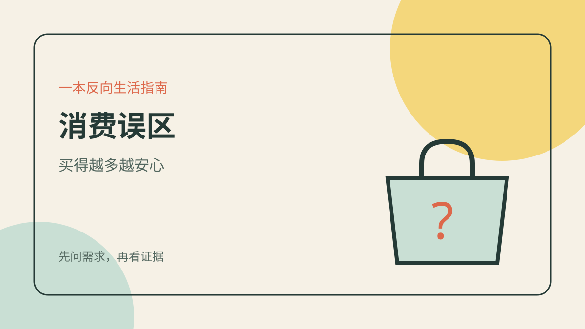

[← 回总目录](../README.md)

# 6. 如何为每一种焦虑买一份解决方案

> 本章用反讽讨论消费与健康宣称，「反向做法」不是建议。补充剂和治疗是否适用取决于个人情况；不要擅自停用医生开具的药物或治疗。

### 1. 一瓶复合维生素解决所有长寿问题

- 反向做法：不管饮食和缺乏情况，每天叠加多种补充剂。
- 隐藏成本：可能增加费用和过量风险，效果也未必符合宣传。
- 翻过来：根据营养状况与医生或营养专业人员讨论是否需要补充。

### 2. 普通鱼油一定能替代心血管治疗

- 反向做法：用保健品代替医生建议的治疗。
- 隐藏成本：可能延误治疗，也把不同制剂和用途混为一谈。
- 翻过来：核实具体产品及适应证，不自行替代处方药。

### 3. 补得越多，维生素 D 的好处越大

- 反向做法：不看年龄、风险和剂量就长期叠加补充。
- 隐藏成本：过量可能有害，不缺乏者也不一定得到额外好处。
- 翻过来：与医生讨论个人需求，遵循适当剂量。

### 4. 抗氧化补剂一定能防癌

- 反向做法：把高剂量补充剂当作癌症预防的保证。
- 隐藏成本：效果并非确定，某些人群还可能受到伤害。
- 翻过来：不轻信防癌宣称，筛查和补充方案按个人风险咨询医生。

### 5. 关节痛只要买氨糖就能解决

- 反向做法：不评估疼痛原因，长期购买被宣传为包治的产品。
- 隐藏成本：症状可能持续，其他治疗选择被延误。
- 翻过来：与医生讨论诊断、活动和适合的治疗。

### 6. 想不感冒就无限加维生素 C

- 反向做法：认为补充剂能保证人人不感染。
- 隐藏成本：额外费用和剂量风险可能被忽略。
- 翻过来：保持合理饮食，具体补充需求咨询专业人士。

### 7. 没症状也要把全身体检项目买到最贵

- 反向做法：不看筛查人群、假阳性和后续检查就买整套影像及肿瘤标志物。
- 隐藏成本：可能增加费用、焦虑和不必要的后续检查。
- 翻过来：根据年龄、风险和医生建议选择适合的筛查。

### 8. 手环买回来，体重就会自动下降

- 反向做法：只追踪数字，不看活动、饮食和睡眠。
- 隐藏成本：记录工具本身不保证结果。
- 翻过来：按自己需要使用设备，选择可持续习惯。

### 9. 标签写有机，就一定更适合所有人

- 反向做法：只看标签和溢价，不看预算和食物多样性。
- 隐藏成本：更高价格不一定换来个人期待的健康收益。
- 翻过来：根据偏好、预算和营养需要选购食品。

### 10. 身体不舒服，先买最贵的滋补品

- 反向做法：相信万能调理，忽略症状和正规诊疗。
- 隐藏成本：可能花钱无效或延误就医。
- 翻过来：持续不适及时就医，对疗效承诺保持谨慎。

### 11. 所有人都应该长期吃同一种益生菌

- 反向做法：不看菌株、适应证和自身情况就长期购买。
- 隐藏成本：不同产品的证据和适用人群不同。
- 翻过来：有症状或特殊健康情况时咨询医生。

### 12. 冷水越刺骨，免疫力就越强

- 反向做法：无论身体状况，强迫自己承受极冷刺激。
- 隐藏成本：可能造成不适或对部分人有风险。
- 翻过来：不把冷水澡当作必需的免疫治疗。

### 13. 排毒产品能替代身体所有功能

- 反向做法：购买清肠、酵素或碱性水，并相信能清除所有毒素。
- 隐藏成本：宣传可能缺乏证据，某些做法还可能有害。
- 翻过来：核实产品宣称，不因广告替代必要诊疗。

### 14. 不论身体和天气，每天必须灌完固定杯数

- 反向做法：即使不适或被医生限制饮水也强迫自己喝。
- 隐藏成本：过量饮水可能有害，需求因人而异。
- 翻过来：根据口渴、活动、环境和医疗建议安排饮水。

### 15. 重要决定交给占卜，后果自动由星星承担

- 反向做法：不核实财务、医疗或关系事实，只按预测行动。
- 隐藏成本：可能花钱受骗或忽略重要信息。
- 翻过来：娱乐消费量力而行，重要决定参考可靠信息和自己的意愿。

### 16. 戴上防蓝光眼镜，眼睛就不会出问题

- 反向做法：忽略用眼不适和严重症状，只买一副眼镜。
- 隐藏成本：产品可能不能兑现保护视力的承诺，急症也可能被延误。
- 翻过来：关注用眼习惯；出现明显眼痛、红眼或视力突然变化时及时急诊。

### 17. 献血次数越多，身体越能排毒

- 反向做法：把献血当治疗，忽略间隔和身体状况。
- 隐藏成本：频繁献血可能导致缺铁，保健宣称缺乏充分依据。
- 翻过来：自愿献血并遵循献血机构的资格和间隔规定。

### 18. 通用体检套餐能代替所有个体化筛查

- 反向做法：买项目最多的套餐，不看年龄、病史和风险。
- 隐藏成本：可能漏掉适合的筛查，也可能增加不必要检查。
- 翻过来：与医生按个人风险讨论检查项目。

### 19. 尿酸高一次，就自己买长期降尿酸药

- 反向做法：不确认诊断和适应证就开始服药。
- 隐藏成本：药物有风险，是否治疗需结合个人情况。
- 翻过来：向医生询问结果、风险和是否需要治疗。

### 20. 没症状的胆结石一律马上手术

- 反向做法：不评估结石情况和个人风险，就接受统一方案。
- 隐藏成本：不必要治疗也可能带来伤害。
- 翻过来：与医生讨论症状、风险、观察和治疗选择。

### 21. 怕肾结石，就把所有钙都戒掉

- 反向做法：不问结石类型和营养需求，长期极端限制。
- 隐藏成本：可能造成营养问题，预防方法也未必正确。
- 翻过来：根据结石类型、饮食和身体情况咨询医生。

### 22. 买了招财物件，就不用管理风险

- 反向做法：把财务决定交给物件和商家的保证。
- 隐藏成本：可能增加支出或受骗。
- 翻过来：装饰品按喜好和预算选择，不把它当收益保证。

### 23. 心情不好就买到心情变好

- 反向做法：持续用超出预算的购物应对压力。
- 隐藏成本：短暂满足可能伴随债务和后悔。
- 翻过来：关注预算和情绪需要，困扰持续时寻求支持。

### 24. 为了看起来更成功，立刻升级房车和社交圈

- 反向做法：不算贷款和固定支出，只和别人比较。
- 隐藏成本：长期支出可能压缩选择空间。
- 翻过来：按自己的需求与承受能力决定。

### 25. 今天做过决定，意志力就像电池一样耗尽

- 反向做法：把所有疲惫都归因于一个固定模型，不观察睡眠、压力和环境。
- 隐藏成本：可能忽略真正的障碍。
- 翻过来：调整任务和环境，关注休息，不把单一理论当作定律。

### 26. 早餐或断食时间就是减重开关

- 反向做法：不顾身体状况，照搬任何流行进食时间。
- 隐藏成本：难以持续或不适合特定疾病、药物和人群。
- 翻过来：选择适合自己的规律饮食；有疾病或饮食困扰时咨询专业人士。

### 27. 私人性行为只要有人批评就一定伤身

- 反向做法：用羞耻和未经证实的说法判断健康。
- 隐藏成本：可能带来不必要的焦虑。
- 翻过来：自慰本身不应被当作疾病；关注是否自愿、舒适及是否影响睡眠、工作和关系，有疼痛或困扰时咨询医生。

### 28. 性取向是需要花钱矫正的疾病

- 反向做法：强迫自己或他人接受所谓「治疗」。
- 隐藏成本：可能造成心理伤害和经济损失。
- 翻过来：性取向不是疾病，不应以治疗或矫正为目标；有困扰时寻找尊重身份的专业支持。

### 29. 学会一个搬运姿势就能搬任何重量

- 反向做法：只参加一次培训，不考虑重量、频率和工作条件。
- 隐藏成本：负荷和重复作业仍可能导致伤害。
- 翻过来：评估并减少不合理负荷，使用辅助设备和合适的工作安排。

### 30. 骨折后补钙越猛，骨头长得越快

- 反向做法：不看营养和治疗方案，猛吃补充剂。
- 隐藏成本：过量可能有害，也不能替代治疗。
- 翻过来：按医生建议治疗和康复，根据需要补充营养。

### 31. AI 给出答案，就不用核实医疗或法律信息

- 反向做法：不看来源和适用条件，直接据此停药或处理诉讼。
- 隐藏成本：内容可能错误、过时或不适合个人情况。
- 翻过来：核实原始来源并咨询合格专业人员。

### 32. 未来不确定，所以现在必须花光所有钱

- 反向做法：不考虑收入波动和应急需要，把储蓄全部花完。
- 隐藏成本：遇到突发支出时可能缺少余地。
- 翻过来：在享受当下与应急储备之间按个人情况平衡。

### 33. 膝盖慢慢疼，一定要立刻做手术

- 反向做法：不讨论诊断、康复和其他方案就决定关节镜治疗。
- 隐藏成本：手术有风险，不同病因的获益也不同。
- 翻过来：与骨科医生讨论诊断、保守治疗和手术适应证。

### 34. 长期失眠只靠褪黑素，不问原因

- 反向做法：长期自行加量，不讨论睡眠习惯和其他治疗。
- 隐藏成本：可能延误适合的评估和治疗。
- 翻过来：持续失眠咨询医生，讨论失眠认知行为治疗等方案。

### 35. 普通感冒必须输液才算治疗

- 反向做法：不看病情就要求输液，或定期输液所谓「通血管」。
- 隐藏成本：不必要的输液可能带来额外风险和费用。
- 翻过来：由医生根据病情判断治疗方式，不为保健自行要求输液。
