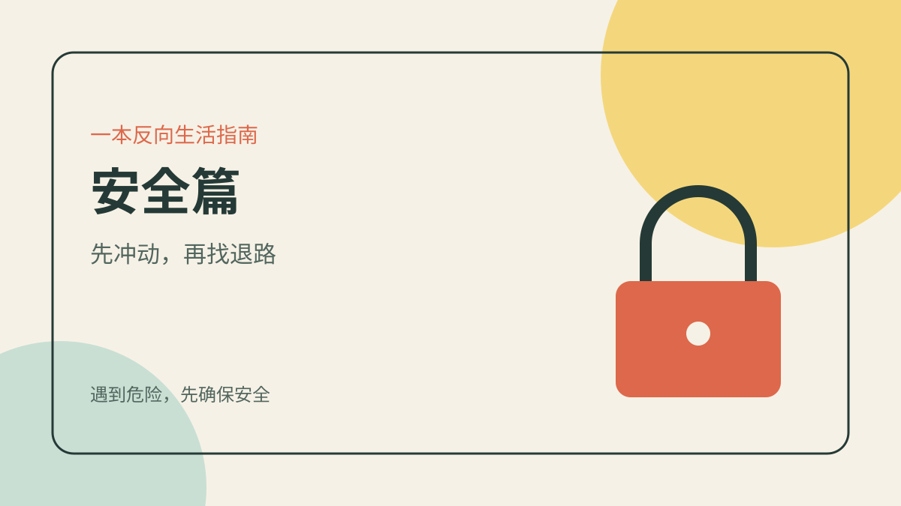

[← 回总目录](../README.md)

# 8. 如何把自己也搭进去

> 本章以反讽描述风险，「反向做法」不能照做。遇到立即危险先远离危险并报警或呼叫急救。法律适用应结合事实及当地现行规则。

### 1. 出了交通事故，先想怎么离开

- 反向做法：不停车、不报警，也不管有没有人受伤。
- 隐藏成本：伤者可能错过救治，逃离也可能产生严重法律后果。
- 翻过来：在确保安全的情况下停车、报警并协助救援，按现场人员指引处理。

### 2. 发现被骗，先独自追查几天

- 反向做法：继续与对方交易，不联系银行和警方。
- 隐藏成本：资金可能继续流失，处置时间也被耽误。
- 翻过来：立即停止转账，联系银行和警方寻求止付并保存记录。

### 3. 骗局只要换个故事，就不需要核实

- 反向做法：陌生来电要求验证码、链接或转账时照做。
- 隐藏成本：账户和资金可能被盗用。
- 翻过来：不透露验证码或敏感信息，不点击可疑链接；通过独立渠道核实再决定。

### 4. 视频里有熟脸，转账就不用回拨

- 反向做法：声音和画面一出现就相信对方，按新号码付款。
- 隐藏成本：影像和声音可能被伪造，身份仍不确定。
- 翻过来：用自己已知的联系方式独立确认，尤其是涉及转账时。

### 5. 被指控或传唤，先删掉所有记录

- 反向做法：不问程序和权利，自行销毁材料或仓促私下处理。
- 隐藏成本：可能损害自身权益，也可能产生新的法律问题。
- 翻过来：依法配合，保留相关记录，及时咨询律师。

### 6. 已经出了事，只研究能不能永远躲开

- 反向做法：不咨询律师，只听人保证「时间久了就没事」。
- 隐藏成本：法律后果和程序不能靠传言判断。
- 翻过来：及时咨询律师，依法处理并如实向专业人士说明情况。

### 7. 喝过酒，只挪一下车不算驾驶

- 反向做法：酒后开车或把车交给喝酒、没有驾驶资格的人。
- 隐藏成本：可能造成严重伤亡和法律责任。
- 翻过来：酒后不驾驶机动车或电动车，安排清醒且具备资格的人驾驶或选择其他交通方式。

### 8. 卡和支付账号借给熟人，只算帮忙

- 反向做法：不问用途就出借银行卡、电话卡或账号。
- 隐藏成本：可能被用于诈骗等活动，牵连本人。
- 翻过来：保护账户与身份，不参与可疑代收代转。

### 9. 征信只在办贷款被拒后才看

- 反向做法：从不核对名下贷款和账户，发现异常也不处理。
- 隐藏成本：身份被冒用或错误记录可能长期未发现。
- 翻过来：通过官方渠道定期核对信用记录，发现异常及时向机构反映。

### 10. 争执先动手，解释留到以后

- 反向做法：用推搡和打斗解决冲突。
- 隐藏成本：可能造成人身伤害和法律责任。
- 翻过来：尽可能远离冲突，必要时报警并保存证据。

### 11. 对方已经停止侵害，也要继续追打

- 反向做法：把报复当成保护自己。
- 隐藏成本：可能造成伤害并产生法律责任。
- 翻过来：以摆脱正在发生的危险为目标，安全后停止并报警；具体法律认定依事实而定。

### 12. 遇到欠薪或被骗，就自己找人算账

- 反向做法：不走投诉、仲裁或诉讼，转而威胁或报复。
- 隐藏成本：可能增加伤害并使自己陷入新的法律问题。
- 翻过来：保存证据，通过合法渠道维权；有紧急危险时报警。

### 13. 把无关的人当作发泄对象

- 反向做法：因纠纷迁怒旁人，威胁或伤害无关人员。
- 隐藏成本：可能造成不可挽回的伤亡和严重法律后果。
- 翻过来：立即远离人群和可能用于伤人的物品，联系可信的人及当地紧急服务。

### 14. 想伤害自己或他人，只当一时气话

- 反向做法：独自继续接触危险物品，不告诉任何人。
- 隐藏成本：冲动可能迅速升级为不可逆的伤害。
- 翻过来：立即远离危险场所和物品，联系可信的人；有立即危险时呼叫当地急救或警方。

### 15. 身边人威胁带着别人一起受伤，只等明天再问

- 反向做法：忽视具体威胁，让孩子或其他人继续处于危险中。
- 隐藏成本：受威胁者和当事人都可能面临紧急风险。
- 翻过来：优先带受威胁者到安全处，立即报警或呼叫急救，由专业人员介入。

### 16. 网上的话不用核实，受攻击也不用留证

- 反向做法：随意辱骂造谣；自己遭网暴时删除所有证据。
- 隐藏成本：可能伤害他人，或使后续投诉和维权更难。
- 翻过来：不传播未经核实的指控；遭网暴时保护账号、合法保存证据并向平台或警方求助。

### 17. 签字只看最后一页

- 反向做法：替别人签名，或在空白纸上签字。
- 隐藏成本：签署内容和责任可能难以确认。
- 翻过来：先读完整文件，不代签或签空白文件，保留副本。

### 18. 借钱和担保不用写明白

- 反向做法：金额、期限和责任都靠记忆。
- 隐藏成本：可能产生争议或承担超出预期的债务。
- 翻过来：写清借款条件，担保前了解责任并评估承受能力。

### 19. 维权期限等事情想清楚再查

- 反向做法：不问程序和时限，长期不保存记录。
- 隐藏成本：超过适用期限可能影响权利主张。
- 翻过来：尽早咨询适用程序和期限，保存证据。

### 20. 被起诉或执行，先把财产藏起来

- 反向做法：忽视法院通知，转移财产或隐瞒信息。
- 隐藏成本：可能产生额外法律后果。
- 翻过来：及时了解程序，依法申报并咨询律师。

### 21. 被限制消费，只能听中介解释

- 反向做法：不查依据，先付费给保证解除限制的人。
- 隐藏成本：可能被骗，也可能错过合法纠正渠道。
- 翻过来：向法院核实依据及履行、异议或纠正程序。

### 22. 网购被骗，先删掉交易记录

- 反向做法：不联系平台或警方，继续向对方转账。
- 隐藏成本：资金可能继续流失，维权证据也会减少。
- 翻过来：停止付款，保存记录，向平台和警方求助。

### 23. 恋爱中的大额转账，不必想资金性质

- 反向做法：不区分赠与、借款和共同支出，也不留凭证。
- 隐藏成本：关系变化后可能发生财产争议。
- 翻过来：量力而行，明确资金性质并保存必要记录。

### 24. 彩礼和其他婚恋转账全靠口头回忆

- 反向做法：不留转账用途、沟通和交付记录。
- 隐藏成本：事实和款项性质可能难以核实。
- 翻过来：保留真实凭证，有争议时咨询法律专业人士。

### 25. 婚前财产和父母出资不用谈

- 反向做法：房屋登记、出资和约定都不核对。
- 隐藏成本：双方对财产权属的理解可能不同。
- 翻过来：记录出资意愿和财产情况，必要时咨询书面安排。

### 26. 谈婚论嫁涉及大额款项，身份不用核实

- 反向做法：不核对对方情况，按催促持续转钱。
- 隐藏成本：可能遭遇欺骗和财产损失。
- 翻过来：谨慎核实身份和交易信息，不因感情压力忽视风险。

### 27. 上门服务先做完，价格再揭晓

- 反向做法：维修、验车或装修都不问收费和增项。
- 隐藏成本：可能产生不必要支出或争议。
- 翻过来：先确认价格、服务范围和增项，保留凭证。

### 28. 挂名法人只借名字，不会有麻烦

- 反向做法：不看公司业务就提供身份注册。
- 隐藏成本：可能卷入企业债务、监管或诉讼问题。
- 翻过来：不为不清楚的经营安排出借身份，先核实责任。

### 29. 陌生包裹只要顺路就替人带

- 反向做法：出入境时不问物品和来源。
- 隐藏成本：可能携带受限制或违法物品。
- 翻过来：拒绝代带来源不明物品，按规定申报自己的物品。

### 30. 狗出门只看心情，不用牵绳

- 反向做法：不看当地养犬规定和疫苗要求。
- 隐藏成本：可能伤人、伤犬并产生责任。
- 翻过来：按当地规定登记、接种并牵引，妥善看护。

### 31. 对方意识不清，也能默认同意

- 反向做法：忽视清醒、自愿和年龄，擅自发生性行为。
- 隐藏成本：可能造成严重伤害并构成性侵害。
- 翻过来：尊重明确、自愿且持续的同意；对方失去意识或无法同意时停止。在中国，不得与不满 14 周岁的儿童发生性关系，所谓同意不能作为理由。

### 32. 对方以报警、告知单位或传播私密影像勒索，先按要求付钱

- 反向做法：持续转账并删掉威胁记录。
- 隐藏成本：勒索可能继续，证据也会丢失。
- 翻过来：停止转账，保存记录并报警；寻求可信的人陪伴。

### 33. 被人捏造事实举报，只能自行忍受

- 反向做法：不保存材料，也不咨询合法处理渠道。
- 隐藏成本：澄清事实和维护权益可能更困难。
- 翻过来：保存证据，依法向相关机关反映，必要时咨询律师。

### 34. 被指控就默认没有辩护权

- 反向做法：不问证据和程序，放弃寻求法律帮助。
- 隐藏成本：可能无法充分行使辩护和救济权利。
- 翻过来：及时咨询律师，了解证据、辩护及申诉程序。

### 35. 被羁押后案件结束，不用问是否能申请赔偿

- 反向做法：不查处理结果和申请条件。
- 隐藏成本：可能错过适用的救济期限。
- 翻过来：保存法律文书，向律师或有关机关咨询国家赔偿条件与程序。

### 36. 受害后索赔只靠单独见面施压

- 反向做法：独自赴不安全的约，把付款与威胁曝光绑在一起。
- 隐藏成本：可能面临人身风险或引发其他法律争议。
- 翻过来：通过平台、投诉、调解或诉讼等合法渠道主张，注意人身安全。

### 37. 遭到网暴，先删除所有内容

- 反向做法：不保护账号、不保存证据，也不寻求支持。
- 隐藏成本：侵害可能持续，后续投诉更困难。
- 翻过来：调整隐私设置，合法保存证据，向平台或警方求助；持续困扰时寻求心理支持。

### 38. 买保险就能把伤害别人的后果清零

- 反向做法：把保险当成伤害他人或骗取赔偿的工具。
- 隐藏成本：可能造成不可挽回的伤亡和严重刑事责任。
- 翻过来：不伤害他人；出现迫切伤人想法时立即远离危险物品和人群，联系紧急服务。

### 39. 报警后不问受理情况

- 反向做法：不保留报案材料，也不查后续通知和救济途径。
- 隐藏成本：可能错过了解进展或申请复议等机会。
- 翻过来：询问受理凭证和后续流程，保存文书，必要时咨询律师。

### 40. 办案遇到问题，先送钱打通关系

- 反向做法：向执法、司法人员提供财物换取结果。
- 隐藏成本：可能涉及行贿并造成新的法律风险。
- 翻过来：通过合法程序表达诉求，不以财物影响执法办案。

### 41. 重要沟通完全不留记录

- 反向做法：不确认约定，也不考虑合法取证。
- 隐藏成本：发生争议时事实可能难以证明。
- 翻过来：依法保留书面记录或其他合法证据，尊重隐私及适用规则。

### 42. 现场证据只留一张模糊截图

- 反向做法：不记录位置、损坏和伤情，还删除原图。
- 隐藏成本：后续核实可能缺少上下文。
- 翻过来：在安全且合法的情况下记录现场，保留原始材料。

### 43. 遭遇家暴，只能等事情自己好转

- 反向做法：不考虑安全计划，也不知道可以报警或申请保护。
- 隐藏成本：伤害可能持续或升级。
- 翻过来：优先离开危险并报警，依法保存证据；向法院或支持机构咨询人身安全保护令等帮助。

### 44. 家人赌博欠债，就先替他全部还掉

- 反向做法：不核实债务性质和个人责任，也不处理赌博问题。
- 隐藏成本：家庭资金可能继续流失。
- 翻过来：先核实事实及法律责任，必要时咨询律师并寻求赌博问题支持。

### 45. 熟人借人脸和验证码，只是帮个小忙

- 反向做法：不看申请内容就刷脸、报码或替人确认贷款。
- 隐藏成本：可能在不知情中承担借款或账户责任。
- 翻过来：不替他人完成不明身份验证或贷款确认，不泄露验证码。

### 46. 门窗锁装好了，出门忘锁也没关系

- 反向做法：不检查门窗和照明，只相信一个设备。
- 隐藏成本：基本的防盗措施可能失效。
- 翻过来：检查门窗锁具和照明，养成出门锁门窗的习惯。
