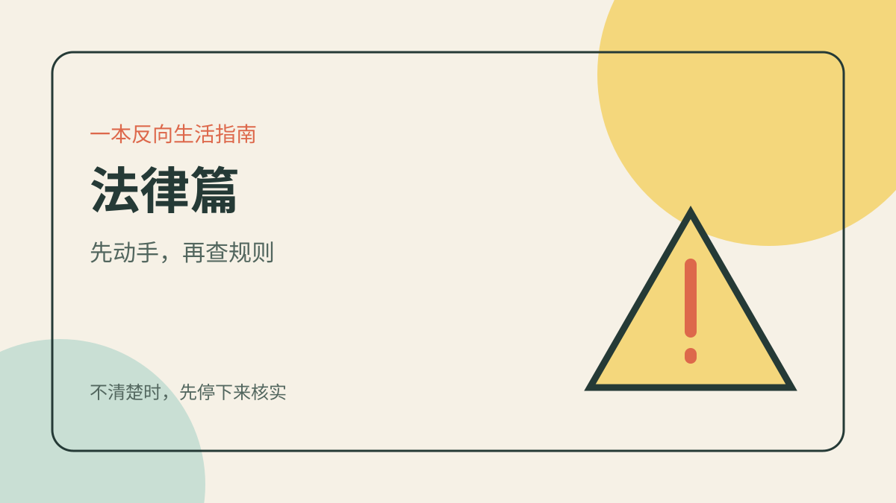

[← 回总目录](../README.md)

# 9. 如何把「顺手」变成法律问题

> 本章通过反讽提示风险，「反向做法」不能照做。具体后果取决于事实、地区和现行法律；遇到危险及时报警，涉及个人法律问题请咨询专业人士。

### 1. 消息越惊人，越不用核实

- 反向做法：灾情或警情截图一来，立即转发或伪造现场图。
- 隐藏成本：错误信息可能伤害他人并引发法律责任。
- 翻过来：核实来源，不制造或传播虚假信息。

### 2. 涉及纪念与公共象征的内容，只图一时好笑

- 反向做法：不考虑真实性、他人感受和适用规定，随意侮辱或恶意传播。
- 隐藏成本：可能伤害他人并触及法律责任。
- 翻过来：尊重他人和公共纪念，发布前核实内容与适用规则。

### 3. 境外信息只需按平台位置判断

- 反向做法：认为网站在境外，就可以不管内容真实性、隐私或适用法律随意搬运。
- 隐藏成本：传播可能产生侵权或其他法律风险。
- 翻过来：核实来源、授权和所在地规则，不传播违法或伤害性内容。

### 4. 私密或色情内容随手转群

- 反向做法：不管是否涉及未成年人、他人隐私或传播限制，拿来分享和交易。
- 隐藏成本：可能严重侵害他人并触及刑事责任。
- 翻过来：不制作、持有或传播涉及儿童性剥削的内容，不擅自传播他人私密内容；遵守适用法律。

### 5. 陌生兼职只借你的卡走一笔钱

- 反向做法：不问资金来源，就替人收款、取现或转账。
- 隐藏成本：可能卷入诈骗或洗钱，账户也可能受限。
- 翻过来：拒绝代收代转可疑资金，通过官方渠道核实招聘和交易。

### 6. 帮忙包装材料贷款，不看材料真假

- 反向做法：对方承诺分成，就提交不真实信息或让人借用身份。
- 隐藏成本：可能产生债务和法律责任。
- 翻过来：不提交虚假材料，不把身份和账户交给不可信的人。

### 7. 捡到钱包，就顺手替失主消费

- 反向做法：使用捡到的卡或据为己有，不寻找失主。
- 隐藏成本：可能侵犯财产权并产生法律后果。
- 翻过来：通过安全方式联系失主或交给警方，不使用他人财物。

### 8. 优惠规则只要能绕过就算允许

- 反向做法：虚构身份、批量注册或利用漏洞重复领取。
- 隐藏成本：可能产生账号、民事或其他法律风险。
- 翻过来：使用真实身份并遵守活动规则。

### 9. 窗外看不见人，就可以扔东西

- 反向做法：从阳台或窗户丢烟头和垃圾。
- 隐藏成本：可能砸伤他人、引发火灾和法律责任。
- 翻过来：不向窗外抛物，安全处理垃圾。

### 10. 外形像玩具，就不用查产品性质

- 反向做法：购买来路不明的发射装置，不管安全和规定。
- 隐藏成本：可能伤人或涉及受管制物品。
- 翻过来：核实产品安全与当地规定，不购买或携带违法物品。

### 11. 无人机飞得起来就哪里都能飞

- 反向做法：不查登记、空域和周边安全要求。
- 隐藏成本：可能影响航空安全或违反管理规定。
- 翻过来：按规定登记，核实飞行区域、限制和安全条件。

### 12. 摄像头藏起来就不算侵犯隐私

- 反向做法：在他人私人空间偷拍或安装隐蔽设备。
- 隐藏成本：严重侵犯隐私并可能承担法律责任。
- 翻过来：尊重他人隐私，不在私人空间偷拍；发现设备及时求助。

### 13. 牌局只要叫娱乐，任何经营方式都一样

- 反向做法：不看资金、组织方式和平台性质，参与赌博或组织抽成。
- 隐藏成本：可能造成财产损失和法律责任。
- 翻过来：了解当地规定，避免赌博和可疑网络平台。

### 14. 野生动植物只要买得到就能带回家

- 反向做法：不查物种、来源和许可，随意捕食、饲养或挖采。
- 隐藏成本：可能破坏生态、传播疾病并违反法律。
- 翻过来：不购买来路不明的野生动植物，核实保护名录和合法来源。

### 15. 要债时，限制别人自由最省事

- 反向做法：扣人、关人或跟踪骚扰，直到对方付款。
- 隐藏成本：可能侵犯人身权利并产生法律责任。
- 翻过来：保存债权证据，通过协商、调解或司法程序处理。

### 16. 身份证借出去，责任自然跟着别人走

- 反向做法：出借或冒用证件开户、登记或买票。
- 隐藏成本：身份被滥用可能带来财务和法律风险。
- 翻过来：保护自己的证件，不冒用他人身份。

### 17. 遇到执法先用推搡解决

- 反向做法：情绪激动时动手或抢夺设备。
- 隐藏成本：可能造成人身伤害并增加法律问题。
- 翻过来：保持冷静，依法配合；对程序有异议时记录并通过合法渠道反映。

### 18. 未成年人的安全和法律保护不用了解

- 反向做法：忽视年龄、权力差异和法律限制，把伤害合理化。
- 隐藏成本：可能造成严重伤害并触及刑事责任。
- 翻过来：保护未成年人；在中国，不得与不满 14 周岁的儿童发生性关系，所谓同意不能作为理由。发现侵害及时报警和寻求专业帮助。

### 19. 冲突升级到动手，事后道歉就够

- 反向做法：用暴力解决争执。
- 隐藏成本：可能造成人身伤害、赔偿及法律责任。
- 翻过来：远离冲突、确保安全，必要时报警。

### 20. 无法照护孩子，私下转交或遗弃就好

- 反向做法：不联系任何机构，擅自收钱转交或丢下孩子。
- 隐藏成本：孩子可能遭受严重伤害，也可能触及刑事责任。
- 翻过来：立即联系当地民政、儿童福利机构或警方，寻求合法安全的照护帮助。

### 21. 保险理赔多报一点只是聪明

- 反向做法：伪造事故或夸大损失，让别人配合提供虚假材料。
- 隐藏成本：可能构成保险诈骗并影响参与者。
- 翻过来：如实申报和保存真实证据，有争议走正规投诉渠道。

### 22. 器官交易只是一份高价兼职

- 反向做法：相信中介的收益承诺，参与买卖或介绍。
- 隐藏成本：可能遭受严重身体伤害、诈骗和法律后果。
- 翻过来：不参与器官买卖；遇到胁迫或相关线索及时报警。

### 23. 性交易的风险只看对方报价

- 反向做法：忽视剥削、安全和当地法律。
- 隐藏成本：可能遭遇暴力、诈骗或法律后果。
- 翻过来：遵守当地法律；遭遇强迫、剥削或危险时及时求助。

### 24. 影视书籍只要没收费就随便传播

- 反向做法：不看授权就大量搬运、分享或经营盗版内容。
- 隐藏成本：免费传播也可能侵犯权利，具体责任因事实而异。
- 翻过来：使用合法渠道，发布前核实授权和适用例外。

### 25. 二创改个名字就自动获得全部权利

- 反向做法：不分析原作品的受保护表达和使用方式，直接出版销售。
- 隐藏成本：改名并不保证不侵权。
- 翻过来：核实授权、使用范围和适用例外，必要时咨询专业人士。

### 26. 防身器材想买什么就随身带

- 反向做法：不核实物品性质、携带规定和使用风险。
- 隐藏成本：可能伤及自己或他人，也可能违反管理规定。
- 翻过来：优先避险和求助，核实当地物品管理规则。

### 27. 捕鱼只看收获，不看季节和水域

- 反向做法：不查禁渔期、区域和工具限制。
- 隐藏成本：可能破坏生态并承担法律责任。
- 翻过来：核实当地禁渔时间、区域和渔具规定，不电鱼、毒鱼或炸鱼。

### 28. 林区用火只看风景好不好

- 反向做法：在有火险的区域烧荒、祭扫或野炊生火。
- 隐藏成本：可能引发火灾和人身伤害。
- 翻过来：遵守禁火规定，发现山火立即远离危险并向消防部门报警。

### 29. 考试作弊只是一条捷径

- 反向做法：代考、买卖答案或帮助组织作弊。
- 隐藏成本：可能失去考试资格并承担法律责任。
- 翻过来：遵守考试规则，不参与代考或作弊交易。
