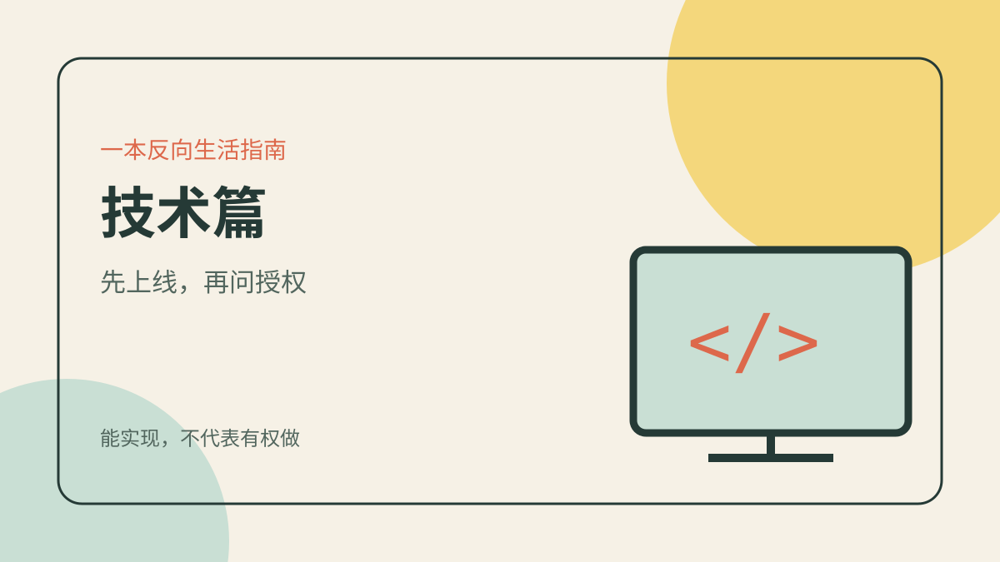

[← 回总目录](../README.md)

# 11. 如何让技术工作附带法律盲盒

> 本章用反讽描述技术工作中的风险，「反向做法」不是操作建议。是否违法取决于行为、授权、用途和适用法律；遇到争议或调查时应及时咨询专业律师。

### 1. 接任务只问能不能做，不问有没有权做

- 反向做法：需求听起来很简单，就不查授权、用途和可能受影响的人。
- 隐藏成本：技术可行不代表行为合法，纠纷也可能影响个人。
- 翻过来：动手前核实委托人身份、授权范围和用途；遇到调查时及时寻求法律帮助。

### 2. 软件外挂只要叫「辅助」就没有风险

- 反向做法：不看用途和软件权利人的规则，只换个名字就开发、销售修改版或外挂。
- 隐藏成本：具体行为可能涉及著作权、不正当竞争或其他法律责任。
- 翻过来：核实授权、实现方式和适用规则，拒绝明显侵权或违法的需求。

### 3. 自动化脚本只要会点按钮就随便用

- 反向做法：抢票、刷单或批量领取权益，不管平台规则和真实交易情况，都当作普通测试。
- 隐藏成本：影响他人交易、虚构交易或绕过限制可能带来账号和法律风险。
- 翻过来：先确认授权、规则和用途，不承接欺诈性刷单或其他违法自动化需求。

### 4. 能打开的网页，数据就能随便拿来卖

- 反向做法：忽略登录限制、反爬措施、个人信息和使用条件，采集后直接转售。
- 隐藏成本：公开可访问不等于可以无限制处理、使用或出售数据。
- 翻过来：评估访问授权、数据来源、个人信息和使用目的；有疑问时咨询专业人士。

### 5. 客户付钱就不必了解业务

- 反向做法：明知项目涉及诈骗、赌博或其他违法活动，仍把支付和账号环节当成普通外包。
- 隐藏成本：技术支持也可能使参与者承担法律责任。
- 翻过来：核实客户与业务用途，拒绝为明显违法活动提供支持。

### 6. 离职时，用破坏系统表达不满

- 反向做法：公司欠薪或交接有争议，就删除数据、保留后门或锁住账号。
- 隐藏成本：破坏系统可能造成独立的法律责任，也无法自动解决劳动争议。
- 翻过来：按约交接权限和资料；欠薪等争议通过合法渠道维权并保存证据。

### 7. 公司代码带回家，以后一定用得上

- 反向做法：离职时把源码、客户名单和内部文档上传个人网盘，并带到新工作中。
- 隐藏成本：可能泄露商业秘密或侵犯相关权利。
- 翻过来：按合同和公司制度交接资料；未经授权不复制、保留或使用受保护的信息。

### 8. 别人的设备空着，就是免费算力

- 反向做法：不取得许可就在他人设备或公司服务器上运行私人程序、占用资源。
- 隐藏成本：设备安全、性能和数据可能受影响，也可能引发法律与劳动争议。
- 翻过来：只在明确授权的设备和范围内运行程序，遵守资源使用规则。

### 9. 安全测试只要出发点好，就不需要授权

- 反向做法：先测试别人的系统，等发现问题再告诉对方，默认事后解释就够了。
- 隐藏成本：未经授权的访问或测试可能影响系统并产生责任。
- 翻过来：测试前取得明确的书面授权，约定目标、范围、时间和报告方式。

### 10. 发现漏洞，先把细节公开再通知

- 反向做法：不管受影响用户和修复状态，立即传播细节和工具。
- 隐藏成本：漏洞可能被滥用，也可能违反适用的报送和披露规定。
- 翻过来：按适用规定和协调披露流程报告，保护受影响方并与相关机构确认公开时间。

### 11. 网络服务只要有人买，就不用核实许可

- 反向做法：提供或转售 VPN、网络节点等网络接入服务前，不查经营许可、服务范围和当地规则。
- 隐藏成本：相关业务可能受到监管，违规经营可能产生责任。
- 翻过来：开展业务前向主管机关核实适用的许可和合规要求，不提供明显违法服务。

### 12. 竞业协议只看名字，不看内容和履行情况

- 反向做法：签约时不读范围，离职后也不核实补偿和期限，直到发生争议。
- 隐藏成本：双方对义务、补偿和解除条件可能理解不同。
- 翻过来：保存协议和支付记录，了解适用的竞业限制及救济规则，必要时咨询劳动法律专业人士。

### 13. 个人项目和公司项目混在同一份代码里

- 反向做法：不区分工作任务、设备、时间和已有代码，发布时再猜权利归属。
- 隐藏成本：可能发生职务成果、商业秘密或开源许可争议。
- 翻过来：查看劳动合同及知识产权约定，区分项目资源与代码来源，必要时取得明确许可。

### 14. 开源许可证只是一段可以跳过的文字

- 反向做法：复制第三方代码后删掉声明，不看分发和修改条件就商业发布。
- 隐藏成本：可能违反许可证要求，影响发布和后续维护。
- 翻过来：识别依赖及许可证，核实具体使用、修改和分发义务并保留必要声明。

### 15. App 能收集的信息，全部先收下来

- 反向做法：不说明用途，不考虑儿童信息和权限范围，等用户投诉再补隐私政策。
- 隐藏成本：过度收集和保护不足可能损害用户并违反适用规定。
- 翻过来：明确处理目的和必要范围，按法律要求告知并取得适当同意，特别保护儿童个人信息。

### 16. 应用上线先冲，备案和安全留到故障以后

- 反向做法：不查部署地点、业务类型和日志要求，认为服务器提供商会自动代办一切。
- 隐藏成本：适用的备案、安全保护和留存义务可能被忽视。
- 翻过来：根据产品和部署情况核实备案、等级保护、安全及日志留存要求。

### 17. 生成式 AI 面向公众前只测界面颜色

- 反向做法：不看服务范围、数据处理、内容标识和适用的安全要求。
- 隐藏成本：产品可能不符合相关规定，也可能损害用户权益。
- 翻过来：依据服务类型核实适用的安全评估、备案和内容标识等要求。

### 18. 改变别家应用的广告展示，不用考虑权利和竞争

- 反向做法：只看用户需求，不评估实现方式、授权和可能影响的经营关系。
- 隐藏成本：具体工具或商业行为可能引发侵权或不正当竞争争议。
- 翻过来：在开发和发布前评估具体功能、使用方式及相关权利，必要时咨询专业人士。

### 19. 低价转售 AI 接口，不问上游授权和用户数据

- 反向做法：不核实接口协议、业务许可或数据流向，就把用户请求和密钥交给不明服务。
- 隐藏成本：可能产生合同、隐私、安全和监管风险。
- 翻过来：核实上游授权、服务条件、适用规则及数据保护措施，不承诺无法保障的安全性。

### 20. 软件破解文件只要免费分享就没有后果

- 反向做法：不看权利人授权，就制作、销售或传播绕过授权的工具和版本。
- 隐藏成本：具体行为可能侵犯著作权或触及其他法律规定。
- 翻过来：使用合法授权的软件和替代方案；对研究和使用边界有疑问时咨询专业人士。

### 21. 与别人发生争执，就让对方服务器停下来

- 反向做法：把破坏他人网络服务包装成「压力测试」，无授权也照样发起。
- 隐藏成本：可能造成业务中断、经济损失和法律责任。
- 翻过来：只对自己控制或明确授权的系统进行约定范围内的测试，用合法渠道处理争议。
