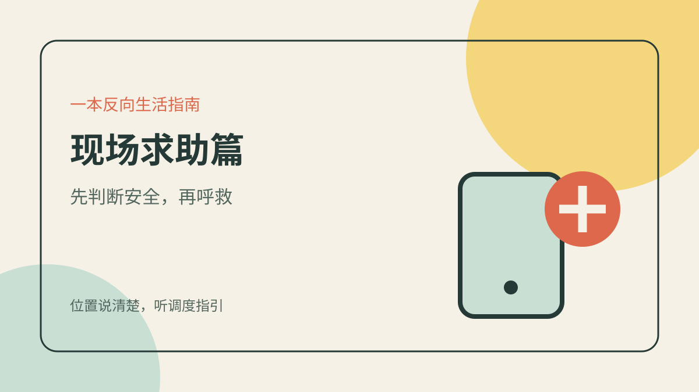

[← 回总目录](../README.md)

# 13. 如何在紧急时刻把时间花在等待上

> 本章用反讽描述紧急时刻的错误反应，「反向做法」不能照做。危急情况先确保现场安全并呼叫急救，按调度人员指引行动。本章不能代替急救培训。

### 1. 人倒地不呼吸，先围观确认热闹程度

- 反向做法：不叫人、不打急救电话，等待对方自己醒来。
- 隐藏成本：心脏骤停时，延误急救可能致命。
- 翻过来：确保现场安全；人无反应且无正常呼吸时立即呼叫急救、开始心肺复苏，请旁人取 AED，按调度员或设备指引操作。

### 2. 有人摔倒，先不看情况把人拉起来

- 反向做法：不确认危险、意识和伤情就强行搬动。
- 隐藏成本：不必要的移动可能加重部分伤情。
- 翻过来：确保现场安全，呼叫并观察，必要时打急救电话；按调度员指引决定是否移动。

### 3. 突然嘴歪手无力，说话不清，先睡一觉

- 反向做法：等待症状自己消失或自己开车去医院。
- 隐藏成本：疑似卒中需要尽快救治，等待可能错过治疗时间。
- 翻过来：立即呼叫急救，说明症状和开始时间，按调度指引行动。

### 4. 突然眩晕站不稳，只当昨晚没睡好

- 反向做法：出现复视、失衡等突发症状仍自行等待。
- 隐藏成本：可能漏掉卒中等急症。
- 翻过来：突发明显失衡、复视等症状立即呼叫急救，由医护评估。

### 5. 一只眼突然看不见，恢复后就不管

- 反向做法：症状几分钟后消失，就不告诉任何人。
- 隐藏成本：短暂视力丧失也可能是严重问题的信号。
- 翻过来：突发视力丧失即使恢复也应立即急诊评估；症状正在发生时呼叫急救。

### 6. 红眼剧痛伴恶心，先换副眼镜

- 反向做法：眼睛胀痛、发红和视力异常时继续等待。
- 隐藏成本：某些眼科急症可能损害视力。
- 翻过来：出现明显眼痛、红眼和视力异常等情况立即急诊评估。

### 7. 胸痛出冷汗，自己开车去看看

- 反向做法：胸口压痛、呼吸困难仍独自开车或硬扛。
- 隐藏成本：可能是危及生命的急症，途中也可能失去行动能力。
- 翻过来：立即呼叫急救，停止活动并按调度指引处理。

### 8. 突然撕裂样胸背痛，先观察一整晚

- 反向做法：不告诉他人疼痛的性质和位置。
- 隐藏成本：可能是严重急症，延误可能致命。
- 翻过来：立即呼叫急救，向调度人员描述症状。

### 9. 突然最严重的头痛，用止痛药压一压

- 反向做法：短时间达到极严重程度仍继续等待。
- 隐藏成本：可能存在需要立即评估的危险原因。
- 翻过来：立即急诊或呼叫急救，不自行驾驶。

### 10. 老人撞头后变迟钝，只当年纪大

- 反向做法：几周后出现嗜睡、走路不稳或无力，也不告诉医生有撞头史。
- 隐藏成本：头部受伤后的严重问题可能被忽略。
- 翻过来：尽快就医并说明撞头经过；意识改变或明显恶化时呼叫急救。

### 11. 一条腿突然肿痛，胸痛气喘也先按摩

- 反向做法：忽视突发症状，继续等待。
- 隐藏成本：可能是需要紧急评估的血管问题。
- 翻过来：腿部突然肿痛尽快就医；伴突发胸痛或呼吸困难立即呼叫急救。

### 12. 大出血先找纸拍照，再决定要不要压

- 反向做法：不呼救、不压迫伤口。
- 隐藏成本：严重失血可能迅速危及生命。
- 翻过来：呼叫急救，在确保安全时直接压迫伤口；按调度指引和培训处理四肢严重出血。

### 13. 被猫狗咬破皮，擦干净就结束

- 反向做法：不冲洗，也不评估狂犬病和破伤风风险。
- 隐藏成本：感染可能带来严重后果。
- 翻过来：尽快用肥皂和流动水充分冲洗伤口至少 15 分钟，及时就医评估疫苗及其他处理。

### 14. 烫伤先涂牙膏或酱油

- 反向做法：用冰块或偏方直接处理伤处。
- 隐藏成本：可能加重损伤或妨碍后续处理。
- 翻过来：尽快用凉的流动水冷却 20 分钟，避免冰敷和涂抹偏方；严重或范围较大的烫伤立即就医。

### 15. 全身起疹又喘不上气，等过敏药慢慢起效

- 反向做法：不呼叫急救，独自等待。
- 隐藏成本：严重过敏反应可能迅速危及生命。
- 翻过来：立即呼叫急救；如本人有医生处方的肾上腺素自动注射器，立即按既有医嘱使用并告知调度人员。

### 16. 有人抽搐，把东西塞进嘴里

- 反向做法：强行按住身体，或向嘴里塞物品。
- 隐藏成本：可能造成额外伤害或阻碍呼吸。
- 翻过来：清开周围危险物，保护头部并计时，不往嘴里塞东西；停止抽搐后按急救指引侧卧，抽搐超过 5 分钟、首次发作或呼吸困难等情况立即呼叫急救。

### 17. 疑似低血糖，先让昏迷的人喝水

- 反向做法：不判断意识和吞咽能力，强行喂食。
- 隐藏成本：意识不清的人可能误吸或窒息。
- 翻过来：清醒且能安全吞咽时按既有医嘱或急救指引补充快速糖；不能安全吞咽时不要喂食，立即呼叫急救。

### 18. 有人触电，先伸手把人拉开

- 反向做法：不确认电源是否切断就直接接触。
- 隐藏成本：救助者也可能触电。
- 翻过来：先确保自身安全并切断电源，呼叫急救，按调度人员指引处理。

### 19. 一屋子人头痛恶心，报警器响了也先找说明书

- 反向做法：继续留在室内排查气味。
- 隐藏成本：可能持续暴露于一氧化碳等危险环境。
- 翻过来：立即撤到新鲜空气处并呼叫急救和有关救援部门，不冒险返回。

### 20. 误服清洁剂或药物，马上催吐

- 反向做法：强行喂水或催吐，认为吐出来就安全。
- 隐藏成本：可能造成误吸或进一步损伤。
- 翻过来：立即联系急救或中毒咨询服务，不自行催吐；保留包装并按专业人员指引处理。

### 21. 化学品溅到皮肤或眼睛，先等感觉到疼

- 反向做法：继续穿污染衣物，不冲洗。
- 隐藏成本：化学损伤可能持续加重。
- 翻过来：确保自身安全，脱去污染衣物，用大量流动清水冲洗并立即寻求专业帮助；按调度或产品安全指引处理。

### 22. 高温下意识不清，继续工作就能适应

- 反向做法：不降温、不呼救，还强行喂水。
- 隐藏成本：严重中暑可危及生命，意识不清时喂水可能误吸。
- 翻过来：立即呼叫急救，在安全条件下移至阴凉处并迅速降温；意识不清者不要喂水。

### 23. 疑似中暑，清醒的人必须一次喝完一大瓶

- 反向做法：无视恶心和吞咽情况，强迫大量饮水或饮酒。
- 隐藏成本：可能引起呕吐或误吸。
- 翻过来：清醒且能安全吞咽时可少量多次补液；症状严重或意识异常立即呼叫急救。

### 24. 火灾时先乘电梯回去拿东西

- 反向做法：不顾烟火和出口情况，反复返回现场。
- 隐藏成本：烟气、电梯故障和火势可能致命。
- 翻过来：安全时走楼梯撤离并报警，不乘电梯或返回取物；出口被封时关门阻烟，在相对安全处呼救并听从消防调度。

### 25. 看到溺水，不会游泳也立刻下水

- 反向做法：不呼救、不评估水流，徒手跳下。
- 隐藏成本：救助者也可能溺水。
- 翻过来：立即呼救和报警，在安全岸边使用可触及的漂浮物或长物协助，按专业救援人员指引行动。

### 26. 大孩子或成人噎住说不出话，先给水

- 反向做法：不呼救，强行灌水或把手伸进嘴里乱掏。
- 隐藏成本：可能加重阻塞或延误救治。
- 翻过来：立即呼救，按急救调度员指引或受过的急救培训进行适龄处理；失去反应时按指引开始心肺复苏。

### 27. 沙漠迷路或车辆抛锚，先独自走远

- 反向做法：不报位置、不考虑天气和水。
- 隐藏成本：可能更难被发现并发生脱水或失温。
- 翻过来：先求救并报告位置，评估现场安全，通常留在容易被发现的位置或车旁，做好遮阳保温并听从救援指引。

### 28. 失温的人喝酒暖身，再剧烈搓揉

- 反向做法：不处理湿衣，也不判断意识和吞咽。
- 隐藏成本：处理不当可能加重伤情或误吸。
- 翻过来：呼叫救援，转移到避风处、轻柔保暖并按调度指引处理；意识不清者不要喂饮品。

### 29. 蛇咬后先切开伤口或用嘴吸

- 反向做法：跑动、紧绑伤口或寻找偏方。
- 隐藏成本：可能加重损伤并耽误治疗。
- 翻过来：尽量保持安静和伤肢不动，去除可能勒紧的饰物，立即求医；不要切、吸或紧绑。

### 30. 地震一来，不看环境就冲楼梯

- 反向做法：忽视坠物和建筑条件，盲目拥挤逃跑。
- 隐藏成本：可能被坠物击中或在拥挤中受伤。
- 翻过来：根据建筑和现场条件采用当地防灾部门建议的避险方式，保护头颈并远离窗户，震后按指引撤离。

### 31. 遇到野生动物，先追近拍照

- 反向做法：接近、挑衅或惊扰动物。
- 隐藏成本：可能引发攻击。
- 翻过来：保持距离，避免激怒，缓慢退向安全处；具体应对遵循当地野生动物管理部门指引。

### 32. 雷雨来了，站到山脊和孤树下避雨

- 反向做法：留在水面或空旷高处继续活动。
- 隐藏成本：雷击风险增加。
- 翻过来：尽快进入坚固建筑或硬顶车辆，远离空旷高处、水面和孤树。

### 33. 高原症状越来越重，继续快速上升

- 反向做法：不报告头痛、呕吐或意识变化，强行完成行程。
- 隐藏成本：可能发展为危及生命的高原疾病。
- 翻过来：提前规划缓慢升高海拔；症状加重时停止上升、寻求医疗帮助并按专业指引下撤。

### 34. 蜱虫叮在肉里，点一把火它就走了

- 反向做法：涂凡士林、抹指甲油，或者用烟头烧它的屁股；实在不行，用手一拽了事。
- 隐藏成本：这些办法会刺激蜱虫把带病原体的体液挤进皮肤；硬拽还容易把口器断在肉里。
- 翻过来：尖头镊子贴着皮肤夹住，稳稳匀速拉出来；之后几周发烧起疹，看病时主动说被蜱咬过。

### 35. 山里的泉水冰凉清甜，比瓶装水高级

- 反向做法：溪水看着清澈，捧起来就喝；讲究一点的，过个滤芯完事。
- 隐藏成本：清澈的水一样可能有寄生虫；多数过滤器挡不住病毒，消毒片杀不死隐孢子虫。
- 翻过来：一律烧开，滚开一分钟就够；烧不了再考虑过滤器加消毒片，互相补短板。

### 36. 遇上劫道的，先掏手机拍他

- 反向做法：被堵住先掏手机录像「取证」，或者抄起手边的东西先下手为强。
- 隐藏成本：激怒持械的人，是把几百块的损失升级成人身风险；手机多半也被抢走。
- 翻过来：钱给他，不动手、不追赶；记下长相口音车牌，脱身到安全处打 110。

### 37. 有人打架，冲上去拉架才叫仗义

- 反向做法：看到一群人打架，冲进去拉架；或者站得近近的，看个全程。
- 隐藏成本：一动手，「劝架」就成了参加斗殴，可能判刑；围观的人也最容易被登记和波及。
- 翻过来：退开走人；要报警就退到安全距离打 110，说清地点、人数、有没有拿刀棍。

### 38. 安全套破了？先睡一觉，天亮再说

- 反向做法：高危暴露之后先洗洗睡；第二天「看看有没有症状」，再决定要不要管。
- 隐藏成本：阻断药超过 72 小时就不建议再启动；越早越好，最好 2 小时内吃上。
- 翻过来：当晚就去定点医院拿阻断药，连吃 28 天别漏服；暴露后 30 天和 90 天复查。

### 39. 救人搭上自己，认了，谁让多管闲事

- 反向做法：救人受伤后自己扛，「谁叫自己多管闲事」；发票病历随手就扔。
- 隐藏成本：见义勇为负伤先救治后收费，医疗费找加害人、走医保，还能申报确认拿待遇；把证据扔了等于全放弃。
- 翻过来：病历、报警回执、目击者联系方式都留好；先找加害人和医保，再申报见义勇为确认。

### 40. 刀扎在身上，拔出来透气好得快

- 反向做法：扎进身体的刀、钢筋、玻璃，先拔出来「看看到底伤得多深」。
- 隐藏成本：异物正起着压迫止血的作用，拔出来可能瞬间大出血；拔不拔该由医生在手术室决定。
- 翻过来：别拔，压住异物周围止血，垫稳别让它晃，打 120；露出来的内脏别塞回去。

### 41. 脚脖子歪了，自己掰正再走路

- 反向做法：扭伤崴脚先自己掰回去，揉一揉、热敷、走两步，「活动开就好了」。
- 隐藏成本：连 X 光都可能漏看骨折；自己掰正，更可能把裂缝掰成错位。
- 翻过来：先当骨折处理，托住别动、冷敷 20 分钟以内，别掰正；片子没事但医生怀疑的，做核磁。

### 42. 这种事太丢人，先洗掉再决定说不说

- 反向做法：被侵害后的第一反应是洗澡、洗衣服、收拾房间，当作什么都没发生。
- 隐藏成本：身上的痕迹是指认对方最要紧的证据，洗掉就没了；紧急避孕和阻断也都有时限。
- 翻过来：先到安全的地方打 110，验伤前别洗澡洗衣服收拾东西，72 小时内去医院；紧急避孕药越早越好。

### 43. 婴儿噎住了，手指伸进去掏

- 反向做法：孩子噎住就伸手指进嘴掏；掏不到，就倒提着抖两下。
- 隐藏成本：盲掏可能把异物推得更深，倒提抖动帮不上忙；婴儿噎住有专门的一套手法。
- 翻过来：趴在前臂上拍背 5 下、翻过来按胸口 5 下轮着做，别按肚子；没反应了立刻做婴儿心肺复苏并呼叫。

### 44. 孩子叫不醒，先抱着往医院跑

- 反向做法：婴儿没反应没呼吸，抱着一路狂奔去医院，路上什么也不做。
- 隐藏成本：跑起来的那几分钟正是最要命的窗口；婴儿心跳骤停多是缺氧引起的，要边按边吹气。
- 翻过来：开免提打 120，按 30 下吹 2 口气，两个拇指按约 4 厘米深；一个人按不过来，先按 1 到 2 分钟再去打电话。

### 45. 吞了纽扣电池？多喝水冲下去就行

- 反向做法：孩子吞了电池或磁珠，先喂水喂饭「裹下去」，再观察两天。
- 隐藏成本：电池卡在食道，两小时就能烧出重伤；磁珠隔着肠壁互相吸住，可能压穿肠子。多数时候没人看见孩子吞下去。
- 翻过来：立刻去有胃镜的医院急诊拍片，别催吐、别等症状；电池和磁力珠收在孩子够不着的地方。

### 46. 兄弟喝多了，抬床上睡一觉就好

- 反向做法：喝断片的兄弟往床上一放，关门走人；「吐了自然醒」。
- 隐藏成本：醉倒的人可能被自己的呕吐物呛死，也可能呼吸慢慢停下；同饮的人之后还可能要按过错赔偿。
- 翻过来：让他侧躺，有人守着到醒；叫不醒、呼吸慢、抽搐、身上发凉就打 120，别灌咖啡别催吐。

### 47. 手指切断了，冰块里冻上保鲜

- 反向做法：断指直接埋进冰块，或者泡在水杯里；「凉着总没错」。
- 隐藏成本：直接接触冰会冻坏组织，泡水会把它泡坏；不低温保存，断指只能等 4 到 6 小时。
- 翻过来：先压住伤口止血；断指用湿纱布包好装密封袋，袋子放进冰水里，去有手外科的医院。

### 48. 牙磕掉了，纸巾一包揣兜里

- 反向做法：撞掉的牙用餐巾纸包着攥回家，「到了牙科再说」；洗手才是当务之急。
- 隐藏成本：干放一小时以上，牙根粘连的风险升到八成多；捏着牙根冲洗也是大忌。
- 翻过来：捏住牙冠冲一下，能放回就放回，放不回泡牛奶，马上去看牙；乳牙别放回。

### 49. 大便发黑？昨晚的猪血罢了

- 反向做法：大便又黑又粘，回想一下昨晚的血豆腐；「吃猪血拉黑便，常识」。
- 隐藏成本：柏油样便常是上消化道在出血；只有黑便的人最容易拖，拖到的人要输血的更多（42% 对 27%）。
- 翻过来：当天去急诊；头晕、出冷汗或吐血别开车，打 120。吃过铁剂、铋剂或动物血的，去时说一声。
