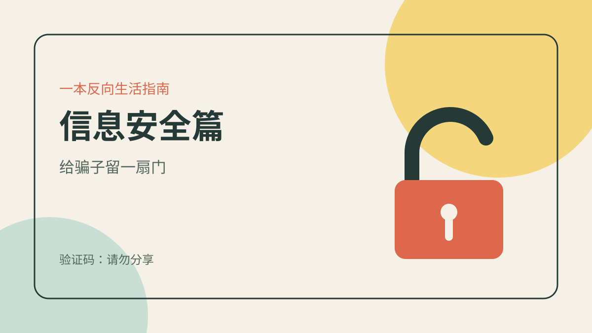

[← 回总目录](../README.md)

# 14. 如何把账号交给运气保管

> 本章用反讽描写常见的信息安全陷阱。「反向做法」不是操作建议；每条末尾的「翻过来」是可参考的做法。遇到盗刷、信息泄露或争议时，具体处理方式以银行、平台和当地主管部门的要求为准。

### 1. 为了登录快一点，关掉所有额外验证

- 反向做法：邮箱、支付和社交账号只靠密码守门。验证提醒一来就点同意，反正能省几秒。
- 隐藏成本：密码泄露后，别人可能更容易进入账号；随手批准陌生请求还会让验证失去作用。
- 翻过来：给重要账号启用平台支持的通行密钥，或为密码登录开启多因素验证；不是自己发起的登录请求不要批准。

### 2. 让邮箱密码服务于互联网每一个角落

- 反向做法：所有网站使用同一个密码，最好还是多年前公开用过的那个。这样谁先泄露，其他账号都能收到影响。
- 隐藏成本：邮箱常用于找回其他账号，重复使用密码会把一次泄露扩展成一连串麻烦。
- 翻过来：给每个账号使用独立密码，尤其要保护好邮箱；可以借助可靠的密码管理工具。

### 3. 手机和电话卡都不用保护

- 反向做法：手机不设锁屏，电话卡也不考虑设置 PIN。毕竟捡到手机的人肯定只是想看看时间。
- 隐藏成本：手机丢失后，账号、短信和个人资料可能面临额外风险。
- 翻过来：为手机设置可靠的锁屏方式，并了解运营商提供的 SIM 卡保护选项；设置 PIN 前先保存好解锁信息。

### 4. 手机丢了，先等它自己回来

- 反向做法：不挂失、不锁定、不检查重要账号。等几天再处理，还能顺便回忆手机最后出现在哪里。
- 隐藏成本：号码、设备和已登录账号可能在等待期间被他人使用。
- 翻过来：尽快通过可信渠道联系运营商挂失号码，使用设备的查找或锁定功能，从可信设备检查邮箱、支付和银行账户并更改重要密码；涉及盗窃或损失时及时报警。具体先后顺序按实际风险和可用设备调整。

### 5. 发现银行卡异常交易后，先在网上发牢骚

- 反向做法：截图留念，猜测到底是谁干的；等下个月账单到了，再考虑联系银行。
- 隐藏成本：卡片可能继续被使用，交易记录和处理时效也可能影响后续沟通。
- 翻过来：尽快联系银行挂失或冻结并核实交易，保存记录；涉嫌犯罪时报警。赔付和举证责任取决于具体事实及适用规则，不要预设结果。

### 6. 授权过的应用和设备永远不用回头看

- 反向做法：每个应用都连一次账号，旧手机卖掉后也保持登录。人走了，权限留下来陪伴平台。
- 隐藏成本：不用的设备或第三方应用仍可能保留访问权限。
- 翻过来：定期检查登录设备和已授权应用，退出陌生设备并撤销不再需要的授权。

### 7. 看到权限申请就无条件全部同意

- 反向做法：手电筒想看通讯录，先答应；应用要读取位置和照片，也一起批准。省下来的时间可以用来清理后续骚扰。
- 隐藏成本：不必要的权限可能暴露更多个人信息，之后也更难弄清信息去了哪里。
- 翻过来：先看权限与功能是否相关，只授予实际需要的范围；不需要的权限可在系统设置中关闭。

### 8. 个人信息被错误使用时，假装自己没有选择

- 反向做法：资料填错了不更正，不需要的账户不处理。即使平台有申诉入口，也默默希望问题自动消失。
- 隐藏成本：错误或不必要的信息可能继续被使用，争议也更难留下处理记录。
- 翻过来：查看平台的个人信息管理和投诉渠道，按适用规则提出查询、更正或删除等请求，并保存沟通记录；争议较大时可咨询专业人士。

### 9. 凡是要求刷脸的场景都直接同意

- 反向做法：不看是谁收集、不问用途，只要屏幕亮起就把脸凑过去。熟人说帮忙刷一下，也立刻照做。
- 隐藏成本：人脸信息敏感，误信他人或忽略用途可能带来身份和隐私风险。
- 翻过来：先确认机构、用途和流程；不明请求不要配合。对有疑问的场景，可以询问是否有其他验证方式及适用条件。

### 10. 把密钥和隐私资料交给任何 AI 工具

- 反向做法：遇到陌生的 AI 中转服务，先把账号令牌、客户数据和整份公司文件贴进去，再允许它自动运行所有命令。
- 隐藏成本：敏感信息可能被不适当保存或转发，自动执行的操作也可能造成额外损失。
- 翻过来：先核实服务来源和数据处理方式，移除不必要的敏感信息；运行命令前审查权限和操作范围，妥善保管密钥。

### 11. 名下电话卡和银行卡越多越不用查

- 反向做法：不记得办过什么也不要紧，只要没看到账单就当它不存在。
- 隐藏成本：遗忘或异常办理的账户可能带来管理、费用和身份使用方面的麻烦。
- 翻过来：通过运营商和银行等可信渠道，定期核对名下账户；发现不认识的账户，及时向机构核实并按其流程处理。

### 12. 换手机号时，让旧号码替你照看全部账号

- 反向做法：新卡一到手就停止使用旧号，银行、邮箱和社交账号的绑定以后再说。
- 隐藏成本：旧号停用后，找回账号和接收验证信息可能变得困难；号码重新分配也可能带来隐私风险。
- 翻过来：停用旧号前逐项检查并更新重要账号的绑定和找回方式，确认新方式可用后再处理旧号。
