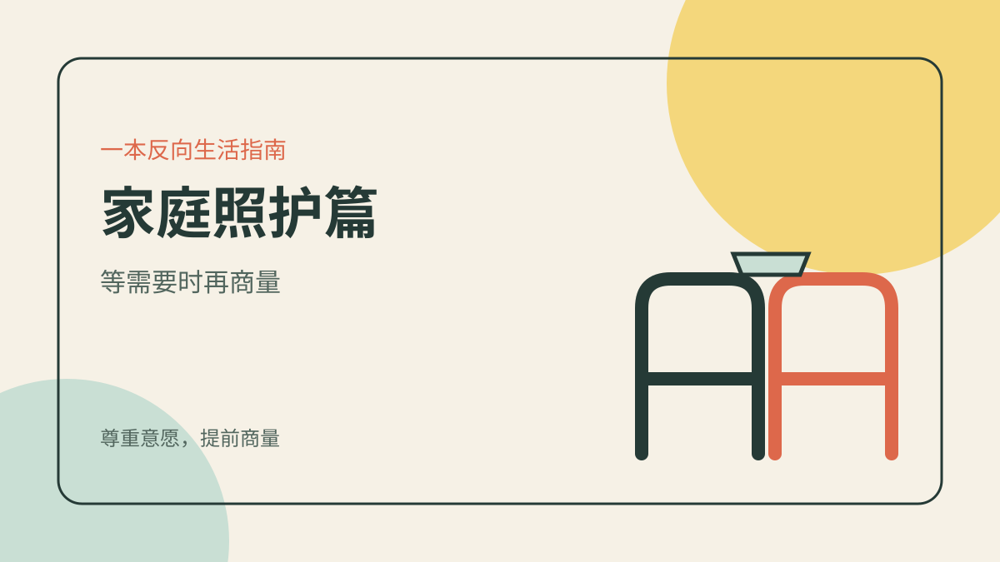

[← 回总目录](../README.md)

# 17. 如何让家庭照护临时拼凑

> 本章以反讽呈现照护和家庭安排中的疏漏。「反向做法」不是照护建议。家庭决策应尊重老人的意愿和自主权；医疗、财产及保障事项请结合具体情况向专业人员或当地部门核实。

### 1. 未来谁协助处理事务，等老人无法表达时再猜

- 反向做法：不谈意愿，也不讨论可能需要的支持。事情发生后，全家临时开会猜谁说了算。
- 隐藏成本：本人的偏好可能无法准确传达，亲友也可能产生分歧。
- 翻过来：在本人愿意且有能力表达时，讨论未来照护和事务安排；需要时向专业人士了解意定监护等制度和办理条件。

### 2. 财产安排只在饭桌上口头说一次

- 反向做法：遗嘱怎么写、财产范围和之前的安排互不核对，让家人以后各凭记忆作证。
- 隐藏成本：本人真实意愿可能难以确认，继承争议也可能增加。
- 翻过来：尊重本人意愿，了解合法遗嘱的形式和效力；涉及复杂财产或变更时咨询专业人士并妥善保管文件。

### 3. 钱交给谁、花在哪，全凭一句「放心」

- 反向做法：不问老人意见就把资金混在家人账户里，大额转账也不留记录。
- 隐藏成本：资金用途难以核对，老人自主支配和家庭信任都可能受影响。
- 翻过来：尊重老人的财产自主权；在本人同意下讨论账户管理、大额支出核对及记录方式，避免不必要的混同。

### 4. 面对推销，必须当场决定

- 反向做法：对方说名额马上没了，就不看合同立刻交钱；不好意思拒绝，也不能给自己留时间。
- 隐藏成本：紧迫感可能让人忽略费用、风险和对方身份。
- 翻过来：遇到不熟悉的推销可以先说「我再考虑一下」，通过独立渠道核实，必要时与可信的人商量。

### 5. 养老项目只看赠品，不看合同和资金去向

- 反向做法：免费旅游、保健品和床位承诺越多，预付款就交得越快。
- 隐藏成本：机构经营或承诺无法兑现时，预付款可能难以收回。
- 翻过来：核实机构资质、服务内容、收费和退款条件，对高额预付及承诺高收益保持警惕。

### 6. 听见「以房养老」，房子先抵押再说

- 反向做法：不弄清是保险、贷款还是投资，只听保证收益就签合同，把房产和借款都交给对方安排。
- 隐藏成本：房屋抵押和借款可能带来失去住房、负债或被骗的风险。
- 翻过来：核实产品性质、提供机构和合同条款，不因高收益承诺抵押房屋投资；复杂方案先咨询独立专业人士。

### 7. 需要长期照护时，所有费用都自己猜

- 反向做法：不问参保地是否有长期护理保险，也不查评估、申请条件和可用服务。
- 隐藏成本：符合条件的人可能错过照护服务或费用支持。
- 翻过来：向参保地医保部门了解长期护理保险的覆盖范围、失能评估和申请流程；适用对象不一定只限老年人。

### 8. 长期卧床时，等皮肤破了再关注

- 反向做法：一直保持同一姿势，不检查皮肤，也不咨询如何使用照护设备。
- 隐藏成本：长期受压可能造成皮肤和组织损伤，照护难度随之增加。
- 翻过来：请医护人员评估压疮风险，制定适合个人的减压、翻身和皮肤检查方案；发现皮肤异常及时咨询。

### 9. 看不清路，就让老人走慢一点

- 反向做法：视力下降已影响生活，仍认为只是年纪大了，不安排眼科检查。
- 隐藏成本：视力问题可能影响行动安全和生活质量，部分原因需要专业评估。
- 翻过来：视力变化影响生活时，尊重本人意愿并安排眼科检查；是否适合白内障手术由医生和本人共同讨论。

### 10. 遛狗时把牵引绳紧紧缠在手上

- 反向做法：狗一冲就靠缠绳硬拉，不管路面、狗的体型或牵引习惯。
- 隐藏成本：突然拉扯可能造成手部受伤或跌倒。
- 翻过来：选择合适牵引装备，避免把绳子缠在手上，训练狗平稳行走；根据个人体力和环境安排陪同。

### 11. 养老机构先交大额押金，协议以后再看

- 反向做法：只看宣传照片，不查备案、服务范围、费用和退出条件。
- 隐藏成本：照护质量、费用和退款安排不清楚时，发生争议更难处理。
- 翻过来：与老人一起考察机构，核实备案、服务、费用及预收费监管要求，签书面协议并保存付款记录。

### 12. 老人住院，照护假等出院再了解

- 反向做法：家人轮流请假，却不查所在地是否有护理假及其申请条件。
- 隐藏成本：可能错过可用的假期或因材料不全影响申请。
- 翻过来：向单位及当地相关部门了解适用的护理假规定、证明材料和申请方式。

### 13. 记忆问题影响生活，就直接断定「老了都这样」

- 反向做法：忘记关火、走失或日常事务频繁出错，也不检查听力、视力、药物和情绪。
- 隐藏成本：可能错过可处理的原因，也延误对照护和安全的安排。
- 翻过来：尊重老人感受，陪同到记忆门诊或神经内科等合适科室评估，并向医生说明症状、用药和生活变化。如果意识或记忆突然明显改变，应立即就医。
