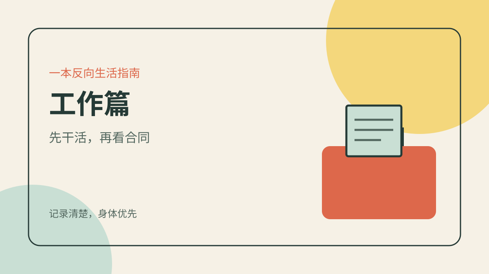

[← 回总目录](../README.md)

# 19. 如何让工作、离职和工伤都靠猜

> 本章以反讽描述职场中容易吃亏的做法，「反向做法」不是建议。劳动和工伤待遇取决于具体事实、所在地及现行规则；发生急症或受伤时先救治。

### 1. 加班时间只记在心里

- 反向做法：不保存考勤，也不看工资明细。
- 隐藏成本：工作时间和应付费用可能难以核对。
- 翻过来：合法保存考勤与工资记录，核实加班费规则和争议渠道。

### 2. 年假有没有休过，让公司替你记

- 反向做法：不查累计工作年限，也不确认未休假如何处理。
- 隐藏成本：假期和离职结算可能出现争议。
- 翻过来：核对休假记录及适用规则，离职时确认结算。

### 3. 试用期多久、工资多少，口头说了算

- 反向做法：合同期限和试用条件不看，也不问社保。
- 隐藏成本：实际安排可能与法律或约定不符。
- 翻过来：签前核对合同、试用期、工资和社保，保留文件。

### 4. 被裁时只问今天能不能走

- 反向做法：不核实解除原因、工作年限和补偿计算。
- 隐藏成本：应结算项目可能遗漏。
- 翻过来：核对解除文件、工资和年限，必要时咨询补偿标准。

### 5. 是否提前通知，反正不用记

- 反向做法：不保存通知，也不区分不同解除情形。
- 隐藏成本：可能无法判断是否存在额外通知或支付义务。
- 翻过来：保留通知并咨询具体情形的适用规则。

### 6. 解除是否合法，谁先开口谁说了算

- 反向做法：不查事实和程序，直接接受或声称固定赔偿金额。
- 隐藏成本：不同解除情况的责任和救济不同。
- 翻过来：保存材料，向专业人士咨询合法性、赔偿和期限。

### 7. 离职原因随便填，先签了再说

- 反向做法：明明不是个人原因，也为赶流程签下相反内容。
- 隐藏成本：可能影响事实认定和后续待遇。
- 翻过来：签前确认文件与事实一致，不明白时先咨询，并保留签署文件。

### 8. 离职前只带走办公桌上的杯子

- 反向做法：工资条、合同和社保记录不留，事后全靠回忆。
- 隐藏成本：劳动关系和待遇可能难以证明。
- 翻过来：依法保存自己的劳动关系材料，不擅自带走公司秘密或客户数据。

### 9. 职业危害等身体出问题再问

- 反向做法：不查岗位是否接触粉尘、噪声或化学品，也不问体检。
- 隐藏成本：可能忽略防护和健康监测。
- 翻过来：核实危害告知、职业健康检查及费用安排，保留相关材料。

### 10. 没有防护也要证明自己能扛

- 反向做法：不使用防护用品，在明显不安全的条件下继续作业。
- 隐藏成本：某些职业损伤可能长期影响健康。
- 翻过来：要求合适防护，了解拒绝危险作业和报告隐患的适用权利。

### 11. 工作受伤后，认定手续交给传言

- 反向做法：不就医、不记录，也不查单位是否申请工伤认定。
- 隐藏成本：伤情和申请期限可能被耽误。
- 翻过来：先救治并保存材料，工作中或上下班途中发生事故时，及时向社保部门核实认定条件和申请方式。

### 12. 突发不适先赶到工位再求救

- 反向做法：为了打卡拖延急救。
- 隐藏成本：危急病情可能因等待而恶化。
- 翻过来：突发严重不适立即呼叫急救，工伤问题之后依法处理。

### 13. 单位没交工伤保险，就当没有任何权利

- 反向做法：不咨询也不申请认定。
- 隐藏成本：可能错过依法主张待遇的机会。
- 翻过来：核实劳动关系和工伤认定程序，咨询单位及相关部门的责任。

### 14. 治疗还没稳定就猜伤残等级和金额

- 反向做法：不问鉴定类型和时机，直接按别人案例计算。
- 隐藏成本：个人伤情、程序和待遇可能不同。
- 翻过来：按规定在适当时机申请劳动能力鉴定，向有关部门核实待遇。

### 15. 工亡待遇只记一个总数

- 反向做法：不区分丧葬、供养亲属及其他待遇，也不查申请条件。
- 隐藏成本：家属可能漏办或误解待遇。
- 翻过来：向社保和相关部门逐项核实资格、材料及程序。

### 16. 职场长期欺负就默默忍受

- 反向做法：辱骂、威胁和刁难不记录，也不寻求支持。
- 隐藏成本：伤害可能持续，事后也更难说明。
- 翻过来：注意安全，合法保存记录，按情况向单位、有关部门或警方求助。

### 17. 离职证明以后再找也一样

- 反向做法：不确认证明内容和领取方式。
- 隐藏成本：后续就业及手续可能需要证明。
- 翻过来：向单位索取并核对离职证明，妥善保存。

### 18. 离职补偿到账后不看税务

- 反向做法：把所有款项都按同一种收入随意计算。
- 隐藏成本：实际适用的税务处理可能不同。
- 翻过来：保存结算明细，向税务机关或专业人士核实适用规则。

### 19. 换城市后社保和医保自动全接上

- 反向做法：不查新旧参保地的接续、转移和待遇。
- 隐藏成本：保障或申请可能出现空档。
- 翻过来：分别向社保、医保部门核实转移接续及缴费安排，不轻信付费代办。

### 20. 上班很久没合同，也不问书面文件

- 反向做法：只靠口头承诺，不保存入职及工资证据。
- 隐藏成本：合同内容和实际劳动关系可能发生争议。
- 翻过来：要求依法签订并领取合同，保留入职、考勤和工资记录，及时咨询权益。

### 21. 社保少交不交，离职时也不用说明

- 反向做法：不查缴费记录，不咨询补缴或解除的具体程序。
- 隐藏成本：可能影响保障和争议处理。
- 翻过来：核实缴费记录，向主管部门咨询补缴及相关维权程序。

### 22. 公司说要违约金，就不看合同直接付

- 反向做法：不区分培训服务期、竞业和其他约定，也不核算依据。
- 隐藏成本：可能支付没有依据或金额有争议的费用。
- 翻过来：保存协议并咨询具体条款的效力、条件和金额。

### 23. 不同意调岗降薪，但永远不表达

- 反向做法：不确认新安排，不保存沟通记录。
- 隐藏成本：双方对是否同意及何时变更可能产生争议。
- 翻过来：及时以书面等可留痕方式表达不同意，核实合同与争议处理程序。

### 24. 派遣工作出问题，两家公司谁都不用问

- 反向做法：不区分劳动合同方和实际用工方，也不查工资与责任。
- 隐藏成本：求助对象和证据可能不清楚。
- 翻过来：保存派遣合同及工作记录，向有关部门咨询同工同酬和损害责任。

### 25. 空白合同先签，内容以后随缘填

- 反向做法：不保留合同，也不记录签字时哪些地方空着。
- 隐藏成本：实际约定可能难以证明。
- 翻过来：签前核对完整内容并领取一份；已经签了空白文件，及时书面要求补全并保留沟通记录。
