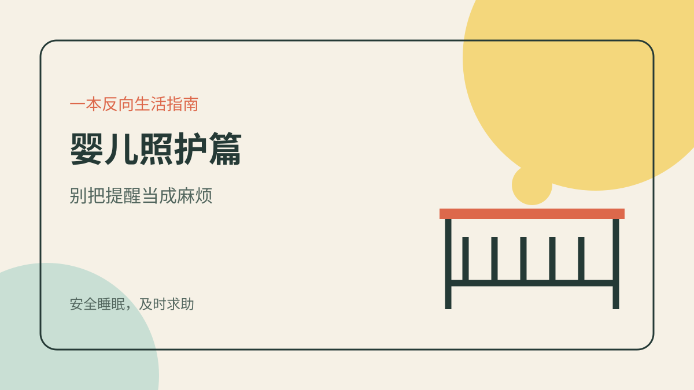

[← 回总目录](../README.md)

# 20. 如何让婴儿照护充满不必要的险情

> 本章以反讽描述照护误区，「反向做法」不能照做。婴儿情况各不相同，喂养、用药和检查请咨询儿科医生；遇到急症立即就医或呼叫急救。

### 1. 婴儿床越柔软、东西越多越安心

- 反向做法：让婴儿趴睡，身边堆满枕头、厚被和玩具。
- 隐藏成本：不安全的睡眠环境可能增加窒息等风险。
- 翻过来：让婴儿仰睡在平整、结实的独立睡眠空间，和照护者同房不同床，床上不放枕头、松软被褥和玩具。

### 2. 出生后的乙肝疫苗等有空再问

- 反向做法：不确认出生时接种情况，出院后也不联系接种门诊。
- 隐藏成本：延误接种可能错过及时保护，特殊情况还需要不同安排。
- 翻过来：出生后及时与医疗机构确认乙肝疫苗及其他必要预防措施；母亲乙肝感染等情况按医生安排处理。

### 3. 疫苗接种记录只靠记忆

- 反向做法：错过一次就认为整个程序作废，之后也不咨询。
- 隐藏成本：孩子可能未得到按计划提供的保护。
- 翻过来：保存接种记录，按当地免疫规划预约；错过时向接种门诊咨询补种方案。

### 4. 喂养只听亲友经验，不看孩子情况

- 反向做法：随意添加水、食物或更改喂养方式，不了解孩子年龄和身体状况。
- 隐藏成本：不适合年龄的喂养可能影响营养或安全，也可能给照护者带来压力。
- 翻过来：与儿科医生讨论适龄喂养；母乳喂养有困难时寻求支持，并按专业建议安全使用适合的配方奶。

### 5. 冲奶粉不看卫生和说明

- 反向做法：瓶具不清洁，水温凭感觉，喝剩的奶反复留到下一顿。
- 隐藏成本：冲调和储存不当可能增加污染和烫伤风险，年幼或高风险婴儿更需谨慎。
- 翻过来：按医生及可靠公共卫生指引和产品说明准备、冷却和储存配方奶；注意卫生与温度，及时处理剩奶。

### 6. 蜂蜜是天然的，婴儿越早吃越好

- 反向做法：给不满一岁的婴儿尝蜂蜜或含蜂蜜的食物。
- 隐藏成本：蜂蜜可能含对婴儿危险的肉毒杆菌孢子。
- 翻过来：不满一岁的婴儿不要喂蜂蜜或含蜂蜜的食物。

### 7. 出生后的维生素 K 只是一项可有可无的手续

- 反向做法：不了解用途和风险，就自行跳过新生儿预防措施。
- 隐藏成本：婴儿维生素 K 缺乏可能导致严重出血。
- 翻过来：与新生儿医疗团队确认维生素 K 的预防安排及孩子的具体情况。

### 8. 小月龄婴儿发热，先在家观察几天

- 反向做法：不测体温、不问月龄，先按成人经验自行用药。
- 隐藏成本：小月龄婴儿发热可能是严重疾病信号，延误评估有风险。
- 翻过来：不满三个月的婴儿体温达到 38 ℃ 或以上时，应立即就医；精神差、呼吸异常等情况也应紧急求助。

### 9. 孩子哭闹时，用摇晃表达着急

- 反向做法：照护者极度疲惫时仍强行抱着孩子，并用力摇晃。
- 隐藏成本：猛烈摇晃可能造成严重脑损伤甚至死亡。
- 翻过来：绝不要猛烈摇晃婴儿；快失控时把孩子平放在安全的婴儿床里，暂时离开并请可信的人帮助。

### 10. 尿布只买最贵的，使用方法不用管

- 反向做法：只比较品牌，不看是否合身、是否及时更换和皮肤状况。
- 隐藏成本：不合身或更换不及时可能让皮肤受刺激。
- 翻过来：选择合身的产品，及时更换并观察皮肤，留意产品安全信息；皮疹持续或严重时咨询医生。

### 11. 婴儿用品一次买齐，安全性以后再看

- 反向做法：不看是否需要、是否适合孩子，也不核实二手床垫和安全座椅的状况。
- 隐藏成本：闲置物品占钱占空间，不安全的二手用品还可能带来伤害。
- 翻过来：按需求逐步准备；特别核对婴儿睡眠用品和安全座椅的适用性、使用历史及安全要求。

### 12. 担心食物过敏，就永远不和医生讨论辅食

- 反向做法：孩子有严重湿疹或已知过敏，却自己猜测何时、如何引入可能致敏的食物。
- 隐藏成本：不同孩子需要不同评估；整粒坚果也有噎住风险。
- 翻过来：向儿科或过敏专科咨询适龄辅食及花生等食物的引入方式；不要给婴幼儿整粒坚果。

### 13. 新生儿越来越黄，也等下次体检再说

- 反向做法：孩子出生后很快发黄、叫不醒或吃奶差，仍只靠晒太阳等待。
- 隐藏成本：严重黄疸或其他疾病可能需要紧急检查和治疗。
- 翻过来：出生后 24 小时内发黄、难以唤醒或吃奶明显差时立即急诊；黄疸加重或大便颜色发白也应尽快就医。

### 14. 素食喂养只看成人菜单，不看营养

- 反向做法：孕期、哺乳期和婴儿辅食都不评估维生素 B12 等营养需求。
- 隐藏成本：营养不足可能影响孕产妇和孩子的健康与发育。
- 翻过来：素食家庭与医生或营养专业人员讨论 B12、铁等营养来源及补充；计划给孩子全素喂养时尤其需要专业指导。

### 15. 带轮子的学步车越快越能学走路

- 反向做法：让孩子在带轮子的学步车里自由移动，认为大人不必看护。
- 隐藏成本：孩子可能快速接近台阶、热源等危险，也可能发生跌落。
- 翻过来：避免使用带轮子的学步车，提供安全的地面活动空间，并由成人看护。

### 16. 维生素 D 和钙都凭广告随意补

- 反向做法：不看年龄和喂养情况，补充剂叠着吃，或者完全不与医生讨论。
- 隐藏成本：营养不足或过量都可能带来问题。
- 翻过来：与儿科医生确认适合孩子的维生素 D 补充和其他营养安排，不自行叠加多种补充剂。

### 17. 洗澡水看起来不冒烟就让孩子进去

- 反向做法：直接放热水，把孩子放进去后再试温度。
- 隐藏成本：婴儿皮肤娇嫩，热水可能迅速造成烫伤。
- 翻过来：先放冷水再兑热水，充分混匀并确认水温合适后再抱孩子入浴；全程看护并远离热水龙头。
