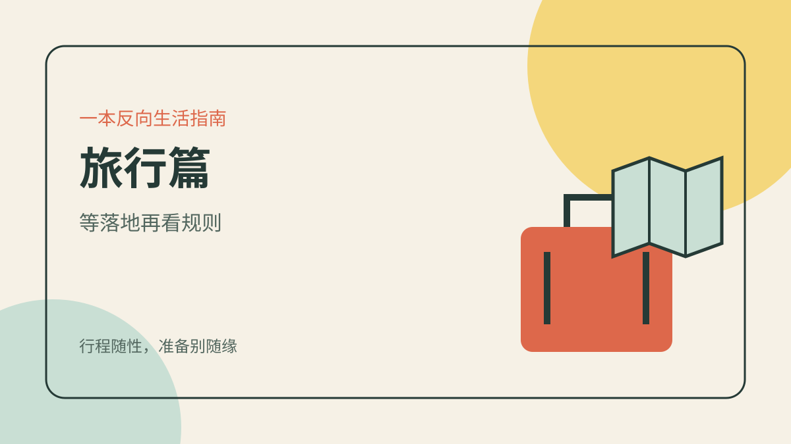

[← 回总目录](../README.md)

# 21. 如何给境外旅行制造额外任务

> 本章以反讽描述旅行准备中的疏漏，「反向做法」不是行动建议。入境、海关、驾驶和领事政策会变化，请在出发前核实目的地及有关主管机关的最新要求。

### 1. 只看机票价格，不看目的地安全提醒

- 反向做法：目的地有局势风险也不查，先买不可退机票；新闻等落地后再补。
- 隐藏成本：安全状况变化可能影响人身安全、行程和保险保障。
- 翻过来：出发前查看外交部门和使领馆的最新安全提醒；对标有「暂勿前往」的地区，暂不前往并调整计划。

### 2. 求助电话等出事了再搜

- 反向做法：只收藏餐厅和景点，不保存当地紧急电话和领事保护联系方式。
- 隐藏成本：手机没网、丢失或情绪紧张时，寻找可靠联系方式更困难。
- 翻过来：提前保存当地紧急电话、中国领事保护服务热线（境外拨打 +86-10-12308 或 +86-10-65612308）和相关使领馆联系方式，另留一份离线记录。

### 3. 认为领事保护能解决所有问题

- 反向做法：不看当地法律，也不准备应急资金，坚信使领馆能代付全部费用或改变当地司法程序。
- 隐藏成本：对领事服务能力期待过高，可能延误寻求当地医疗、警方或律师帮助。
- 翻过来：了解领事保护可提供的协助及其边界；发生紧急情况时联系当地救援和使领馆，并准备支付相关费用。

### 4. 旅行保险只保航班，不看医疗

- 反向做法：只比较保费，不管目的地、医疗保障、医疗转运、免赔和除外责任。
- 隐藏成本：发生疾病、受伤或需要转运时，保障可能不足。
- 翻过来：结合目的地、活动和身体情况比较境外医疗与医疗转运保障，认真阅读限额和除外责任。

### 5. 境外高薪招聘，越着急越可信

- 反向做法：对方承诺高薪、要求迅速出境并代管证件时，不核实公司和工作内容就答应。
- 隐藏成本：虚假招聘可能涉及诈骗、非法拘禁或强迫参与违法活动。
- 翻过来：通过独立渠道核实雇主、工作和签证；不要把证件交给不可信的人，遭遇胁迫或限制自由时尽快向当地警方和使领馆求助。

### 6. 出入境带多少钱，到了海关再猜

- 反向做法：不查现金携带、申报和境外取现规则，认为多张卡的额度自然互不相关。
- 隐藏成本：超过适用限额或未按要求申报可能产生处罚、延误或资金使用问题。
- 翻过来：出发前向银行、外汇和海关等官方渠道核实取现、携带现金及申报规则，并结合同行人的实际情况准备。

### 7. 所有证件只带一份原件，丢了再想办法

- 反向做法：护照、签证和身份证不留任何记录，也不知道丢失后联系谁。
- 隐藏成本：证件遗失后确认身份和补办可能更费时；照片泄露也有隐私风险。
- 翻过来：妥善保管证件并安全备份必要信息；遗失时按当地要求报失，并联系使领馆了解补办旅行证件的流程。

### 8. 境外自驾，网上写「国际驾照」就当能用

- 反向做法：不查目的地、驾照来源和租车保险，先买一张看起来很国际化的证件。
- 隐藏成本：证件可能不被当地认可，发生事故时还可能影响保险和法律责任。
- 翻过来：向目的地主管机关和租车公司核实驾驶资格、翻译件及保险要求，不轻信所谓万能证件。

### 9. 签证中介只看广告，不查身份

- 反向做法：对方保证「一定成功」，就直接交证件和大额费用，合同是否清楚无所谓。
- 隐藏成本：服务范围、退款条件和资质不明，可能遭遇诈骗或材料被不当使用。
- 翻过来：核实机构资质、合同和收费，查看是否需要办理相关备案；签证要求以官方信息为准。

### 10. 陌生人借你的名字办手续，先答应再说

- 反向做法：邀请函、担保或身份材料谁要都给，对方去哪里、做什么都不问。
- 隐藏成本：不实材料和冒用身份可能使你卷入纠纷或承担法律后果。
- 翻过来：不提供虚假邀请、担保或身份材料，也不替陌生人出具邀请或担保；保护个人证件和签名。

### 11. 出门后谁也别告诉，失联也保持神秘

- 反向做法：行程、住宿和同行人全部保密，改变计划也不联系任何人。
- 隐藏成本：发生意外或失联时，亲友可能不知道从哪里开始寻找。
- 翻过来：把主要行程、住宿及同行信息告诉可信的人，约定适合双方的联系频率；计划变化时及时更新。

### 12. 常用药到了境外一定也能随便带

- 反向做法：不看目的地规定，把散装药片塞满行李；处方和原包装都觉得太占地方。
- 隐藏成本：某些成分在目的地可能受限制，缺少证明也可能影响入境或后续用药。
- 翻过来：提前查目的地对药品成分、数量和证明文件的规定，必要时携带原包装、处方或医生证明，并咨询医生安排用药。

### 13. 回国带食品，觉得真空包装就不用管

- 反向做法：肉干、奶制品、水果和种子只要包装漂亮就装箱，海关申报等工作人员猜。
- 隐藏成本：部分动植物及其产品受入境限制，违规携带或不申报可能带来处罚和检疫风险。
- 翻过来：出发前查询中国海关最新禁止、限制携带及申报要求；拿不准时如实申报并接受检查。
