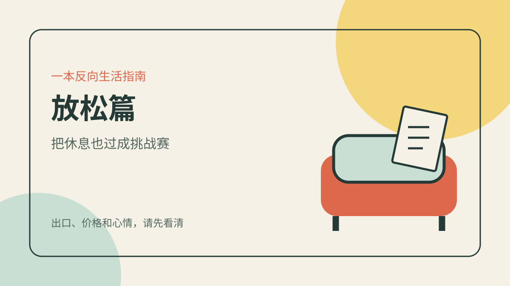

[← 回总目录](../README.md)

# 22. 如何把放松变成另一场冒险

> 本章通过反讽描写娱乐和减压中的误区。「反向做法」不是行动建议；「翻过来」提供参考。心理困扰的成因和程度各不相同，运动、呼吸或爱好不能替代必要的专业治疗。

### 1. 进娱乐场所，出口留到需要时再找

- 反向做法：进门只看灯光和音响，安全出口被挡住也不影响兴致。
- 隐藏成本：发生火灾或其他紧急情况时，陌生环境会增加寻找出口的困难。
- 翻过来：进入酒吧、KTV 或密室等场所后，先看看出口和疏散通道；出口被锁或堵住时选择离开。

### 2. 娱乐消费先开始，价格结束后再猜

- 反向做法：不看价目表，不问包厢费和服务费，坚信账单一定会给你惊喜。
- 隐藏成本：收费方式不清楚，结账时更容易发生争议。
- 翻过来：消费前确认价格、计费方式和额外费用，保存菜单、订单及付款记录。

### 3. 有人递来来历不明的东西，就当是热情

- 反向做法：不问是什么，也不管对方让你保管或转交什么，先替朋友答应。
- 隐藏成本：不明物品可能涉及人身安全和法律风险，替人保管或转交也可能带来严重后果。
- 翻过来：拒绝接触和代为保管不明物品，尽快离开有风险的场所；遇到紧急危险时报警求助。

### 4. 饮料离开视线后，继续喝以免浪费

- 反向做法：陌生人给的糖、饮料或烟弹都收下，杯子在外面放多久都不管。
- 隐藏成本：你无法确认这些东西的来源或在离开视线期间发生了什么。
- 翻过来：不要接受来历不明的食物、饮料或烟弹；饮料离开视线且不放心时换一杯，并和可信的人结伴。

### 5. 选密室只看恐怖程度，不看场地

- 反向做法：居民楼改造的复杂迷宫、深地下的封闭空间，都先买票再考虑怎么出来。
- 隐藏成本：不合适的场地和不畅通的出口会增加紧急疏散的困难。
- 翻过来：选择合规经营、出口清楚且通道畅通的场所；对居民楼内或深地下场所有疑问时先核实当地规定和安全条件。

### 6. 心情低落时，给自己定一个极限运动目标

- 反向做法：既然听说运动对情绪有帮助，就无视身体条件，要求自己每天拼到筋疲力尽；做不到就继续自责。
- 隐藏成本：过高的门槛可能增加挫败和受伤风险，还可能耽误对持续情绪困扰的评估。
- 翻过来：从身体允许、自己愿意做的活动开始；情绪低落持续或影响生活时，主动寻求专业支持，运动可以作为辅助。

### 7. 焦虑时只准选择一种办法

- 反向做法：别人说正念有效，就自行停掉原有治疗；如果练习后仍不舒服，认定自己没救。
- 隐藏成本：不同人的需要不同，自行停药或中断治疗可能带来风险。
- 翻过来：正念等练习可以作为部分人的支持方式；焦虑影响生活时，和专业人员讨论适合自己的治疗和调整，不自行停药。

### 8. 呼吸练习必须一次见效，否则就是失败

- 反向做法：给自己掐秒表，越练越紧张也坚持到底，直到证明自己不会放松。
- 隐藏成本：把缓解不适变成考核，反而可能让注意力更集中在紧张上。
- 翻过来：可以尝试舒适、缓慢的呼吸，适当延长呼气；感到头晕或更不舒服就停止。持续或严重的身体症状需要就医评估。

### 9. 一个人扛到撑不住，才允许联系朋友

- 反向做法：平时觉得见面太麻烦，难受时又怕打扰别人，于是继续等对方猜到。
- 隐藏成本：长期缺少支持时，遇到困难可能更孤立；关系也需要日常维护。
- 翻过来：按自己的意愿和能力与可信的人保持联系，不必把每次见面都变成倾诉或任务。

### 10. 看见公园，就认为健康已经自动到账

- 反向做法：选住处只问离公园几米，然后忽略交通、空气、住房条件和个人需要。
- 隐藏成本：周边环境只是居住选择的一部分；绿地附近居住和健康之间的关系不能简单视为因果。
- 翻过来：根据喜好把可达的绿地、交通、预算和其他生活条件一起考虑；喜欢户外时，可以选择方便安全的地方活动。

### 11. 酒后泡热水，给身体增加一点难度

- 反向做法：喝多后马上泡温泉、蒸桑拿或独自洗热水澡，用高温庆祝今天的放松。
- 隐藏成本：酒精和高温都可能影响判断和身体状态，独处时发生意外也更难获得帮助。
- 翻过来：饮酒后避免泡温泉、蒸桑拿和泡热水澡；出现意识异常或其他严重不适时及时求助。

### 12. 头盔会影响发型，所以运动时不用戴

- 反向做法：滑雪、轮滑或骑山地车时，把护具留在家里，认为自己技术好就不会摔倒。
- 隐藏成本：跌倒或碰撞可能发生在不同水平的参与者身上。
- 翻过来：选择适合项目、尺寸合适的头盔和必要护具，并按场地条件和自身能力活动。

### 13. 到了五十岁，爱好只准有治疗作用

- 反向做法：不问自己是否喜欢，只选据说最能预防疾病的爱好；心情持续低落也只靠它硬撑。
- 隐藏成本：没有兴趣的安排难以持续，爱好也不能替代需要的诊疗。
- 翻过来：不论年龄，都可以尝试喜欢且负担得起的爱好；出现持续情绪困扰时，另行寻求适当支持或治疗。
