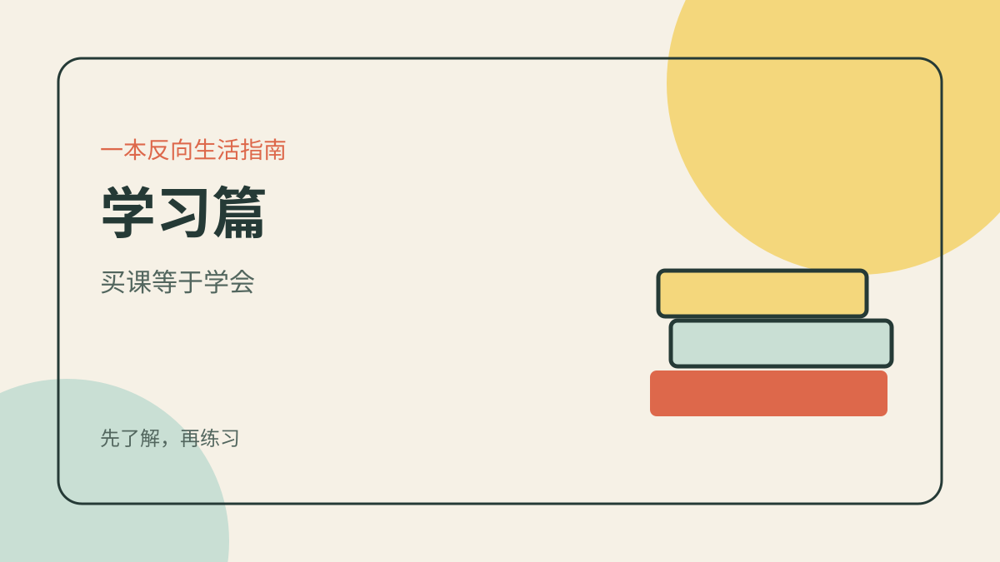

[← 回总目录](../README.md)

# 23. 如何把学习变成一场昂贵的收藏

> 本章讽刺忽略条件、成本和练习的做法，不评价学历或职业选择。「反向做法」不是建议。招生、就业、职业资格和职称要求可能变化，请以最新官方信息及个人情况为准。

### 1. 未成年人的工作条件不用查

- 反向做法：招聘方说能上班，就不问年龄、工作性质和法律要求。
- 隐藏成本：未成年人可能遭遇违法用工和安全风险。
- 翻过来：核实法定就业年龄及未成年劳动保护；遇到涉嫌违法用工向有关部门求助。

### 2. 评价教育只看眼前收入

- 反向做法：不考虑学习对机会、健康和生活的潜在影响，就断定结果已经写死。
- 隐藏成本：个人和群体的教育收益不同，也可能受到其他因素影响。
- 翻过来：结合兴趣、资源和目标，多方面理解教育的可能价值与成本。

### 3. 学历是否普遍，全靠朋友圈判断

- 反向做法：身边几个人读过大学，就认为全国情况完全一样。
- 隐藏成本：样本范围太小，容易误判教育结构。
- 翻过来：查看可靠统计的年份、范围和定义，再结合个人目标判断。

### 4. 学费困难时，先认定没有任何支持

- 反向做法：不查助学金、减免和贷款条件，就放弃比较教育选择。
- 隐藏成本：可能错过符合条件的支持，也可能因不了解贷款成本而仓促借款。
- 翻过来：向学校和主管部门核实资助、贷款、申请期限及还款责任。

### 5. 一次考试结果决定以后所有道路

- 反向做法：没有进入预期学校，就认为职业教育、继续升学和其他路径全部关闭。
- 隐藏成本：可能忽略仍然存在的选择和门槛。
- 翻过来：了解当地职业教育、升学及就业路径，按兴趣和条件比较。

### 6. 读书还是工作，只算第一个月

- 反向做法：只看当前工资或学费，不看长期机会、生活成本和不确定性。
- 隐藏成本：不同选择的收入时间和代价不同。
- 翻过来：比较学习成本、可能放弃的收入、就业机会及个人偏好，不把估计当保证。

### 7. 平均教育回报，就是每个人的工资承诺

- 反向做法：拿一项平均数字推算自己的确定收入。
- 隐藏成本：地区、专业、机会和个人处境会影响实际结果。
- 翻过来：理解研究的范围和限制，把平均值作为背景而不是保证。

### 8. 证书越多越好，是否认可不重要

- 反向做法：不查颁发机构、用途和考试条件，先交钱拿证。
- 隐藏成本：证书可能不被目标岗位认可。
- 翻过来：通过官方职业资格目录或主管部门渠道核实证书和评价机构。

### 9. 培训只考虑最贵的商业班

- 反向做法：不查免费资源和当地补贴，听到限时折扣就报名。
- 隐藏成本：可能承担不必要的费用或贷款。
- 翻过来：先比较正规课程、补贴条件、费用和实际教学内容。

### 10. 选技能只看现在最火的标题

- 反向做法：不看岗位任务、现场工作和变化风险，就跟着热搜投入。
- 隐藏成本：热点不一定对应当地岗位或个人兴趣。
- 翻过来：了解实际工作内容、现场判断需求、技术变化和自己的适应程度。

### 11. 技能等级和工作回报不用核实

- 反向做法：培训机构说升一级就涨薪，就直接相信。
- 隐藏成本：评价等级与岗位、待遇的关系因单位和行业而异。
- 翻过来：向用人单位及评价机构核实资格、晋级和可能的待遇。

### 12. 短视频说高薪，就是当地缺工

- 反向做法：不查招聘要求、工作强度和所在城市需求，马上转行。
- 隐藏成本：宣传收入未必代表多数岗位。
- 翻过来：查看当地岗位、缺工信息和培训补贴，访谈实际从业者。

### 13. 课程越长越贵，就越容易上岗

- 反向做法：不问目标岗位需要什么，只比较学习时长和包装。
- 隐藏成本：时间和费用可能与实际能力需求不匹配。
- 翻过来：围绕目标比较课程内容、实践机会和可承担的投入；同等条件下可关注周期较短、能直接应用于岗位的项目。

### 14. 读过一遍，就证明自己会了

- 反向做法：书一合上就结束，不尝试回忆或应用。
- 隐藏成本：熟悉文字不一定代表能独立使用。
- 翻过来：学习后尝试自己回忆、解题或实践，再检查不足。

### 15. 所有内容必须一晚学完

- 反向做法：把复习集中到最后一夜，之后再也不碰。
- 隐藏成本：疲劳和遗忘可能影响学习效果。
- 翻过来：把学习和复习分散到可持续的时间里。

### 16. 划线越多，理解越深

- 反向做法：整页画满颜色，反复阅读却不检查能否解释。
- 隐藏成本：投入看得见，掌握程度却不一定提高。
- 翻过来：把标注作为辅助，配合回忆、练习和反馈。

### 17. 一种题连续做熟，就不用换题型

- 反向做法：只练相同套路，遇到混合问题再重新适应。
- 隐藏成本：可能难以判断何时使用哪种方法。
- 翻过来：在掌握基础后适当混合题型，检查方法选择。

### 18. 自称视觉型，就拒绝其他学习方式

- 反向做法：不看内容和效果，只按固定标签挑材料。
- 隐藏成本：可能错过更适合任务的文字、听讲或实践方式。
- 翻过来：按学习任务选择方式，并用练习结果调整。

### 19. 背诵只要原句一字不差

- 反向做法：背得滚瓜烂熟，却不尝试将知识用于将来的问题。
- 隐藏成本：熟记不一定能迁移到实际场景。
- 翻过来：根据实际用途提问、练习解释或操作，再复习遗漏。

### 20. 评职称先交材料，系列和级别以后查

- 反向做法：不核实本人岗位、单位性质和申报渠道。
- 隐藏成本：可能准备错误材料或不符合申报条件。
- 翻过来：查明适用系列、级别、条件和单位申报渠道。

### 21. 职称考试只看报名广告

- 反向做法：不查学历、工作年限和官方报名信息。
- 隐藏成本：资格或考试类型可能与宣传不同。
- 翻过来：核对官方公告、报名条件和考试安排。

### 22. 代评和造假比准备材料省事

- 反向做法：购买代写论文、虚构经历或相信「包评过」。
- 隐藏成本：可能被骗，造假还可能导致资格撤销和其他责任。
- 翻过来：如实提交材料，通过正规渠道申报。

### 23. 职称证书到手，工资一定自动上涨

- 反向做法：不问岗位、聘任规则和单位待遇，就按最高宣传计算收入。
- 隐藏成本：取得资格和获得聘任、待遇可能是不同环节。
- 翻过来：向单位核实岗位、聘任及薪酬政策。

### 24. 读硕士只比较头衔，不算时间和费用

- 反向做法：不问专业、学习形式、学费和机会成本，就用别人经历替自己决定。
- 隐藏成本：投入和就业收益因项目与个人目标不同。
- 翻过来：比较全日制与非全日制项目的招生、学习安排、费用和适用要求。

### 25. 读博士只因为暂时不知道下一步

- 反向做法：不了解研究内容、指导方式、经济和心理负担，认为博士一定适合所有人。
- 隐藏成本：长期投入与个人目标可能不匹配。
- 翻过来：了解目标岗位、研究兴趣、项目条件和支持系统，再决定是否申请。
