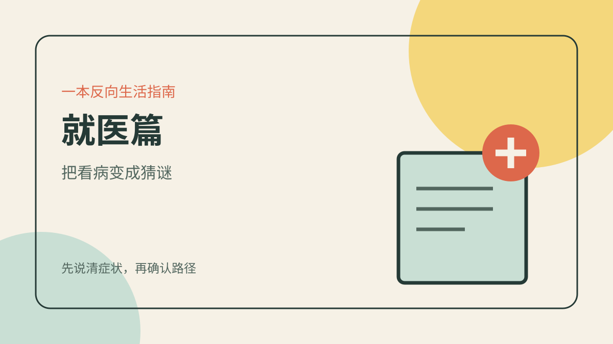

[← 回总目录](../README.md)

# 24. 如何让看病多绕几圈

> 本章用反讽描述就医与办事中的疏漏。「反向做法」不是诊疗建议。病情、医疗资源和医保规定因人因地而异；遇到急重症，应及时呼叫急救或前往急诊。

### 1. 所有不适都先排最长的队

- 反向做法：无论病情轻重，先找最远、最难挂号的医院；社区能否处理和转诊途径以后再说。
- 隐藏成本：可能增加等待和往返时间，也可能错过更合适的就诊渠道。
- 翻过来：非急症可结合病情、基层服务能力和转诊规则选择就诊机构；急重症优先急救和急诊。

### 2. 医保待遇只凭别人上次的经验猜

- 反向做法：不问参保地、机构级别和项目是否纳入医保，等结账后才开始了解。
- 隐藏成本：待遇因地区、险种、机构和项目而异，预期与实际费用可能不同。
- 翻过来：就医前向医保部门或医疗机构核实自己的待遇、起付线及报销范围；不要因为费用疑问耽误急救。

### 3. 挂不上号就相信任何「内部渠道」

- 反向做法：不查医院预约规则，直接向陌生人转账购买所谓内部号源。
- 隐藏成本：可能被骗、买到无效号源，还会增加就医成本。
- 翻过来：通过医院或官方预约渠道挂号，必要时了解基层转诊和医院转诊服务。

### 4. 异地就医先出发，结算规则以后研究

- 反向做法：跨省看病不查备案、转诊和定点机构要求，认为所有费用都能按同一方式结算。
- 隐藏成本：不同情况可能影响直接结算和报销待遇。
- 翻过来：非急症异地就医前向参保地医保部门核实备案、转诊和结算条件；急诊先救治，再按规定补办手续。

### 5. 检查结果只让它存在医院系统里

- 反向做法：病历、影像和报告看完就丢，下次换医生时全靠记忆复述。
- 隐藏成本：资料不完整可能增加沟通和重复检查的困难。
- 翻过来：妥善保存病历、检查报告和影像资料，复诊或转诊时按需要提供，并注意隐私保护。

### 6. 对诊疗过程有疑问，只在社交平台争论

- 反向做法：不向医院询问，不保存记录，也不知道病历可以通过什么程序复制或封存。
- 隐藏成本：事实和证据可能难以整理，处理争议的时间也可能被拖长。
- 翻过来：及时向医院了解病历复制、封存和争议处理程序，保留相关材料；必要时咨询专业人士。

### 7. 急重症先排普通挂号队

- 反向做法：严重胸痛、呼吸困难或其他危急情况出现时，先研究哪个普通门诊号便宜。
- 隐藏成本：急症救治可能被延误。
- 翻过来：遇到急重症立即呼叫当地急救电话或前往急诊，并向预检分诊人员说明情况。

### 8. 证件或钱没带齐，就先放弃急救

- 反向做法：陪同者先找钱包和身份证，等材料齐全再请求救治。
- 隐藏成本：危急情况下等待可能耽误救治。
- 翻过来：遇到急危重症先呼叫急救或向急诊求助，说明病情；没有家属、证件或无法说清身份时也不要等待，立即寻求救治；身份和费用手续由医院按实际情况处理。

### 9. 一受伤就立即找机构做最终伤残鉴定

- 反向做法：伤情还在变化，也不问鉴定类型和适用程序，先支付费用。
- 隐藏成本：时机或程序不合适可能导致无法评定或需要重新办理。
- 翻过来：根据事故和用途向相关机构咨询鉴定类型、治疗稳定条件、材料及申请时间；工伤等情形可能有不同程序。

### 10. 治疗后生活受影响，也不问有哪些支持

- 反向做法：出现持续功能障碍后，不了解康复、辅助器具和残疾人证等可能的服务。
- 隐藏成本：符合条件的人可能错过适合自己的支持。
- 翻过来：根据实际情况向医疗机构和当地残联了解康复、评估、办证及相关服务的条件和流程。

### 11. 感谢医生只能靠塞红包

- 反向做法：不管医院规定，也不考虑医患双方的处境，认为不送财物就表达不了谢意。
- 隐藏成本：赠送财物可能违反医疗机构规定并给双方带来困扰。
- 翻过来：可以用感谢信、锦旗或反馈等合适方式表达谢意，遵守机构规定。

### 12. 种牙只看广告里的最低价

- 反向做法：不问检查、材料、手术和后续费用是否包含，也不核实医生和机构。
- 隐藏成本：实际总价和治疗方案可能与广告印象不同。
- 翻过来：面诊后了解可选方案、完整费用、复诊和质保安排，核实机构资质及当地价格政策。

### 13. 医院暂时没有药，就自行更换治疗方案

- 反向做法：不问医生，也不核实医保药店，随便找替代药或在不明渠道购买。
- 隐藏成本：自行换药可能影响治疗；药品来源和报销条件也可能不清楚。
- 翻过来：与医生讨论处方和替代方案，向医保部门或医院核实符合条件的「双通道」定点药店及结算方式。

### 14. 第一次看病，也照搬别人的线上处方

- 反向做法：症状相似就使用他人的处方；原本需要面诊的检查也直接跳过。
- 隐藏成本：相似症状可能有不同原因，不适当用药可能造成伤害。
- 翻过来：按医生判断选择面诊或符合规定的线上复诊；慢病续方时提供准确病史、用药和近期情况。

### 15. 住院账单只看总数，不看项目

- 反向做法：不问自费项目、费用明细和授权流程，发现疑问后也不保存清单。
- 隐藏成本：收费差异和报销范围不清时，核实问题更困难。
- 翻过来：询问费用明细及医保、自费项目，保存票据；有疑问先向医院核实，仍有争议可向医保等主管部门反映。
