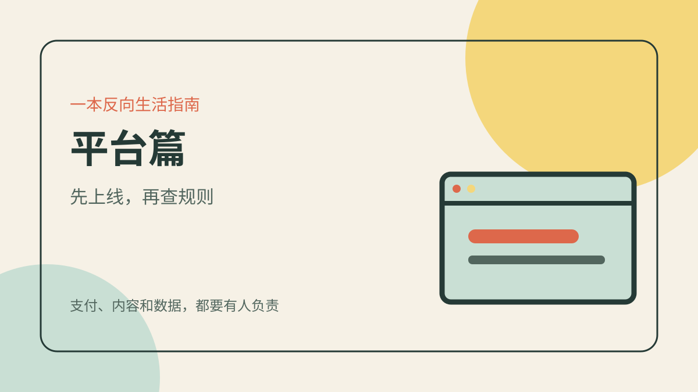

[← 回总目录](../README.md)

# 26. 如何让一个平台带来更多意外

> 本章是反讽作品。「反向做法」不是经营建议。网站、平台、应用及直播业务的要求因业务模式、所在地和时间不同而变化；上线前应向主管机关及专业人士核实。

### 1. 平台先把所有人的钱收进自己的账户

- 反向做法：买家付款、商家结算全由平台私人账户中转，资金归属和退款机制以后再想。
- 隐藏成本：资金混同、结算和支付合规问题可能让纠纷迅速扩大。
- 翻过来：先梳理交易和资金流，向持牌支付机构及专业人士确认可用的合规结算方案。

### 2. 网站一律先上线，许可证等被问起再查

- 反向做法：不区分自营销售、撮合交易和其他收费服务，认为有服务器就等于具备经营资格。
- 隐藏成本：不同服务可能涉及不同备案、许可或其他要求，误判业务模式会带来整改风险。
- 翻过来：列清服务内容、收费方式和参与方，向主管机关核实适用的备案与许可要求。

### 3. 直播和视听业务只考虑设备清晰度

- 反向做法：摄像头买最好的，至于节目类型、经营资格和内容管理，一概交给开播后的自己。
- 隐藏成本：不同直播或视听服务的准入要求不同，投入后才发现限制可能造成损失。
- 翻过来：上线前确认业务分类、许可条件和内容管理要求，不假设一种许可证适用于所有场景。

### 4. 服务器一开，网站和应用自动完成备案

- 反向做法：不管服务器所在地、网站、App 或小程序，只要服务商让付款就直接发布。
- 隐藏成本：相关备案或接入要求未核实时，服务可能受影响。
- 翻过来：根据部署地点和产品类型核实网站、App 或小程序的适用备案及接入服务要求。

### 5. 商家随便入驻，出了问题再找人

- 反向做法：不核实身份、联系方式和经营信息，交易记录也不留；投诉来了再请用户自己找卖家。
- 隐藏成本：商家无法追溯时，消费者纠纷和平台责任可能更难处理。
- 翻过来：按适用规定核验入驻经营者信息，建立更新、报送和留存机制，明确消费者投诉渠道。

### 6. 用户内容全交给运气管理

- 反向做法：没有审核流程，没有举报入口；发现违法内容也等它自己沉下去。
- 隐藏成本：有害或侵权内容可能持续传播，用户和平台都可能受到影响。
- 翻过来：按业务需求和法律要求建立内容管理和举报受理流程；发现违法内容时，依法及时停止传输、保存记录并按要求报告。

### 7. 用户身份信息想收多少就收多少

- 反向做法：需要核验的服务完全不核验，不需要的信息却一次收齐，以备将来想起用途。
- 隐藏成本：既可能遗漏适用的身份核验义务，也可能造成过度收集和泄露风险。
- 翻过来：核实具体服务的身份核验要求，只在合法、必要的范围内处理信息，并做好安全保护。

### 8. 未成年人直播和打赏，先收钱再研究规则

- 反向做法：不识别适用年龄限制，也不准备监护、退款和争议处理流程。
- 隐藏成本：未成年人权益可能受损，平台也可能面临退款和监管问题。
- 翻过来：依据最新规定核实年龄、直播与打赏限制，设置适合未成年人的保护和申诉机制。

### 9. 侵权通知来了，先放进无人查看的邮箱

- 反向做法：投诉不登记，相关内容不核实，反通知也不转送，直到各方自己找到负责人。
- 隐藏成本：权利人和发布者都难以获得及时处理，争议可能扩大。
- 翻过来：提供可用的投诉渠道，记录并依法处理通知、声明及后续措施；期限和恢复条件按适用规定核实。

### 10. 用户数据传到哪里，反正用户看不见

- 反向做法：不用确认数据类型和接收方，就把全部个人信息同步到境外服务。
- 隐藏成本：数据出境可能涉及不同条件、评估和告知要求，误操作也会增加泄露风险。
- 翻过来：先盘点数据和跨境流向，按适用规定评估合法基础及所需程序，限制不必要的数据传输。

### 11. 服务器只比较最低报价

- 反向做法：不考虑备份、恢复、可用性和谁负责维护；停机时再决定业务能不能停。
- 隐藏成本：看似便宜的方案可能在故障和恢复时产生更大的损失。
- 翻过来：结合业务可承受的停机时间、维护能力、安全和恢复需求比较成本。

### 12. 用户信息泄露、丢失或被篡改后，先祈祷没人发现

- 反向做法：不隔离故障、不保留记录，也不告诉需要知情的人，让所有人继续猜发生了什么。
- 隐藏成本：损失可能扩大，用户无法及时保护自己，也可能错过适用的报告义务。
- 翻过来：立即组织处置并保留记录，评估影响；按适用规定通知相关用户和主管部门，涉及犯罪时及时报警。

### 13. 自动续费藏得越深，用户越不会取消

- 反向做法：开通时把续费条件写进难找的角落，扣费前不提醒，取消入口藏到客服对话的最后一页。
- 隐藏成本：用户容易产生非预期扣费和投诉，平台也可能面临退款及监管风险。
- 翻过来：清楚展示续费价格、周期和取消方式，按适用要求提醒扣费，并提供方便的取消渠道。
