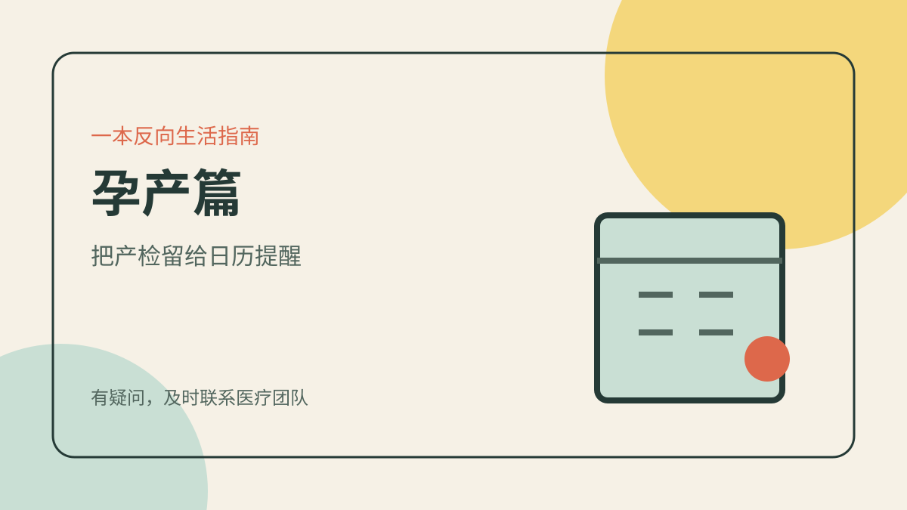

[← 回总目录](../README.md)

# 27. 如何把孕产安排留给临场发挥

> 本章用反讽描述容易遗漏的安排，「反向做法」不能照做。孕期和产后情况因人而异，医疗决定请咨询产科医生；出现紧急症状时立即联系急救或产科。

### 1. 备孕营养等怀孕很久以后再问

- 反向做法：不告诉医生既往疾病、用药或营养状况，也不讨论叶酸。
- 隐藏成本：某些准备需要在怀孕前开始，个人剂量也可能不同。
- 翻过来：计划怀孕时咨询医生关于叶酸、营养、疾病和用药的安排。

### 2. 产检手册等快生产时再找

- 反向做法：不联系产检机构，也不了解当地保健服务。
- 隐藏成本：可能错过早期建档和检查安排。
- 翻过来：尽早联系社区或产检机构，了解建档和产检时间。

### 3. 感染筛查只靠自己感觉

- 反向做法：认为没有症状就不需要与医生讨论艾滋病、梅毒和乙肝筛查。
- 隐藏成本：某些感染可能没有明显症状，及时发现有助于安排照护。
- 翻过来：按产检建议讨论相关筛查及阳性后的治疗和母婴预防措施。

### 4. 孕期烟酒只要别人说没事就继续

- 反向做法：自己吸烟饮酒，家人也在室内抽烟。
- 隐藏成本：烟草烟雾和酒精可能影响孕产妇与胎儿健康。
- 翻过来：孕期避免吸烟、二手烟和饮酒；需要戒烟或戒酒帮助时咨询医疗人员。

### 5. 预防用药照着别人的孕期方案吃

- 反向做法：不看风险因素，自行开始或停用阿司匹林等药物。
- 隐藏成本：是否需要用药、剂量和时间取决于个人情况。
- 翻过来：向产科医生说明病史，由医生评估是否需要预防用药，不自行调整。

### 6. 糖尿病筛查等有明显症状再问

- 反向做法：不参加医生安排的孕期筛查，只靠感觉判断血糖。
- 隐藏成本：血糖异常可能没有明显症状。
- 翻过来：按医生建议的孕周进行筛查，有问题时讨论后续管理。

### 7. 孕期和产后严重不适，先等群里回复

- 反向做法：大量出血、严重头痛、呼吸困难或其他明显异常出现时，只在网上搜索。
- 隐藏成本：可能延误紧急评估和治疗。
- 翻过来：提前向产科了解需要立即就医的症状；出现严重症状时立刻联系急救或产科。

### 8. 怀疑破水，先洗澡整理行李

- 反向做法：忽略持续流液和其他不适，等收拾完再联系医院。
- 隐藏成本：可能耽误产科评估。
- 翻过来：怀疑破水时立即联系产科或急救，按医护人员指引行动。

### 9. 想要分娩镇痛，却不敢提问

- 反向做法：只听传言，到了分娩时也不告诉医疗团队自己的需求。
- 隐藏成本：可能错过了解适用方案、风险和限制的机会。
- 翻过来：提前询问分娩镇痛方案，与医生讨论个人情况和可用选择。

### 10. 分娩方式只按日历和传言决定

- 反向做法：不讨论医学情况，只按方便或他人的经历选择手术或阴道分娩。
- 隐藏成本：不同方式各有适应证和风险。
- 翻过来：与产科团队结合孕产妇意愿、病情和医学指征共同决定。

### 11. 生育保险等结账时再了解

- 反向做法：不查参保状态、异地生育手续和可能适用的待遇。
- 隐藏成本：材料或手续不足可能增加办理难度。
- 翻过来：提前向参保地医保部门核实条件、报销和申请流程。

### 12. 出生医学证明拿到后不看信息

- 反向做法：姓名、证件号和出生信息不核对，发现错误以后再问。
- 隐藏成本：更正可能需要额外程序。
- 翻过来：按医院流程办理并逐项核对证明信息，妥善保存。

### 13. 新生儿筛查项目一律不问就跳过

- 反向做法：不了解足跟血和听力筛查用途，也不问哪些项目自费。
- 隐藏成本：可能错过早期发现问题的机会。
- 翻过来：向新生儿医疗团队了解筛查内容、时间、费用和结果领取方式。

### 14. 新生儿医保等第一次住院再问

- 反向做法：不查参保期限和材料，认为什么时候办理待遇都一样。
- 隐藏成本：可能影响保障衔接或增加费用。
- 翻过来：向当地医保部门尽早核实新生儿参保条件、期限和办理方式。

### 15. 出生登记留给不知道哪一天

- 反向做法：不查登记地点、期限和材料，等别的手续受影响时才开始办。
- 隐藏成本：可能增加往返和材料准备时间。
- 翻过来：向户籍登记机关核实出生登记的时限、材料和办理方式。

### 16. 产后只关心孩子，不问产妇恢复

- 反向做法：身体不适、情绪持续低落或复查预约全都搁置。
- 隐藏成本：产后恢复和心理健康需要也可能被忽略。
- 翻过来：按医疗机构建议进行产后复查，主动讨论身体恢复、情绪和照护支持；出现严重症状及时求助。

### 17. 怀孕后宠物和食物安全只听传言

- 反向做法：不问医生，一边恐慌地处理宠物，一边忽略清理猫砂和生肉卫生。
- 隐藏成本：不必要的焦虑和感染风险都可能增加。
- 翻过来：与医生讨论个人风险；处理猫砂和食物时注意卫生，肉类彻底煮熟，接触土壤时戴手套；条件允许时请他人清理猫砂。

### 18. 孕期疫苗只看别人一句「能打」

- 反向做法：不问疫苗种类、接种时机和自身病史就自行决定。
- 隐藏成本：不同疫苗及个人情况的建议不同。
- 翻过来：与产科医生或接种门诊讨论适合孕期的灭活流感疫苗等接种安排。

### 19. 孕晚期睡姿靠别人的焦虑安排

- 反向做法：不知道自己的健康情况，也不和医生讨论，就用网上最绝对的说法要求自己整夜不能动。
- 隐藏成本：睡眠和心理压力可能增加，也可能忽视个人医疗需要。
- 翻过来：询问产科团队适合孕周和个人情况的睡姿；孕晚期入睡时可侧卧，醒来姿势变化不必惊慌。

### 20. 产后哺乳，就不需要谈避孕和下一胎

- 反向做法：认为哺乳一定能避孕，也不讨论产后恢复和再次怀孕的时间。
- 隐藏成本：避孕效果和再次妊娠风险因情况不同而不同。
- 翻过来：恢复性生活前与医生讨论适合自己的避孕方式及妊娠间隔，不把哺乳视为普遍可靠的避孕方法。
