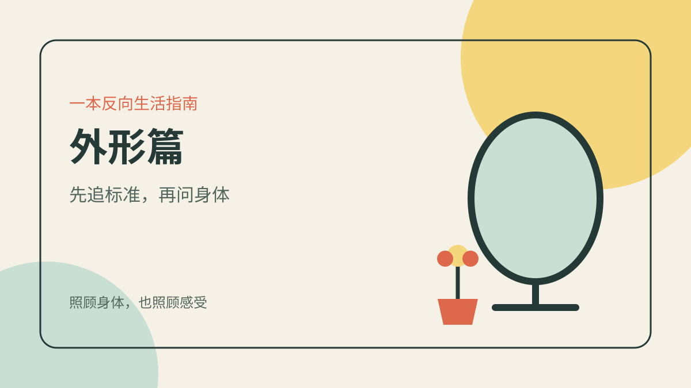

[← 回总目录](../README.md)

# 28. 如何为了外形和身体讨价还价

> 本章用反讽呈现外形焦虑和不安全做法。「反向做法」不是行动建议。每个人都有权选择自己的外形，也有权不改变；医疗决定应由本人和合格的医疗专业人员结合具体情况讨论。

### 1. 为了体重数字，把吃饭变成惩罚

- 反向做法：极端节食、长时间不吃或催吐，只要体重秤数字下降，就忽略身体和情绪的反应。
- 隐藏成本：限制和补偿行为可能损害身体，也可能让饮食关系变得痛苦。
- 翻过来：避免极端节食和催吐；想调整体重或饮食时，从可持续的生活习惯入手，必要时咨询医生或营养专业人员。若反复出现催吐等行为，尽早寻求专业帮助。

### 2. 医美先付定金，再查谁动手

- 反向做法：只看效果图和折扣，不确认机构是否具备相关许可，也不核实操作人员资质。
- 隐藏成本：操作不规范或发生并发症时，处理可能更困难。
- 翻过来：在医疗美容项目前核实机构许可、执业人员资质、项目风险及术后处理安排，并保留合同和凭证。

### 3. 面部注射越便宜越适合尝试

- 反向做法：为了省钱接受没有资质的人注射，不问材料来源，也不问面部哪些部位风险更高。
- 隐藏成本：面部填充存在血管损伤等严重并发症风险，非正规操作可能增加风险。
- 翻过来：不要接受非正规注射；决定前向有资质的医生了解不同部位、材料和急症处理风险。注射后出现异常疼痛、皮肤发白或发灰、视力变化或中风症状时立即急诊。

### 4. 广告说快速变瘦，就先吃再看成分

- 反向做法：减肥咖啡、糖果和酵素梅只要说「天然」「快速」，就默认有效又安全。
- 隐藏成本：产品成分和效果可能不透明，某些产品可能含未标示的药物或有害成分。
- 翻过来：不要轻信快速减重宣传，避免购买来源和成分不明的产品；体重管理需要医疗支持时咨询正规医疗机构。

### 5. 为了肌肉增长，自行使用增肌药

- 反向做法：不体检、不问医生，按健身群推荐使用合成代谢类固醇；出现不适就继续加大训练量。
- 隐藏成本：这类药物可能造成严重健康损害，来源不明的产品还有额外风险。
- 翻过来：不要自行使用合成代谢类固醇增肌；有相关使用经历或不适时，如实告知医生并寻求帮助。

### 6. 减重针谁发货快，就找谁

- 反向做法：不用处方的网店和美容院只要价格低，就按别人分享的剂量自行注射。
- 隐藏成本：药物可能不适合本人，来源、剂量和不良反应也缺少专业把关。
- 翻过来：是否需要减重药物由医生结合个人情况评估；通过正规渠道取得处方药，并按医嘱用药和复查。

### 7. 激素药照着别人的方案自己调

- 反向做法：看到别人有效，就网购性激素药物，自行加量；检查等身体提出抗议以后再做。
- 隐藏成本：用药方案和监测需求因人而异，不适当用药可能造成伤害。
- 翻过来：在合格医生指导下讨论适合自己的方案、风险及复查安排，不自行调整处方剂量。需要性别肯定医疗的人也应获得尊重和专业支持。

### 8. 对外形的担忧越来越强，就马上安排下一次手术

- 反向做法：每天反复检查镜子、花大量时间担心外形，却把困扰全部交给下一次项目解决。
- 隐藏成本：即使改变了某个部位，持续的焦虑和对身体形象的困扰也可能没有得到处理。
- 翻过来：如果对外形的担忧反复出现并影响生活，可以先找专业人士评估体像困扰，再从容讨论是否需要任何外形改变。

### 9. 牙套在网上买，牙齿自己负责移动

- 反向做法：不检查牙齿和牙周情况，直接按照片买牙套；疼痛也不用复诊。
- 隐藏成本：未经评估和随访的矫治可能损伤牙齿或牙周组织。
- 翻过来：找具备相应资质的口腔医生面诊，了解适应证和风险，并按安排复诊。

### 10. 祛斑霜只看见效速度，不看来源

- 反向做法：卖家承诺几天变白，就使用没有可靠标签、私自配制或来源不明的产品。
- 隐藏成本：不合规产品可能含有对身体有害的成分，出现问题也难以追溯。
- 翻过来：通过正规渠道购买，核对产品标签，并用包装上的注册证编号查询国家药监局相关信息；皮肤出现明显不适时停用并咨询医生。
