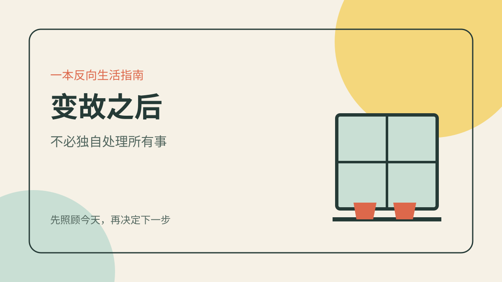

[← 回总目录](../README.md)

# 29. 如何让变故后的日子更难撑

> 本章讽刺的是忽略支持和仓促决定的做法，不评价遭遇丧亲、疾病、失业或创伤的人。「反向做法」不是建议。悲伤没有统一进度；如果存在立即伤害自己的危险，请马上联系当地急救、警方或身边可信的人。

### 1. 亲人刚离世，就把自己和所有帮助隔开

- 反向做法：不吃饭、不休息，也不告诉任何人自己的身体出了问题；慢性病药物和复查全部搁置。
- 隐藏成本：悲伤和事务可能同时消耗体力，原有疾病或急症也不能靠忍耐处理。
- 翻过来：尽量让可信的人陪伴或保持联系，照顾饮食、休息和原有治疗；出现持续胸痛、呼吸困难等急症时立即呼叫急救。

### 2. 拿到重病报告当天，独自做完所有重大决定

- 反向做法：一个人听完复杂诊断后，立刻决定辞职、搬家和处置全部财产。
- 隐藏成本：信息尚未听清、情绪压力很大时，容易遗漏选择和支持。
- 翻过来：如愿意，可以请可信的人陪同，记录诊断和需要问医生的问题；非紧急的重大决定可以给自己一些时间。

### 3. 失业后，让生活完全失去节奏

- 反向做法：不查医保和可用支持，也不区分找工作、休息和睡觉的时间。
- 隐藏成本：经济压力与作息紊乱可能叠加，让下一步更难安排。
- 翻过来：先核实医保和可申请的支持，给求职、休息和日常生活安排一个能维持的节奏。

### 4. 亲人因意外、自杀或暴力去世后，规定自己必须独自承受

- 反向做法：无论冲击多大，都拒绝可信的人和专业人员提供的帮助，因为觉得求助代表不坚强。
- 隐藏成本：强烈悲伤、创伤反应或生活困难可能持续影响日常。
- 翻过来：可以按自己的节奏联系可信的人或专业支持；反应持续、严重或影响安全时，尽快寻求专业帮助。

### 5. 丧偶之后，三餐和治疗全靠旁人猜

- 反向做法：不告诉任何人自己已经几天没吃好、没睡好或无法按计划用药。
- 隐藏成本：生活支持和医疗需要可能被忽略，尤其是原本需要长期治疗的人。
- 翻过来：如果愿意，可以请可信的人定期联系，协助安排吃饭、休息、用药和必要复查，同时尊重自己的边界。

### 6. 身边暂时没有亲友，就认定没有任何支持

- 反向做法：不联系社区、邻居或医疗机构，也不设置紧急联系方式。
- 隐藏成本：需要帮助时，旁人可能不知道你的处境或如何联系你。
- 翻过来：按自己的意愿寻找可靠的社区探访、邻里联系和医疗支持，设置可用的紧急联络方式；需要时向当地部门询问服务。

### 7. 家中有人去世，让孩子独自猜发生了什么

- 反向做法：用含糊说法掩盖事实，也不听孩子是否想参加告别或提出问题。
- 隐藏成本：孩子可能困惑、担心或误解，却不知道能向谁询问。
- 翻过来：用符合孩子年龄的语言如实解释，允许提问和表达感受；是否参加告别，应尊重孩子意愿并给予陪伴。

### 8. 悲伤已经让生活长期无法继续，还规定自己不能求助

- 反向做法：持续无法睡眠、工作或照顾自己，也不向任何人提起。
- 隐藏成本：痛苦和功能受影响的状态可能持续，支持和治疗却没有进入选择。
- 翻过来：如果悲伤长期严重影响生活，或随时出现安全担忧，可以联系精神科、临床心理等专业服务，不必等待固定期限。

### 9. 一难过就必须立刻购买最贵的咨询套餐

- 反向做法：不问咨询师资质和适合程度，先被「不买就会留下创伤」的推销催着付款。
- 隐藏成本：可能增加经济压力，也不一定获得适合自己的支持。
- 翻过来：悲伤反应各不相同，可以先选择信任的人陪伴；想接受专业帮助时，了解服务资质、费用和适配情况。

### 10. 分居或离婚后，用酒代替休息和求助

- 反向做法：不管医保和日常生活，用酒精压住情绪，独自承担所有事情。
- 隐藏成本：酒精可能加重身体和情绪问题，保障中断也会增加之后的困难。
- 翻过来：关注医保接续、睡眠和基本生活；如果饮酒或情绪已经难以控制，联系可信的人和专业服务。

### 11. 需要人倾听时，等别人自动发现

- 反向做法：觉得自己的困难不够严重，既不联系熟人，也不查询当地心理支持资源。
- 隐藏成本：可以获得的陪伴或专业支持可能一直没有被使用。
- 翻过来：可以主动联系可信的人、当地心理支持服务或医疗机构；存在紧急危险时优先呼叫当地急救或警方。

### 12. 变故刚发生，把所有不可逆决定挤到今天

- 反向做法：在没有时间了解后果时，立刻出售重要资产、签长期合同或切断全部支持。
- 隐藏成本：重要条件尚未核实，事后可能难以改变。
- 翻过来：在安全和期限允许的情况下，先处理迫切事项；重大决定请可信的人协助核对，必要时咨询专业人士。

### 13. 债务压得喘不过气，就独自承担所有绝望

- 反向做法：不告诉任何人，也不寻求债务协商或情绪支持，认为自己没有其他选择。
- 隐藏成本：孤立和压力可能让问题显得无解，也让可用的帮助无法及时介入。
- 翻过来：债务问题可以与债权人协商，并向法律援助等机构咨询；如果出现伤害自己的想法，请立即联系可信的人或专业支持。有立即危险时呼叫当地急救或警方。

### 14. 经历车祸、暴力或灾难后，要求自己立刻恢复

- 反向做法：一次谈话之后就判定所有创伤反应都应结束；噩梦、闪回和警觉持续影响生活也不再求助。
- 隐藏成本：每个人的恢复过程不同，持续的创伤症状可能需要针对性支持。
- 翻过来：先保障安全和基本需要；如果症状持续、严重或影响生活，联系精神科或合格心理专业人员，讨论适合的创伤治疗。
