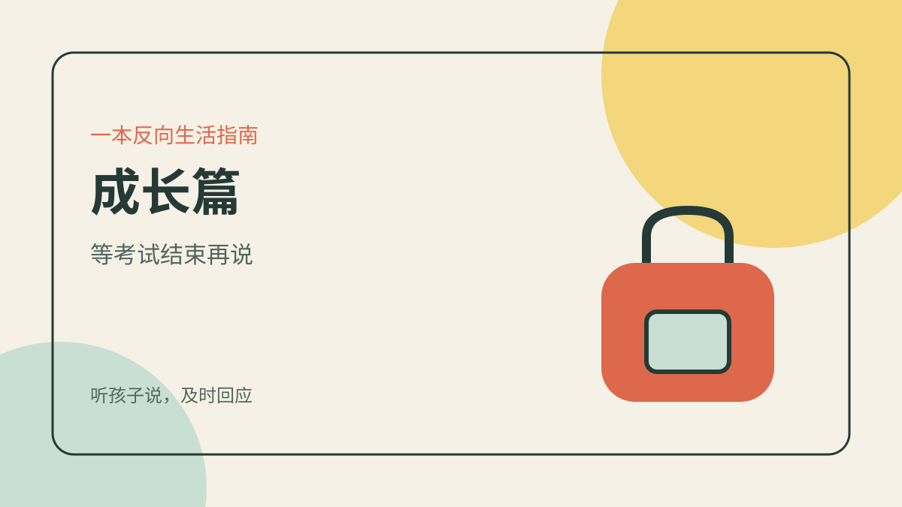

[← 回总目录](../README.md)

# 30. 如何让孩子的问题排在考试后面

> 本章讽刺忽视孩子健康、感受和安全的做法，「反向做法」不能照做。医疗问题请及时咨询专业人员；危险或暴力情况应优先保护孩子并寻求帮助。

### 1. 突然剧痛也要先上完课

- 反向做法：孩子说疼得厉害且越来越重，先让他忍到放学。
- 隐藏成本：急症可能被延误。
- 翻过来：突然剧痛或疼痛加重时立即就医；严重或危急时呼叫急救。

### 2. 所有治疗都等考试结束

- 反向做法：不问医生时间窗口，就把检查和治疗一再推迟。
- 隐藏成本：某些治疗需要根据发育和病情及时安排。
- 翻过来：与医生讨论治疗时机和学习安排，不自行延误。

### 3. 被欺凌就当孩子自己解决

- 反向做法：不听、不记录，只让孩子别惹事。
- 隐藏成本：伤害可能持续，孩子也可能不敢再求助。
- 翻过来：认真倾听并保护孩子，保存记录，要求学校书面处理；涉及暴力等危险情况及时报警或就医。

### 4. 户外活动是学习之后才配有的奖励

- 反向做法：全天关在室内，假设视力和活动都不受影响。
- 隐藏成本：户外活动和休息时间被挤占。
- 翻过来：在安全条件下为孩子安排适龄户外活动，视力问题咨询眼科医生。

### 5. 屏幕使用只看大人是否方便

- 反向做法：不管年龄、内容和睡眠，让屏幕填满所有空闲。
- 隐藏成本：可能挤占睡眠、活动和交流。
- 翻过来：结合年龄、内容和家庭情况制定屏幕安排，保护睡眠与活动时间。

### 6. 近视只要看得清黑板就不用管

- 反向做法：不复查、不配合医生评估，认为度数变化只是数字。
- 隐藏成本：近视发展及相关眼部风险需要持续关注。
- 翻过来：定期眼科检查，按医生建议矫正和管理视力。

### 7. 学生体检报告负责被收进抽屉

- 反向做法：不看异常项，也不向孩子解释或安排复查。
- 隐藏成本：需要评估的问题可能被延误。
- 翻过来：查看报告，对异常项目按医疗建议复查。

### 8. 一次心理测评就能替孩子下诊断

- 反向做法：拿问卷结果贴标签，或因为分数正常而忽略孩子持续的痛苦。
- 隐藏成本：筛查不能代替专业诊断，也可能漏掉需要帮助的人。
- 翻过来：倾听孩子，必要时请合格专业人员评估；存在立即危险时紧急求助。

### 9. 广告说治愈近视，就立刻付款

- 反向做法：不核实产品证据和医疗资质，只看前后对比图。
- 隐藏成本：可能花钱无效、延误正规检查。
- 翻过来：对治愈或降度数承诺保持谨慎，向正规眼科咨询。

### 10. 睡眠、作业和体育都让成绩让路

- 反向做法：不问学校安排和孩子身体状况，只增加任务。
- 隐藏成本：休息、运动和身心健康可能受影响。
- 翻过来：了解当地教育规定，与学校沟通合理的学习、睡眠和活动安排。

### 11. 孩子撑不住，也不允许讨论休学

- 反向做法：无视医生建议和孩子感受，认为暂停学习就是失败。
- 隐藏成本：健康问题可能加重。
- 翻过来：与孩子、医生和学校讨论支持或休学选项，核实学籍与复学程序。

### 12. 看不清就随便买副眼镜

- 反向做法：不做专业检查，只按别人度数配镜。
- 隐藏成本：可能无法发现真正原因或获得合适矫正。
- 翻过来：到正规机构进行眼科检查和适龄验光，按医生建议复查。

### 13. 恒牙长出来，预防龋齿以后再说

- 反向做法：不做口腔检查，也不问牙齿清洁和保护措施。
- 隐藏成本：龋齿风险可能被忽略。
- 翻过来：按医生建议口腔检查，讨论窝沟封闭等适合孩子的预防方式。

### 14. 游戏问题只需盯着分钟数

- 反向做法：不关心睡眠、学习、运动、社交和孩子玩游戏的原因。
- 隐藏成本：真正影响生活的问题可能没有被看见。
- 翻过来：共同讨论游戏与睡眠、学习、活动的平衡；持续影响生活时寻求专业支持。

### 15. 孩子谈性取向，先用羞辱和驱赶回应

- 反向做法：拒绝倾听，试图强迫改变孩子。
- 隐藏成本：可能伤害孩子的安全感和心理健康。
- 翻过来：尊重并支持孩子，不强迫所谓「矫正」；如有心理困扰，寻找尊重身份的专业支持。

### 16. 打骂越多，教育越有效

- 反向做法：用身体惩罚和羞辱处理所有行为问题。
- 隐藏成本：会伤害孩子，并可能加重情绪和行为困难。
- 翻过来：不用暴力或羞辱，设置清晰边界并教具体行为；照护者快失控时先确保安全和求助。

### 17. 家长总忍不住发火，也不需要支持

- 反向做法：把所有困难归咎孩子，不学习新的沟通方式。
- 隐藏成本：冲突可能重复发生。
- 翻过来：可以参加可靠的家长课程或咨询专业人员，练习具体的非暴力照护方法。

### 18. 封闭式「特训」说有效就直接送

- 反向做法：不核实机构、方法和孩子意愿，就让陌生人限制孩子自由。
- 隐藏成本：可能遭受暴力、虐待或其他伤害。
- 翻过来：避免伤害性和非法限制自由的机构；寻求正规医疗、教育或心理支持，遭遇侵害时报警。

### 19. 身体边界不必教，孩子说受伤也先责怪

- 反向做法：要求孩子保密，或把求助当成添麻烦。
- 隐藏成本：孩子可能继续遭受伤害并不敢求助。
- 翻过来：教孩子身体隐私和求助方式；孩子透露侵害时保持冷静、相信并保护孩子，及时报警和就医。

### 20. 骑车上路只看孩子敢不敢

- 反向做法：不查年龄要求、道路条件和头盔。
- 隐藏成本：可能发生交通事故或违反适用规定。
- 翻过来：核实当地自行车、电动自行车的年龄及道路规则，做好防护和看护。

### 21. 撞头后还能站起来，就继续比赛

- 反向做法：忽视头痛、头晕或发懵，让孩子马上回场。
- 隐藏成本：可能加重伤情，严重症状也可能延误处理。
- 翻过来：疑似脑震荡时立即停止运动并就医评估；反复呕吐、越来越困或头痛加重时立即急诊。
