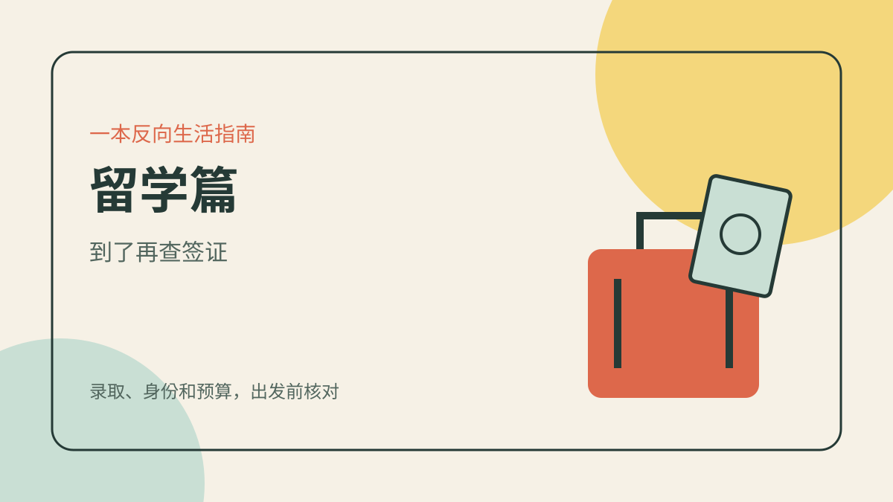

[← 回总目录](../README.md)

# 32. 如何让留学手续追着你跑

> 本章以反讽方式呈现留学准备中的疏漏。「反向做法」不是行动建议。各国签证、打工、保险和学历认证规则会变化，且取决于具体身份；做决定前应查看主管机关和学校的最新信息。

### 1. 交完学费再查学校和课程

- 反向做法：宣传页说毕业就能认证，先付款；学校是否正规、具体课程是否符合要求，等回国以后再了解。
- 隐藏成本：学校资质、办学方式和个人学习经历都可能影响后续认证，退款也未必容易。
- 翻过来：报名前通过官方渠道核实学校、课程、办学资质及学历认证要求，保存录取和学习材料。

### 2. 美国学生身份规则，听说过一次就够了

- 反向做法：不看学校通知，也不查官方最新规定，凭几年前的帖子决定什么时候离境或申请变更。
- 隐藏成本：签证、身份规则和诉讼状态可能变化；把过期消息当现行规定可能影响合法停留。
- 翻过来：留意美国主管机关和学校国际学生办公室的最新通知，核实当前适用于自己的身份期限与程序。

### 3. 打工时数只看工资，不看签证

- 反向做法：朋友说能打工，就默认所有国家、学期、假期和工作类型都没有区别。
- 隐藏成本：超出许可范围工作可能影响学生身份或未来申请。
- 翻过来：工作前核对所在国家和个人签证的工作许可、时数及工作类型限制，学期和假期分别确认。

### 4. 休学、转学或减课后，继续按原身份打工

- 反向做法：改变学习状态只通知同学，工作资格和移民身份等有空再问。
- 隐藏成本：学习状态变化可能影响打工资格、保险或居留条件；各国例外不同。
- 翻过来：办理休学、退学、转学或改为非全日制前，向学校和主管机关确认身份、工作和保险会怎样变化。

### 5. 在美国搬家，只告诉快递员

- 反向做法：住址变更后，学校和主管机关的记录保持原样；重要通知寄到旧地址，正好给前房客增加阅读量。
- 隐藏成本：错过通知或未履行适用的地址更新义务，可能影响后续手续。
- 翻过来：搬家后尽快核实并按要求更新学校及美国主管机关的地址记录，确认适用的期限和渠道。

### 6. 出发前只看旅行攻略，不看留学预警

- 反向做法：餐厅、打卡点和行李清单研究得很充分，教育部门和使领馆的安全提醒一条不读。
- 隐藏成本：可能错过影响学校选择、出行和当地安全的重要信息。
- 翻过来：出发前及在读期间查看教育部门、使领馆和学校发布的相关提醒，并关注更新。

### 7. 去澳大利亚留学，保险有空档也算有保险

- 反向做法：只买最便宜的一小段保险，续保日期放在日历之外；入境或就医时再解释。
- 隐藏成本：不符合签证要求或保险中断，可能影响身份和医疗费用承担。
- 翻过来：核实自己的签证及澳大利亚海外学生医疗保险要求，确认保障范围、覆盖期限和续保安排。

### 8. 算英国留学费用时只算学费

- 反向做法：签证申请费、医疗附加费和生活费都不列进预算；付款页面出现总额时再认识它们。
- 隐藏成本：一次性和持续性费用可能超出预期，影响资金安排。
- 翻过来：申请前查看英国官方最新收费标准，把签证费、适用的医疗附加费及其他开支一起估算。

### 9. 回国后明天要用认证，今天才开始准备

- 反向做法：材料不整理，办理时间不查，坚信认证一定能赶在入职截止前完成。
- 隐藏成本：材料补充和审核耗时可能影响入职、落户或其他安排。
- 翻过来：提前查看教育部留学服务中心的认证要求和预计办理时间，准备好学位、身份及学习经历相关材料。

### 10. 学校有没有被加强审查，交钱后再说

- 反向做法：不查公告，也不问办理周期；只要中介说「包认证」，就把时间和钱都交出去。
- 隐藏成本：加强审查等情况可能带来更长审核时间，个案结果也不能由中介保证。
- 翻过来：报名前查询学历认证主管机构的公告和学校信息，了解潜在的审核时间与材料要求。

### 11. 美国毕业后实习，不记录失业时间

- 反向做法：工作什么时候结束、什么时候开始都不留档；允许失业多久，等申请下一步时再回忆。
- 隐藏成本：毕业后实习许可有具体身份和报告要求，记录不全可能影响后续判断。
- 翻过来：了解自己适用的 OPT 或 STEM 延期规则，记录雇佣状态及日期，按要求向学校报告变化。

### 12. 加拿大申请学签，材料清单靠想象

- 反向做法：不查省级或地区证明文件是否适用，也不问学校如何取得，提交后再等退件通知。
- 隐藏成本：缺少所需材料可能延误申请；不同项目和申请人的要求可能不同。
- 翻过来：申请前查看加拿大移民主管机关和学校的最新要求，确认是否需要 PAL/TAL 等材料及适用例外。
