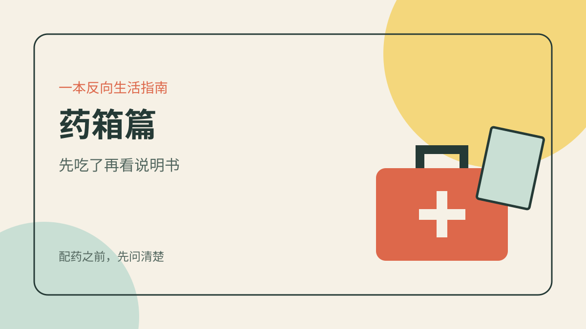

[← 回总目录](../README.md)

# 34. 如何让家庭药箱制造新问题

> 本章用反讽描写用药误区。「反向做法」不是用药建议，不能照做。药物选择和剂量取决于年龄、疾病、其他用药以及具体药品说明书；拿不准时咨询医生或药师。怀疑过量、误服或出现严重症状，应立即联系急救或就近急诊，不要等待症状出现。

### 1. 药名不一样，就当成分一定不一样

- 反向做法：两盒感冒药一起吃，再加止痛药。只要包装颜色不同，就认定不会重复。
- 隐藏成本：不同药品可能含相同成分，重复服用可能造成过量；某些过量早期不一定有明显不适。
- 翻过来：合用前核对每种药的成分和说明书，问医生或药师是否重复；怀疑对乙酰氨基酚过量时，不要等症状出现，立即就医。

### 2. 孩子发烧，照搬大人的退烧方案

- 反向做法：不看年龄、不看成分，随手拿家里的退烧药，用普通汤匙凭感觉量。
- 隐藏成本：某些药物不适合儿童，错误计量和重复成分也可能造成伤害。
- 翻过来：按儿童年龄、体重、药品说明和医生建议选择用药，使用药品配套量具；不自行给儿童使用阿司匹林、尼美舒利或安乃近。孩子精神差、呼吸困难或出现其他严重症状时及时就医。

### 3. 有出血风险时，止痛药越随意越省事

- 反向做法：不告诉医生自己的年龄、胃出血史和正在服用的药，拿到止痛药就长期吃。
- 隐藏成本：部分止痛药可能增加胃肠道出血等风险，与其他药合用还可能改变风险。
- 翻过来：有胃出血史、年龄较大，或正在使用抗凝药、激素等药物的人，使用布洛芬等止痛药前先问医生或药师。

### 4. 小婴儿感冒，先把复方药柜搬出来

- 反向做法：孩子一流鼻涕，就把大人剩下的复方感冒药和止咳药拆开估量着喂。
- 隐藏成本：幼儿对药物的反应和适用剂量不同，复方药还可能含多个成分。
- 翻过来：两岁以下儿童感冒时，不自行使用复方感冒药和止咳药；咨询医生，按年龄和症状获得照护建议。

### 5. 怀孕时用药，只需要问网上哪个牌子好

- 反向做法：不看孕周，不问医生，沿用怀孕前买的止痛药。
- 隐藏成本：一些药物在孕期不同阶段有不同风险。
- 翻过来：怀孕期间用药先询问医生或药师，说明孕周和既往用药；孕二十周后不要自行使用布洛芬等药物。

### 6. 烧心反复出现，胃药无限续杯

- 反向做法：症状来了就自己加药，吞咽困难、呕血或黑便也继续等待药效。
- 隐藏成本：持续用药可能掩盖需要检查的问题；某些症状需要尽快评估。
- 翻过来：按说明书和医生建议使用胃药，不要自行长期服用；出现呕血或黑便时立即前往急诊；吞咽困难也应及时就医。

### 7. 一感冒就要求抗生素

- 反向做法：认为感冒越普通，抗生素越应该提前准备；别人的剩药也可以拿来凑数。
- 隐藏成本：抗生素对普通病毒性感冒无效，还可能产生不良反应并增加耐药风险。
- 翻过来：不要自行使用或索要抗生素；是否需要抗菌治疗由医生根据病情判断。

### 8. 腹泻时只想着立刻止住

- 反向做法：不管是否脱水，先翻出止泻药；大人能吃的，也按感觉给小孩子一份。
- 隐藏成本：补液被忽略时，脱水可能加重；儿童用药也有不同限制。
- 翻过来：注意补液，可按说明使用口服补液盐；儿童不要自行使用止泻药。出现明显脱水、血便、持续呕吐或精神状态差等情况时及时就医。

### 9. 头痛药随时吃，吃了多久不必记

- 反向做法：每次头痛就补一片，不记录药名和使用天数。头痛更频繁了，就认为药还不够。
- 隐藏成本：频繁使用某些止痛药可能与药物过度使用性头痛有关。
- 翻过来：记录头痛和用药情况；头痛反复或需要频繁止痛时请医生评估，不要自行增加用药。

### 10. 过期药留下来，迟早有用

- 反向做法：把过期药、没标签的药和别人剩下的处方药混在一个盒子里，等需要时靠颜色辨认。
- 隐藏成本：药物可能被误认、误服或不适当地再次使用。
- 翻过来：定期检查有效期和包装，把过期或不再需要的药品按当地回收与分类要求处理，避免儿童接触。

### 11. 用药时只数饮料里的酒，不看药里的酒精

- 反向做法：用药期间先喝酒；如果是含酒精的药水，就认为它不算酒精。
- 隐藏成本：酒精可能与某些药物发生相互作用，影响安全。
- 翻过来：服用头孢类、甲硝唑等药物时，向医生或药师确认是否需要避酒、避多久，并留意其他药品中的酒精成分。

### 12. 吃了容易犯困的药，马上开车证明自己清醒

- 反向做法：感冒药或抗过敏药吃完就开车、登高或操作机器，困了就打开车窗。
- 隐藏成本：部分药物可能引起嗜睡或影响反应，危险不一定靠主观感觉判断得准。
- 翻过来：服用含氯苯那敏或苯海拉明等成分的药物时，查看说明书，询问医生或药师是否影响驾驶和操作机器；可能嗜睡或已经犯困时不要进行这些活动。

### 13. 长期服药，从来不看食物相互作用

- 反向做法：药和西柚汁一起吃，看见说明书上的食物提醒就直接跳过。
- 隐藏成本：某些药物会与西柚等食物相互作用，不同药物的限制并不相同。
- 翻过来：查看所用药品的说明书，询问药师是否需要避开西柚或其他食物；不要自行停药或调整剂量。

### 14. 肾功能不好，止痛药和水果不用问

- 反向做法：长期自行买止痛药吃，也不告诉医生自己的肾病；听说水果健康就随意吃杨桃。
- 隐藏成本：肾功能受损时，部分止痛药和杨桃可能带来严重风险。
- 翻过来：有慢性肾病或肾功能不佳时，使用止痛药前先问医生或药师，不自行长期使用布洛芬等药物，并避免杨桃及其制品。
