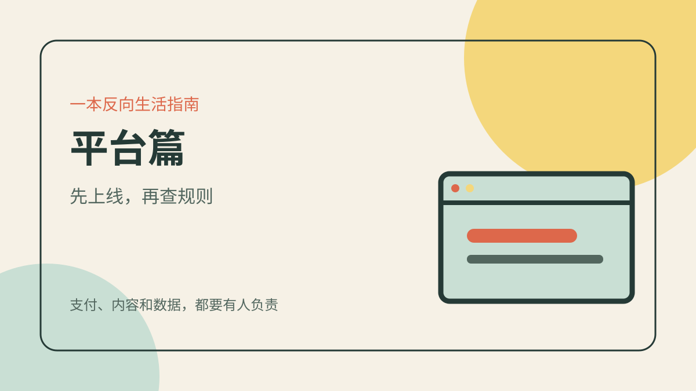

[← 回总目录](../README.md)

# 做平台：如何把资质和服务器都交给运气

> 本文用反讽描述常见决策误区。「反向做法」不是经营建议。业务分类、许可、备案和数据保护规则会变化；下表只提供核对方向，实际要求应向属地主管机关及专业人士确认。

## 一、先把所有业务当成一种业务

**反向做法：** 平台只要叫「网站」，就默认收费、交易、直播、新闻和服务器托管全都适用同一套规则。先上线，等被问到再研究。

**隐藏成本：** 一个产品可能同时涉及多类服务；名称相似也不意味着适用相同条件。错误判断可能造成停运、整改和投入损失。

**翻过来：** 先列清具体功能、服务对象、收费方式、交易与数据流，再逐项向主管机关核实。

| 场景 | 容易忽略的问题 |
|---|---|
| 信息站、个人博客、企业官网 | 部署地点、网站或应用备案要求是什么？ |
| 付费内容、会员或增值服务 | 具体收费模式是否涉及经营许可？ |
| 自营销售与第三方入驻 | 是自己卖货，还是为其他经营者处理交易？业务分类是否不同？ |
| 主播表演、视听节目和新闻 | 内容与服务属于哪一类，适用哪些准入或登记要求？ |
| 直播带货 | 平台、商家和主播各承担什么责任？ |
| 自建机房或向别人出售接入服务 | 服务提供者需要哪些电信业务许可？ |

### 三个特别方便出错的假设

1. **反向做法：** 个人和公司申请所有许可的条件一样。**翻过来：** 核实申请主体、资金、人员和经营范围等具体条件，不预设个人一定能申请。
2. **反向做法：** 有一张直播相关证照，就能提供任何视听或新闻服务。**翻过来：** 按实际功能分别核对适用资格，注意不同项目的申请主体和条件。
3. **反向做法：** 任何电商或交易平台都能套用网上同一句「一定要办」或「一定不用办」。**翻过来：** 准备业务流程和资金流说明，向属地通信管理部门确认具体分类及要求，并留存咨询记录。

## 二、平台日常义务等投诉来了再想

**反向做法：** 商家谁都能入驻；交易、直播和安全日志想删就删；侵权通知放在没人看的邮箱里；举报入口藏得比续费按钮还深。

**隐藏成本：** 无法追溯交易、及时处理投诉或履行适用的报告和留存义务，可能同时影响用户和平台。

**翻过来：** 按业务模式建立商家核验和更新、信息报送、记录留存、内容管理、侵权通知与举报处理流程；分别核实各类记录的起算点、期限和安全要求，不把不同规定混成一个数字。

| 需要核对的事项 | 应先弄清什么 |
|---|---|
| 入驻商家 | 身份核验、更新和退出后的信息处理要求 |
| 监管与税务报送 | 谁报、报什么、何时报告，以及适用例外 |
| 交易、直播与网络日志 | 各自的留存内容、期限、访问权限及删除规则 |
| 侵权通知和反通知 | 受理、转送、处置和恢复的条件与时限 |
| 投诉举报 | 如何让用户找到入口，如何记录和反馈处理 |

## 三、服务器只按最低报价挑

**反向做法：** 不问停机能否接受、数据能否恢复、谁负责维护，也不核实服务商资质；把生产数据和唯一一份备份放在同一个地方。

**隐藏成本：** 服务中断、配置失误或服务商问题可能让数据和业务同时受损。

**翻过来：** 先确认业务可承受的停机时间、维护能力、预算和数据恢复目标，再比较云服务、虚拟服务器或托管方案。核实服务商资质和合同，安排彼此隔离的备份，并定期测试恢复。

**反向做法：** 服务器放在境外，就认为所有面向境内用户的义务自动消失；把用户信息发到哪里都不用评估。

**翻过来：** 分别核实服务所在地、面向用户的业务义务以及个人信息跨境处理要求。盘点数据流向、接收方和处理目的，根据实际情况咨询适用的告知、同意及其他法定程序。

## 四、只看旧清单，不看边界和变化

**反向做法：** 把一篇文章的旧阈值、期限和许可结论复制到所有项目，不确认日期或官方原文。

**翻过来：** 记录核实日期、业务事实和主管机关答复；上线前与业务变化时重新核对官方规则。项目复杂时寻求专业法律和安全意见。

---

相关章节：[平台日常运营](../book/26-做一个网站或平台.md) · [技术工作](../book/11-程序员和技术人容易踩的红线.md) · [创业与做生意](../book/12-创业与做生意.md)。这些章节采用反讽格式，请先阅读章首说明。
