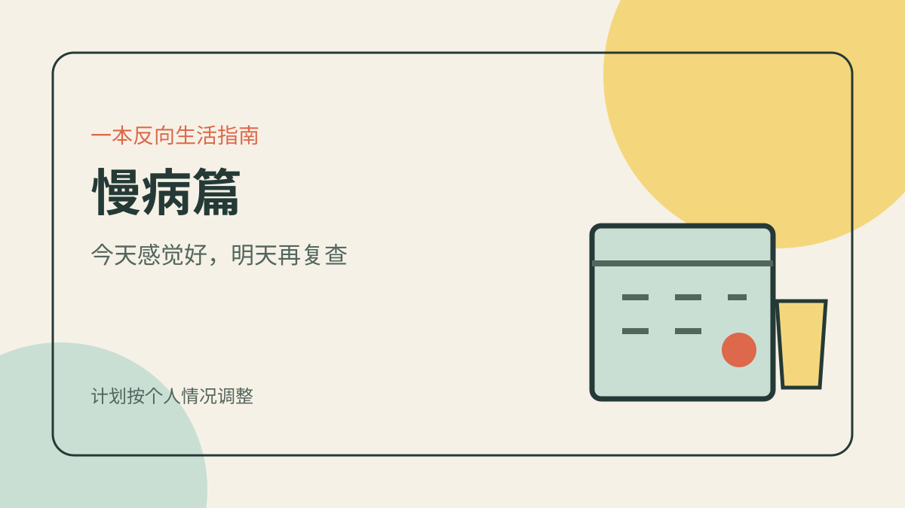

[← 回总目录](../README.md)

# 刚确诊慢性病：如何让后续安排全靠猜

> 本文讽刺忽略信息、支持和复查的做法，不评价患病的人。「反向做法」不能作为医疗建议。诊疗和饮食需要结合病情；不要自行停药、换药或增减剂量。出现严重不适时立即求医。

## 确诊那一周：先把所有决定挤在一天

**反向做法：** 独自拿报告、听不懂也不问；回家立刻做不可逆的大决定。药想吃就吃、感觉好就停，检查报告也不保存。

**隐藏成本：** 诊断和治疗计划可能需要时间理解，仓促停药或忽略严重症状可能带来风险。

**翻过来：** 如果愿意，请可信的人陪同，记下诊断、用药、复查和需要急诊的症状。按医嘱治疗；有不良反应、费用或用药困难时联系医生或药师。出现呼吸困难、昏厥等严重症状时立即呼叫急救；怀疑严重药物过敏时不要继续服用可疑药物，并告知急救人员。非紧急的大决定可在安全和期限允许时稍后再定。

**反向做法：** 高血压不问居家测量，糖尿病不问眼底检查；尿酸一高就自行吃药，也不告诉医生过敏史和既往用药。

**翻过来：** 根据医生建议了解血压测量、糖尿病眼底检查和痛风治疗是否适合本人。单次尿酸结果不能替代诊断；对别嘌醇等药物的基因检测和不良反应风险有疑问时，向医生询问，不自行开始或调整治疗。

**反向做法：** 戒烟只靠责备自己，咨询医生和戒烟服务则显得太麻烦。

**翻过来：** 想戒烟时，可以与医生讨论适合自己的支持和治疗方式；如果一次没有成功，也可以继续寻求帮助。询问医生或药师是否有适合自己的集采药或仿制药选择，并核实费用。

## 头三个月：报告分散放，问题等下次再说

**反向做法：** 病历、化验单、影像、药名和剂量各放一处；医保慢特病、异地结算和家庭医生的费用都不问。

**隐藏成本：** 复诊沟通可能变复杂，待遇和自费金额也可能与预期不同。

**翻过来：** 安全保存病历、报告、影像和用药清单，记录复查日期。向参保地医保部门核实慢特病认定、异地备案和家庭共济条件；签家庭医生服务前询问范围和费用。

**反向做法：** 听见低钠盐、运动或补充剂对别人有用，就不看肾功能、服药情况和体力，全部照搬。

**翻过来：** 与医生讨论适合自己的饮食和活动计划。肾功能不佳或正在使用影响血钾药物的人，使用低钠盐前尤其要询问医生；从身体允许的活动开始。不要用保健品或偏方替代治疗，使用补充剂前告知医生或药师。

**反向做法：** 饮酒越多越不想提；如果停酒时手抖、心慌，也坚持自己突然停掉。

**翻过来：** 与医生如实讨论饮酒量和减少饮酒的方式；长期大量饮酒且停酒后出现手抖、心慌等症状时，及时就医，不要独自硬扛。

**反向做法：** 新买感冒药或止痛药时不看成分，也不告诉医生已有药物；痛风发作就自行停用长期药。

**翻过来：** 核对药品成分，避免重复使用同一成分；正在用抗凝药、激素或其他长期药物时，先问医生或药师能否合用止痛药。痛风发作、饮食及长期用药按个人方案与医生讨论。

## 病情稳定以后：没症状就当任务全部结束

**反向做法：** 感觉好就停药，药吃完才想续方；复查间隔、糖尿病眼底和足部检查都不再问。

**翻过来：** 按医生建议复查、记录指标并提前安排续方。糖尿病患者与医生确认眼底、足部和其他检查计划；换药后有疑问或指标变化时联系医生，不自行停药。

**反向做法：** 得过结石就照着别人的饮水数字执行；有心血管疾病也不问疫苗是否适合自己。

**翻过来：** 结合结石类型、心肾功能及其他情况，与医生讨论饮水和饮食；按个人情况咨询疫苗接种建议。

**反向做法：** 每次就医都临时决定，医保待遇、基层服务、转诊和异地流程全凭猜测；挂不上号就买陌生人的「内部号」。

**翻过来：** 非急症时，根据病情和当地资源选择就诊机构，向医保部门和医院核实转诊与异地结算；通过官方渠道预约。急重症应先急救，不因手续耽误。

---

相关章节：[慢性病管理](../book/16-得了慢性病之后怎么活.md) · [看病](../book/24-看病.md) · [家庭常备药](../book/34-家里的常备药别吃出事.md)。这些章节已采用反讽格式，请先阅读章首说明。
