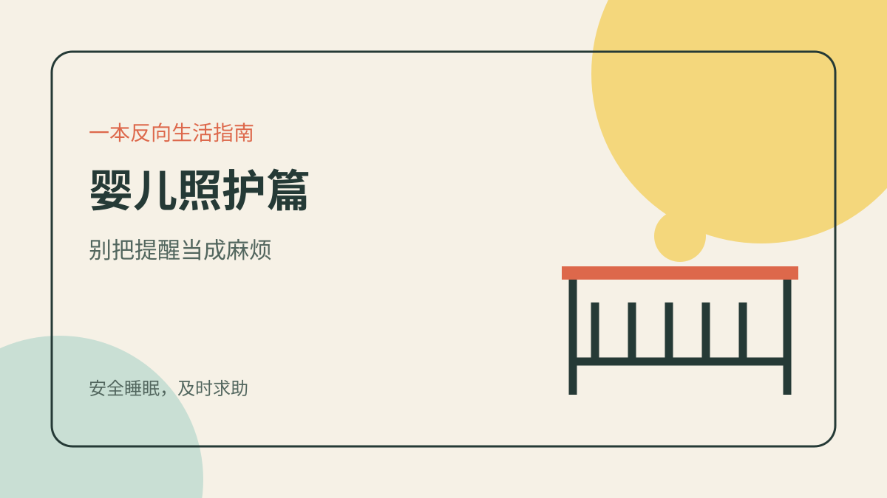

[← 回总目录](../README.md)

# 孩子出生前后：如何把准备工作留到最后

> 本文用反讽描述容易遗漏的准备，不评价任何家庭选择。「反向做法」不能照做。孕产和婴儿情况不同，检查、用药、喂养和急症处理请遵循医生及当地机构的具体指导。

## 一、准备怀孕时：先把问题留给未来

**反向做法：** 不问孕前营养、叶酸、现有疾病和药物；家里的烟照抽，医保待遇也不用查。

**隐藏成本：** 一些准备需要提前进行，具体营养和医疗需求也因人而异。

**翻过来：** 与医疗专业人员讨论孕前检查、叶酸、现有疾病及用药；保持无烟环境。向参保地了解生育保障条件，结合家庭经济情况讨论风险保障和照护安排。

## 二、怀孕以后：产检、生产和费用靠猜

**反向做法：** 不按医嘱产检，不说既往病史；药物、酒精和吸烟是否安全只问群聊。生产方式、分娩镇痛和紧急联系人等到临产再讨论。

**隐藏成本：** 可能遗漏需要及时处理的健康问题，也可能在临时决策时缺少信息。

**翻过来：** 尽早联系产检机构，按医生建议进行检查和感染筛查，如实说明病史及用药。孕期避免吸烟和饮酒；包括布洛芬在内的药物应先咨询医生，不自行用药。提前询问分娩方式、镇痛选择、产检中需要立即就医的症状，以及生产机构的联系方式。

**反向做法：** 异地生育、产假和工作安排不问；婴儿用品一次买满，名字和证件信息等出院再想。

**翻过来：** 向医保和单位核实异地备案、生育待遇、假期及申请方式；保存工作沟通记录。按需求逐步准备用品，优先确认安全睡眠用品和儿童安全座椅的适用性。提前商量出生证明所需信息。

## 三、住院生产时：情况紧急也先在网上投票

**反向做法：** 出现破水或其他危险症状时，只在群里比较偏方；出生后不问新生儿接种、维生素 K 和筛查安排。

**隐藏成本：** 可能延误对孕产妇或新生儿的评估，也可能遗漏需要及时完成的预防措施。

**翻过来：** 破水、出血或其他紧急情况应立即联系产科或急救，并按医护人员指引行动。与医疗团队确认喂养支持、乙肝疫苗和必要的免疫球蛋白、维生素 K、足跟血及听力筛查；了解额外项目的费用和选择。

## 四、出院前：姓名和回家方式等到了家再核对

**反向做法：** 出生医学证明上的姓名和证件号不核对，医保何时办理也不问；回家途中认为抱着婴儿比安全座椅方便。

**隐藏成本：** 信息错误可能增加补办难度，车辆乘坐方式不安全可能造成伤害。

**翻过来：** 与医院核对出生医学证明信息，向当地医保部门询问新生儿参保期限和材料。提前准备适合婴儿的儿童安全座椅，按说明及当地规定正确安装使用；婴儿使用适合其年龄和体型的后向式座椅。

## 五、出生后头一个月：睡眠和发热全凭经验

**反向做法：** 出生登记、补贴和医保申请一律不查；婴儿睡在堆满软物的床上，奶粉冲调和储存也只看自己的习惯。

**翻过来：** 向当地有关部门核实出生登记、育儿补贴和医保办理条件及期限。让婴儿仰睡在平整结实的独立睡眠空间，床上不放松软物品；按可靠公共卫生指引、医生建议及产品说明安全冲调和储存配方奶。

**反向做法：** 小月龄婴儿发热先等几天；照护者筋疲力尽时依然独自硬扛，产后身体不适也不说。

**翻过来：** 不满三个月的婴儿体温达到 38 ℃ 或以上应立即就医；孩子难以唤醒、呼吸异常等情况也应紧急求助。绝不猛烈摇晃婴儿；照护者快失控时可将孩子平放在安全婴儿床，暂离并请人帮助。产后出现严重或异常症状时及时联系医疗机构。

## 六、满月以后到一周岁：疫苗、辅食和照护规则一起忘

**反向做法：** 不安排产后复查和疫苗接种，辅食和补充剂全听广告；孩子未满一岁也随意吃蜂蜜或整粒坚果。

**翻过来：** 按医疗机构建议安排产后复查、情绪与心理状态评估、婴儿体检和接种；错过接种时询问补种。与医生讨论适龄辅食和营养补充；不满一岁不喂蜂蜜，不给婴幼儿整粒坚果。有严重湿疹或食物过敏的孩子，引入相关食物前先咨询医生。两岁以下儿童不要自行使用复方感冒药或止咳药。

**反向做法：** 窗户、阳台和热源不做防护；工作后的哺乳安排、医保家庭共济及个税扣除都不查。

**翻过来：** 检查窗户、阳台、热水和家具等居家风险，按儿童年龄提供持续看护；电子屏幕使用可向儿科医生咨询适龄建议。向单位及当地相关部门核实哺乳安排、医保家庭共济和婴幼儿照护个税扣除的条件与办理方式。

---

相关章节：[怀孕和生产](../book/27-怀孕和生产.md) · [婴儿照护](../book/20-刚出生的孩子怎么带.md) · [家庭常备药](../book/34-家里的常备药别吃出事.md)。这些章节已采用反讽格式，请先阅读章首说明。
