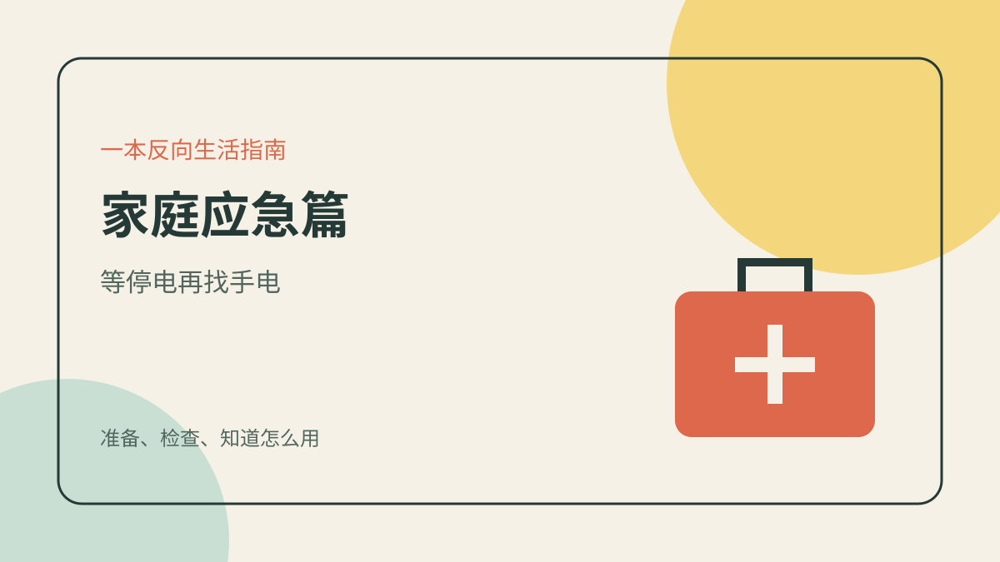

[← 回总目录](../README.md)

# 家庭应急装备：如何让停电变成寻宝游戏

> 本文讽刺忽略准备和检查的做法，「反向做法」不能照做。火灾等紧急情况优先撤离到安全地点并呼叫救援；不要为了取装备或灭火冒险返回现场。

## 一、清单越官方，越不用看

**反向做法：** 不考虑当地灾害、家庭人数、药物和特殊需求，一次买一整箱外观最整齐的套装。

**隐藏成本：** 实际需要的水、食品、药品或联络信息可能没有准备，买来的东西也可能不适合。

**翻过来：** 参照应急管理部门清单，结合当地风险与家庭成员情况准备饮水、食品、照明、通信、卫生用品、必要药品和重要信息。数量、更新频率及特殊需求可按当地指引调整。[应急管理部家庭物资建议清单](https://www.mem.gov.cn/kp/shaq/202011/t20201129_372149.shtml)

## 二、消防装备只管买，不管能否安全使用

**反向做法：** 把灭火器锁在最难找的柜子里，报警器不测试，火势扩大后仍坚持靠装备硬闯。

**隐藏成本：** 无法及时发现火情、取不到设备或不了解限制，都可能延误逃生。

**翻过来：** 了解住所的报警器、逃生路线和合适的消防装备，按产品说明安装检查；只在受过训练、火势很小且退路安全时考虑使用灭火设备。发生火灾时在安全条件下撤离并报警，不乘电梯，不返回取物。逃生路线被火或浓烟封住时不要强行穿越，应关门阻烟，在相对安全的位置呼救并听从消防调度。

## 三、急救包越复杂越有效

**反向做法：** 购买不熟悉的器械和大量药物，不看有效期，也不准备过敏史和用药信息。

**隐藏成本：** 急救时可能找不到适用品，使用不当还可能造成伤害。

**翻过来：** 按家庭情况准备基础敷料、手套、必要常用药和紧急信息；处方急救药物依医生建议准备。学习正规急救课程，遇到危急情况呼叫急救并按调度指引操作。

## 四、照明和通信全靠手机剩下的电

**反向做法：** 手电没电也不检查，不保存紧急联系人；停电或断网时再找充电器。

**隐藏成本：** 照明和求助可能受到影响。

**翻过来：** 准备可用照明、备用电源和紧急联络方式，结合当地情况考虑广播、哨子等用品，并定期检查。

## 五、装备买到家，就永远不需要维护

**反向做法：** 药品过期、包装破损、报警器没电也继续放着，认为外盒还在就代表能用。

**隐藏成本：** 真正需要时可能发现装备失效。

**翻过来：** 定期依照设备说明检查报警器、电池、照明、消防设备和急救用品，及时更换过期或损坏的物品；让家人知道存放位置。

## 六、越贵越多，就是越安全

**反向做法：** 不看培训和维护成本，购买所有昂贵设备或囤积无法轮换的食物；不明来源的防护用品也照买。

**隐藏成本：** 物资可能闲置过期，设备也可能不适用或无法可靠工作。

**翻过来：** 先满足基本需求，选择来源可靠、适合用途的产品。昂贵设备是否有必要应结合家庭风险、训练和维护能力评估；储备食品定期轮换。

## 七、买齐清单，就能保证不会受伤

**反向做法：** 把购物清单当成安全保证，不做风险排查，也不练习逃生和求助。

**翻过来：** 准备装备只是家庭安全的一部分。安全教育和装备干预的研究结果有不确定性，不能把某个研究结果当成个人安全保证；应结合报警、逃生计划、环境风险排查与实际训练。[Kendrick 等，2012](https://doi.org/10.1002/14651858.CD005014.pub3)

---

相关章节：[家庭安全](../book/01-不要早死.md) · [紧急情况](../book/13-紧急情况.md)。这两章仍是原版；具体急救和疏散请以当地救援部门及设备说明为准。
