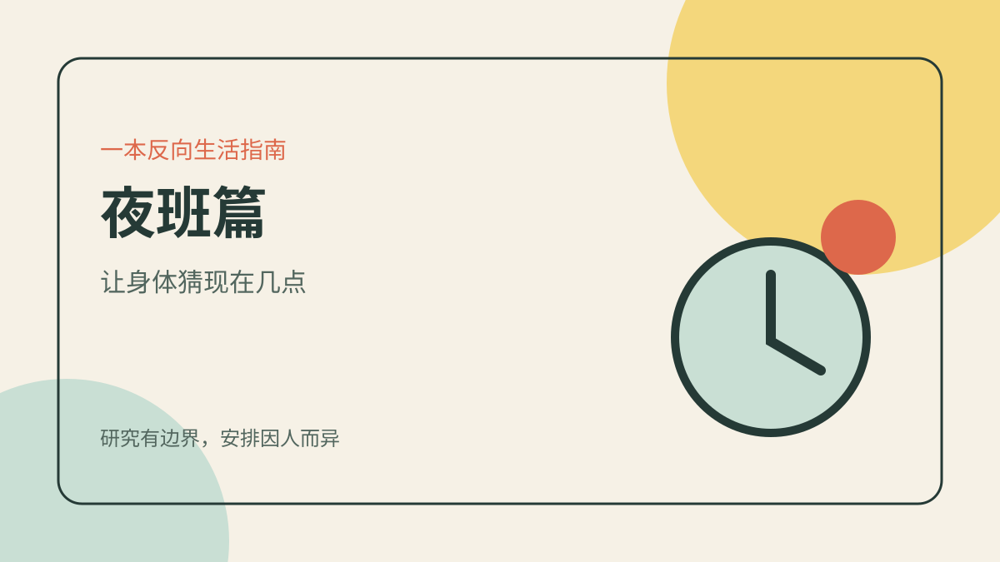

[← 回总目录](../README.md)

# 夜班与生物钟：如何让身体猜现在几点

> 本文讽刺把复杂研究说成简单保证的做法，不评价需要上夜班的人。「反向做法」不是健康建议。研究多为小规模或模拟工作环境，个人排班、睡眠和饮食安排应结合实际与医疗建议。

## 一、身体当然没有自己的时钟

**反向做法：** 认为只要墙上时钟显示几点，身体就会立刻切换到对应状态。

**翻过来：** 身体存在约一天周期的昼夜节律。大脑中的视交叉上核参与协调节律；睡眠、体温和激素等变化并不只由主观意愿决定。

## 二、光只负责让人看清东西

**反向做法：** 不管光照的时间和强度，默认白天与夜里的光对身体节律完全一样。

**翻过来：** 光也是校准昼夜节律的重要线索；其影响取决于照射时间等条件。不同人的视觉和感光功能也并不完全相同。

## 三、全身只有一个能随手拨动的钟

**反向做法：** 把睡眠、进食和工作时间同时大幅改变，并假定所有身体节律会同步移动。

**翻过来：** 大脑和身体其他组织都有相关节律；光照、进食、活动与睡眠等线索可能以不同方式影响它们。

## 四、夜班的所有影响都能归结为「不够努力」

**反向做法：** 把疲劳、睡眠和工作时间的冲突当成人的意志问题，不讨论排班与环境。

**翻过来：** 夜间工作可能与睡眠、生活安排及身体节律发生冲突。个体差异、工作条件和休息时间都需要考虑。

## 五、上久了就一定完全适应

**反向做法：** 用一句「习惯就好」代替对疲劳和安全的关注。

**翻过来：** 一篇对固定夜班研究的综述发现，按所用生物钟指标达到完全适应的人很少；不同研究和个人情况不能简单套成每个人的结果。[Folkard，2008](https://doi.org/10.1080/07420520802106835)

## 六、小型实验一出现，就能解释所有人的健康

**反向做法：** 看到实验室里几个代谢指标变化，就断定每个夜班工作者都会患同一种病。

**翻过来：** 控制条件下的研究发现，作息与昼夜节律错位可伴随血糖、血压及睡眠等指标变化；样本小、观察时间短，不能直接推算个人长期结局。[Scheer 等，2009](https://doi.org/10.1073/pnas.0808180106)

## 七、进食时间有一项研究，就能给所有人开同一张食谱

**反向做法：** 不管夜班强度、饥饿、糖尿病或用药情况，强迫所有人夜间完全禁食。

**翻过来：** 一项模拟夜班的小型随机试验观察到进食时间与血糖节律等指标的差异；这并不等于已证明某一种进食安排适合所有真实夜班工作者。[Chellappa 等，2021](https://doi.org/10.1126/sciadv.abg9910)；[Chellappa 等，2025](https://doi.org/10.1038/s41467-025-57846-y)

有低血糖风险、慢性病或特殊用药的人，调整进食前应咨询医生。对任何人来说，工作安全和能否持续也应纳入考虑。

## 八、强光一照，生物钟就永久搬家

**反向做法：** 不问光照时间、眼部情况、工作安全和休息日安排，就自行照搬实验室方案。

**翻过来：** 小型实验研究过夜间光照与白天遮光对节律的影响；真实生活的轮班和家庭安排可能使方案难以照搬。[Czeisler 等，1990](https://doi.org/10.1056/NEJM199005033221801)

### 研究条件和现实条件不是同一件事

光照时间、强度、下班路上的光和白天睡眠环境都可能影响结果。适合的安排因人和班次而异，强光设备也可能不适合有特定眼病或其他健康问题的人；考虑使用时先咨询专业人员。

### 睡得更久，不等于已证明长期风险消失

有综述研究轮班工人的光照干预与睡眠结果，但睡眠改善不能直接推断心血管发病或死亡风险会下降。[Zhao 等，2025](https://doi.org/10.1038/s41598-024-83789-3)

## 九、让每个夜班工作者都做同一选择

**反向做法：** 不考虑收入、家庭、工作安全和是否能调岗，就断言所有人都必须离开夜班，或者所有人都只能忍受。

**翻过来：** 根据个人处境评估排班、休息环境、交通和职业选择；持续睡眠问题或严重困倦应咨询医疗人员，困倦时避免驾驶。

---

相关章节：[健康与生活习惯](../book/02-不要慢慢死.md) · [精力](../book/03-不要浪费精力.md)。第 2 章仍是原版，第 3 章已采用反讽格式。
