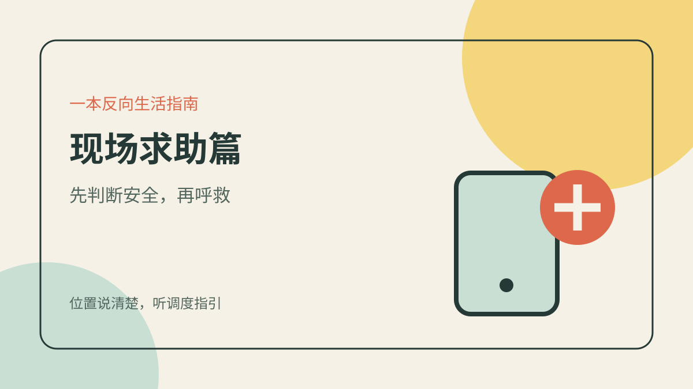

[← 回总目录](../README.md)

# 遇到陌生人出事：如何让现场更混乱

> 本文反讽仓促和武断的判断，不嘲笑遇险者或未受训练的旁观者。「反向做法」不能照做。现场有立即危险时，先确保自身安全并联系当地急救或警方，按调度人员指引行动。

## 把所有选择压成「走开」或「冒险冲上去」

**反向做法：** 认为只能完全不管，或者不判断环境就独自冲进危险现场。

**隐藏成本：** 忽略了呼叫专业救援、说明位置和请求旁人协助等选择；盲目进入危险区域也可能让更多人受伤。

**翻过来：** 先观察交通、火、电、水或其他危险，在安全位置呼叫当地急救；需要警方或消防时同步求助。说明准确位置、现场危险和伤者状态，跟随调度人员指引。

## 把可能的麻烦当成必然结果

**反向做法：** 因为听过纠纷故事，就断定每次求助都会被追责；或者反过来断定任何现场行为都绝无责任。

**隐藏成本：** 缺乏具体事实和可靠数据时，两种绝对判断都可能误导；处理纠纷也可能耗费时间和精力。

**翻过来：** 可以邀请其他人在安全范围内协助，依法保护个人隐私并留存必要事实。相关责任取决于地点、身份、行为和具体事实；有争议时咨询法律专业人士，不凭传闻估计概率。

## 把每个国家、每种身份都当成同一套规则

**反向做法：** 不管自己身在何处，也不区分普通路人、场所管理者或事故当事人，就套用网上同一句法律结论。

**隐藏成本：** 义务与责任可能因司法辖区、职责和事故经过不同而不同。

**翻过来：** 事后按发生地和个人角色核实适用规则；如果自己与事故有关，应依法处置并向相关部门说明。

## 救助时先抢着搬人，再想怎么呼救

**反向做法：** 不观察危险、不拨急救电话，也不判断伤情，就独自搬动伤者或把伤者塞进车里。

**隐藏成本：** 可能使现场更危险，或加重某些伤情，也可能延误专业救援。

**翻过来：** 立即呼叫急救并说明位置；避免不必要地移动伤者。若现场存在迫在眉睫的危险，听从调度人员的安全指引。若人无反应且没有正常呼吸，立即开始心肺复苏，请旁人呼叫急救并取用附近 AED；按调度员指引或培训操作，AED 一到就按设备提示使用。

## 遇到后续纠纷，只在评论区争论

**反向做法：** 不保存通知和沟通记录，也不了解投诉、报警或法律援助渠道。

**翻过来：** 合法保存相关记录，必要时向警方、平台或法律专业人士咨询；情绪受到持续影响时可寻求可信的人或专业支持。

---

相关章节：[紧急情况](../book/13-紧急情况.md) · [个人与财产安全](../book/08-别把自己搭进去.md)。第 13 章仍是原版，第 8 章采用反讽格式；具体急救应以现场调度和受过的培训为准。
